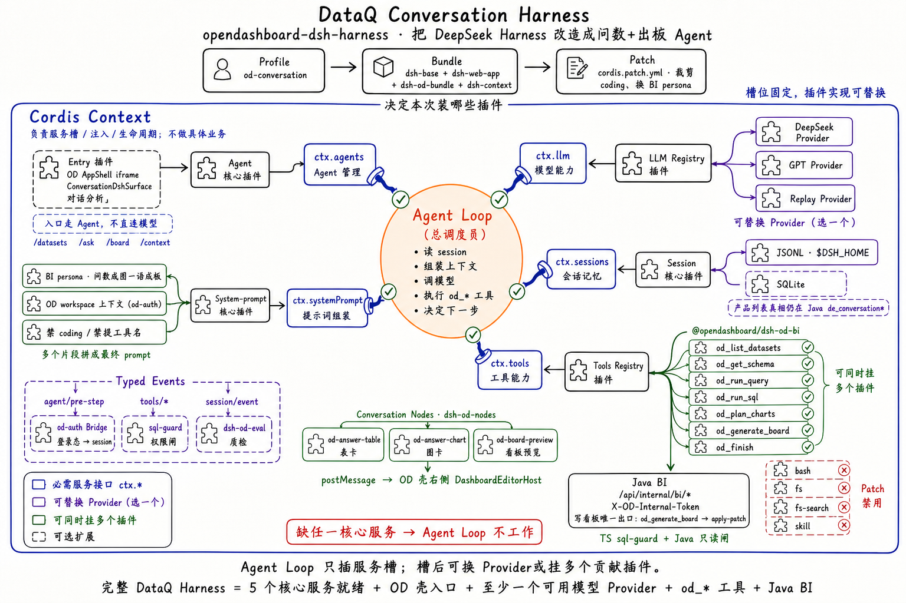

# P011 设计：对话表面 = DeepSeek Harness Web

> 状态：draft。对照仓：`refs/deepseek-harness`。  
> 产品确认（2026-08-21）：问数 / 仪表盘生成对话框直接用 dsh **UI 层 + Agent 层**；现有 Vue 对话工作区交互不达标，不再作为主路径演进。

## 1. 目标体验

用户进 OD「对话」后，看到的是 **数据分析一体化 Agent**（问数出表/图、一句话出板）。顶栏保留 dsh **对话 / 轨迹 / 上下文** Tab（看 Agent 怎么跑、窗口里装了什么）；对话流里不铺系统提示词、工具卡、coding 产物行。dsh 仍提供思考流与会话能力。

问数出表/临时图、生成出看板预览，都作为 dsh **Conversation Node** 嵌在同一条 chat 流里；`board_ready` 后 OD 壳 **右侧展开 `DashboardEditorHost`**（可收起），并保留「全屏编辑器」跳转。**新对话 / 切换历史会话**时右侧看板收起并清掉 `?dashboardId=`；历史里若该轮已有 `board_ready`，Node 会再 postMessage 打开对应 draft。

**产品表面（分析一体化 Agent）**：对话流只留闲聊 + 表/图/看板结果；顶栏开放 **对话 / 轨迹 / 上下文**（`ui-trajectory` + `dsh-context`，含 `/context`）。不展示系统提示词全文、工具卡、coding 产物行。工具仍在 Host 执行，只是不进对话气泡。

**问数高保（当前增量）**：[`conversation.html`](../../../prototypes/hi-fi/conversation.html)（左栏与 [`workbench.html`](../../../prototypes/hi-fi/workbench.html) 同一套 `od-rail`）+ 内嵌 [`conversation-ask-dsh.html`](../../../prototypes/hi-fi/conversation-ask-dsh.html)（主区居中 dsh 问数；壳顶栏账号固定右上角）。  
**旧壳定稿**：[`snapshots/2026-08-21-p006-ask-data`](../../../prototypes/snapshots/2026-08-21-p006-ask-data/)。

## 2. 分层（终态）



```text
┌─────────────────────────────────────────────────────────┐
│ OD AppShell（P007） 左栏：工作台|对话|数据|看板|报告      │
│   「对话」路由 ──embed/iframe 或同域反代──▶ dsh Web UI   │
└────────────────────────────┬────────────────────────────┘
                             │ session/event + tools
                             ▼
┌─────────────────────────────────────────────────────────┐
│ opendashboard-dsh-harness（npm 锁 @deepseek-ai/dsh-*）   │
│   profile od-conversation · agent-loop · session log     │
│   tools: od_*（含 sql/质检/layout，禁默认 coding bash）   │
│   client: ConversationNode = answer_table/chart/board    │
└────────────────────────────┬────────────────────────────┘
                             │ X-OD-Internal-Token
                             ▼
┌─────────────────────────────────────────────────────────┐
│ Java /api/internal/bi/*  +  conversations CRUD（历史真相）│
│ Dashboard draft / chartQuery / apply-patch               │
└─────────────────────────────────────────────────────────┘
```

| 层 | 负责 | 不负责 |
|----|------|--------|
| **`opendashboard-dsh-harness`** | 对话 UI+Agent、turn/step、工具卡、Plan、审批、会话持久/回放、原 Python 管道的 TS 实现 | 不持有生产库写账号；不直接改 DV 画布 JSON |
| **OD 壳** | 登录、工作区切换、一级导航、嵌入 dsh、跳转编辑器 | 不再实现平行 Composer/步骤 UI |
| **Java BI** | 数据集/查询/Patch/会话消息落库 | 不做 Lead/LLM |
| **Python harness** | **删除**（不设 sidecar） | — |

## 3. 为什么不是「只换 Agent、留 Vue UI」

自研 UI 要追上 dsh，等于重做：流式思考尾、工具树、composer 审批接管、steering、deliverables、统计条。投入高、仍难齐。产品选择 **直接用 dsh UI**，OD 只补 BI 业务节点。

## 4. dsh 上要挂的 OD 插件

### 4.1 Host（Node）工具包 — 位于 `opendashboard-dsh-harness`

| 工具 | 行为 |
|------|------|
| `od_list_datasets` / `od_get_schema` / `od_run_query` / `od_run_sql` | → Java internal |
| `od_profile_dataset` / `od_plan_charts` / `od_layout_board` / `od_emit_patch` | → Java；plan/layout/质检在 **本包 TS** 实现（迁自旧 Python） |
| `od_finish` | 本地；结束问数轮 |

约束：

- 默认 **关掉或强沙箱** `bash` / 任意 `fs.write` 对业务库的路径；BI 写只能走 `od_emit_patch`
- `tools/pre-execute` 接 OD 权限（`dataset:use` / `dashboard:edit`）
- SQL 只读闸：在本包 TS（或 Java）实现，**不**再跑 `opendashboard-harness`

### 4.2 Client Conversation Nodes

按 [adding-a-conversation-node](../../../../../../refs/deepseek-harness/docs/cookbook/adding-a-conversation-node.zh.md)：

| Node kind | 事件族（示例） | 渲染 |
|-----------|----------------|------|
| `od-answer-table` | `od/answer_table/*` | 表格卡 |
| `od-answer-chart` | `od/answer_chart/*` | ECharts/iframe 到 OD 预览 API |
| `od-board-preview` | `od/board_ready/*` | 缩略卡 + postMessage 打开壳内右侧编辑器 +「全屏编辑器」 |
| `od-clarify` | `od/clarify/*` | 澄清选项（可接 dsh user-questions） |

工具 `presentCall` / `presentResult` 负责过程卡；业务结果用 **自有 SessionEvent + Node**，不要把大表塞进通用 tool raw。

### 4.3 Profile / Bundle（`opendashboard-dsh-harness`）

新建 profile `od-conversation`，`package.json` **锁版本**依赖 `@deepseek-ai/dsh-*`：

1. dsh base（llm/session/tools/agent-loop，裁剪 coding）
2. dsh web-app（UI）
3. 本包：`od-bi` + `od-nodes` + `od-auth` + `od-context`
4. patch：coding persona → **BI persona**

## 5. 与 OD 壳的接合

**推荐（第一刀）**：同域反代

```text
OD Vue `/conversations*` → iframe `https://od.example/dsh/` 
  Nginx: /dsh/ → dsh :3080
  启动时注入：token、workspaceId、userId、可选 datasetIds
```

**第二刀**：去掉 iframe 边框差异（主题 token 对齐 P007）；编辑器内 SQLBot 浮层改为「打开/聚焦同一 dsh session」或迷你 embed。

鉴权桥：

- OD 登录后签发短时 `OD_DSH_BRIDGE`（含 user/workspace/perms）
- dsh 插件校验后写入 session 元数据；工具调用带 `X-User-Id` / `X-Workspace-Id` / internal token

会话双写（过渡）：

- **交互真相**：dsh SessionEvent 日志
- **产品列表/权限**：Java `de_conversation*` 仍存标题、owner、linkedDashboardId；dsh sessionId ↔ Java conversationId 映射表

## 6. 能力映射（旧 SSE → dsh）

| 旧 FE 事件 | dsh 落点 |
|------------|----------|
| `message_delta` | `assistant/chunk`（自带） |
| `step` + preview | tool call/result 卡 + 可选 `od/step` Node |
| `answer_table/chart` | Conversation Node |
| `plan` / confirm | dsh plan + approval / confirm 命令 |
| `patch` / `board_ready` | Node + turnTail「打开看板」 |
| `finish` | `turn/end` |

旧 `opendashboard-harness`：切流时 **整目录删除**；FE 不再有 `/harness/v1`。

## 7. 确定性降级

无 LLM key 时：dsh headless + **本包 TS** 固定工具序 preset（无模型）。产品文案提示「智能对话不可用，仅确定性生成」。不依赖已删除的 Python。

## 8. 迁移波次

完整清单见 **[migration.md](./migration.md)**。摘要：

| 波次 | 交付 | 退出标准 |
|------|------|----------|
| M0 | `opendashboard-dsh-harness` 起 Web；壳 embed；鉴权桥 | 能聊一句纯文本 |
| M1 | `od_*` 只读查数；表 Node | 问数出表 |
| M2 | TS SQL 闸 + `od_run_sql`；图 Node | 问数出临时图 |
| M3 | gen 链（TS 质检/layout）+ board Node | 一句话生成 draft |
| M4 | 下线 Vue 对话主路径；**删除 `opendashboard-harness/`** | FE 无 `/harness`；仓内无 Python Agent |

## 9. 风险与约束

- dsh 仍是 **developer preview**，有破坏性变更 → OD 插件包边界要薄，锁定版本 + 契约测试
- 默认 coding 能力（bash/写文件）与 BI 产品安全冲突 → profile 必须裁剪
- 图表视觉在 React Node 里实现，需复用 OD 查询 API，避免复制一套 chartQuery
- P004/P006 现有 acceptance 基于 SSE，接受本提案后要重写验收 ID

## 10. 明确不做

- 用 dsh 当整个 OD 前端
- FE 绕过 Java 直接 apply-patch
- 继续演进自研对话壳作为主 UX
