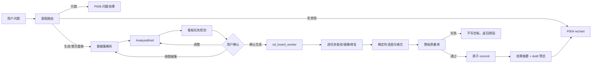

# P015 · 对话式仪表盘端到端设计

> 本文描述未完全实现的目标流程。现行能力以 `.teamai/docs/design/architecture.html` 为准；是否完成只看 [acceptance.yaml](../test/acceptance.yaml)。源码漏洞、开源取舍与目标模块见 [architecture-assessment.md](./architecture-assessment.md)，质量度量与发布门见 [quality-evaluation.md](./quality-evaluation.md)。

## 1. 设计结论

整体链路采用“Lead 负责理解与确认，单个 board worker 负责受限执行，harness 负责确定性校验与选图”的分工。

进一步源码评估后，这个分工保留，但 worker 不再是自由决定工具调用顺序的质量权威。权威语义、查询编译、run 状态、发布闸和 DashboardPatch 位于 Java/host；LLM 只生成可校验的问题候选或从受控修复候选中选择。端到端数据必须经过：

```text
SemanticSnapshot
  → AnalysisBrief
  → BoardQuestion
  → QuerySpec
  → ResultProfile
  → VizSpec
  → BoardSpec
```

任一级不合法都不能靠后一级“修漂亮”后提交。



关键决定：

- 不按图创建多个自由 agent；一个 worker 持有整板上下文，harness 最多并发两个查询任务。
- 规划阶段不锁 `chartType`，但必须锁定可校验的业务问题、字段角色、聚合、过滤与信息层级。
- 所有图表（含 KPI）都先由正式语义编译查询并真实执行，再基于结果画像选图。
- `od_data_trans` 如果只改变内存样本而不能被正式 encode/运行态复现，只可用于诊断，不得提交。
- 部分成功允许产出，但用户必须看到哪些任务成功、修复、跳过；不能用“已完成”掩盖降级。
- 固定 KPI/趋势/结构/排行/明细模板只在用户没有明确主题时作为问题候选先验，不再强制 3 个 KPI 或 6～10 个槽位。

## 2. 用户会提什么问题，怎么分流

### 2.1 意图类型

| 意图 | 用户示例 | 系统动作 | 用户看到 |
|------|----------|----------|----------|
| `ask` 问数 | “本月销售额多少？”“各区域订单量” | 默认进入 P006 问数，不创建 draft | 数值、表或临时图；可继续追问 |
| `generate_board` 首次出板 | “用销售数据做一张经营驾驶舱”“生成订单分析看板” | 解析数据集 → brief → 规划确认 → worker | 先看到规划卡，确认后看到 draft |
| `explore` 模糊分析 | “帮我分析一下销售”“看看有什么问题” | 默认先问数/探索；追问用户是否需要整板 | 一条澄清 + 推荐探索问题，不直接生成 |
| `rechart` 改一张/几张 | “把区域销售额换成横向柱图”“订单量改成同比” | 走 P004 `od_get_board_summary → od_rechart_chart` | 原位置更新；其余图和布局不变 |
| `regenerate_board` 整页重做 | “整页重做，重点看利润和渠道” | 复用同一 `dashboardId`，重新 brief/确认/worker | 新规划卡；确认后原子 replace，不新建重复 draft |
| `explain` 解释/追问 | “这张图为什么选柱图？”“销售额口径是什么？” | 读取 trace/配置回答，不改板 | 依据、口径、筛选与数据集来源 |

### 2.2 路由优先级

1. 已链接看板且点名“改/换/删/新增某张” → `rechart`。
2. 已链接看板且明确“整页/全部/重新生成” → `regenerate_board`。
3. 明确“仪表盘/看板/驾驶舱/整页” → `generate_board`。
4. 单指标、单分析问题或未明确产物 → `ask`。
5. “分析一下/看看情况”且产物不明 → `explore`，最多问一个关键澄清问题。

路由输出必须是结构化结果：

```json
{
  "intent": "generate_board",
  "confidence": 0.93,
  "reason": "用户明确要求经营驾驶舱",
  "linkedDashboardId": null,
  "needsClarification": false
}
```

`confidence < 0.75` 或 `needsClarification=true` 时，不执行写操作。聊天文案只表达产品含义，不暴露 `od_*` 工具名。

## 3. 数据集怎么选

### 3.1 输入优先级

1. 用户在 Composer 显式选择的数据集；
2. 用户在话术中精确点名且只有一个有权匹配；
3. 当前会话已确认的数据集；
4. 从 `conversation:use ∩ dataset:use` 集合召回 Top 3；
5. 无高置信候选时，请用户选择，不猜。

“最近用过”只能用于同分排序，不能覆盖权限或语义匹配。

### 3.2 候选评分

每个候选产生 0～1 的 `datasetScore`：

| 维度 | 权重 | 证据 |
|------|------|------|
| 名称与描述匹配 | 0.20 | 数据集名、描述、主题域 |
| 业务术语匹配 | 0.20 | P010 confirmed glossary、字段别名 |
| 指标覆盖 | 0.25 | 用户提到的指标是否有 confirmed 指标或可合法推导字段 |
| 维度/时间覆盖 | 0.20 | 分析对象、日期粒度、组织/地域等维度是否存在 |
| 数据可用性 | 0.10 | 非空、更新时间、字段空值/基数可用 |
| 会话上下文 | 0.05 | 本会话已确认或最近使用 |

自动选中条件同时满足：

- Top 1 `score ≥ 0.82`；
- Top 1 与 Top 2 差值 `≥ 0.12`；
- 用户要求的关键指标和维度覆盖率均为 100%；
- 数据集有权限且 profile 不是空表/弱表。

否则展示候选卡：

```text
我找到 3 个可能的数据集，请确认：

● 销售订单宽表（推荐，匹配 92%）
  覆盖：销售额、订单量、利润、下单日期、区域、渠道
  数据更新：今天 09:30

○ 销售目标表（匹配 71%）
  缺少：订单量、渠道

○ 门店月报（匹配 63%）
  只有月粒度，无法回答日趋势

[用推荐数据集] [查看字段] [重新描述]
```

选择后在会话中写入“本轮已确认数据集”；不能把一个工作区的选择复用于另一工作区。

### 3.3 数据集可查询不等于可出板

数据集 `status=ready` 只说明表和字段可读取。整板生成还必须通过 `semanticReady`：

- 候选字段有 profile 统计或等价的确定性语义证据；
- ID、实体键、枚举代码、比率、金额和时间的允许角色/聚合已能判定；
- 至少存在一个合法核心指标、一个可用分析维度；需要趋势时存在可分桶的业务时间；
- confirmed 指标若缺失，系统能明确哪些指标只是候选口径；
- 画像失败、超时或 0 行时不得默默回到“数字字段都是 measure、按字段顺序填模板”。

`semanticReady=false` 时只有两种合法结果：先触发/等待数据集学习后重新评估，或者向用户说明“数据集字段语义尚未准备好，暂不能可靠生成整板”。可以继续做受限问数，但不能写 draft。

字段不是单一的 dim/measure 二分，而是“允许用途”集合。例如：

| 字段类别 | 允许 | 禁止 |
|----------|------|------|
| 订单号 `PayOrderId` | `COUNT` / `COUNT_DISTINCT` 的计数键，受控明细展示 | `SUM`；作为高基数柱/饼分类轴 |
| 商户 ID `MchId` | Top N 商户的分类维；商户数 `COUNT_DISTINCT` | `SUM(MchId)`；KPI 显示 ID 合计 |
| 状态/类型代码 | 低基数分类维，配合 valueMap | `SUM(Status/MchType)` |
| 费率 | confirmed 口径下 AVG/加权 AVG | SUM；未确认口径直接发布 |
| 金额/收入/成本 | 合法过滤下 SUM，可做 KPI/趋势/排行 | 与错误状态或错误时间混用 |
| 时间戳 | 按日/周/月分桶后做趋势或过滤 | 原始秒级时间点直接画线 |

真实反例、当前 draft encode 和正确目标板见 [t-pay-order-case-study.md](../test/t-pay-order-case-study.md)。

## 4. AnalysisBrief：规划前先固化理解

`AnalysisBrief` 是 Lead 与 planner 的契约，不是自由文本提示词。

```json
{
  "briefId": "brief_01",
  "datasetIds": ["ds_sales"],
  "objective": "帮助经营负责人判断销售规模、趋势、渠道和区域贡献",
  "audience": "经营负责人",
  "timeRange": {"mode": "latest_available", "field": "order_date"},
  "grain": "day",
  "focus": ["规模", "趋势", "结构", "异常"],
  "confirmedMetrics": [
    {"name": "销售额", "field": "pay_amount", "agg": "SUM", "unit": "元"},
    {"name": "订单量", "field": "order_id", "agg": "COUNT_DISTINCT", "unit": "单"}
  ],
  "candidateDimensions": ["order_date", "region", "channel"],
  "constraints": ["不展示客户个人信息", "最多 8 张图"],
  "unknowns": ["利润字段未确认"]
}
```

生成规则：

- 用户明确条件优先，confirmed 语义资产次之，schema/profile 只提供可实现性证据。
- 未确认的派生指标不得伪装成 confirmed；写入 `unknowns` 并在规划卡披露。
- 相对时间（本月、最近 30 天）保留语义与时区，执行时再解析为绝对边界。
- 比率、转化率、客单价必须保存分子/分母或正式表达式，不得降级为对单字段 `SUM`。

## 5. 怎么规划一张板

### 5.1 先规划问题，不先填图槽

planner 输出 4～8 个 `BoardTask`。每个任务必须回答一个互不重复的业务问题：

```json
{
  "taskId": "task_03",
  "question": "各渠道销售额和订单量表现如何？",
  "intent": "compare",
  "section": "结构与贡献",
  "priority": "core",
  "dimensions": [{"field": "channel", "role": "category"}],
  "measures": [
    {"field": "pay_amount", "agg": "SUM", "label": "销售额"},
    {"field": "order_id", "agg": "COUNT_DISTINCT", "label": "订单量"}
  ],
  "filters": [],
  "sort": [{"field": "pay_amount", "direction": "DESC"}],
  "resultLimit": 10,
  "chartType": null,
  "rationale": "回答渠道贡献和规模差异"
}
```

### 5.2 信息架构

不是固定“KPI + 两张饼 + 一张表”，而是按问题覆盖组织：

- 概览：1～3 个经过验真的核心指标；
- 趋势：有合法时间字段且用户目标需要变化判断时才出现；
- 对比/结构：按业务维度解释差异，避免同一指标换维度机械堆图；
- 明细：只有决策需要下钻且列数可控时出现；行维必须是经营主体（商户/应用/代理商/门店），不得只用已在对比/构成中出现的支付状态、类型、渠道当唯一行。没有主体维时跳过明细，不把对比图再画成表。
- 注释/风险：指标口径、数据截止时间、被跳过问题。

整板规划硬规则：

- 4～8 张图，超过 8 张必须删减低价值任务；弱数据集可少于 4 张，但要提示限制。
- 每个核心问题至少一张图；同一 `measure + dimension + agg + filter` 不重复。
- 最多一张饼图；没有稳定时间字段不造趋势；没有 confirmed 口径不造同比/转化率。
- 先按业务阅读顺序分 section，再交给确定性 layout；模型不输出像素坐标。

### 5.3 规划确认怎么展示

用户确认的不是技术 encode，而是“系统理解了什么、准备回答什么”。

```text
销售经营看板 · 生成规划
数据集：销售订单宽表                     [更换]
目标：判断销售规模、趋势、渠道与区域贡献
时间：使用数据中最新可用日期，按日分析

准备生成 7 张图：
1. 核心销售额、订单量、客单价             核心
2. 近 30 天销售额与订单趋势               核心
3. 各渠道销售额和订单量对比               核心
4. 各区域销售贡献排名                     核心
5. 品类销售结构                           补充
6. 高价值订单明细                         补充

注意：利润口径尚未确认，本次不生成利润图。

[确认生成] [调整规划] [更换数据集]
```

“调整规划”继续自然语言，例如“去掉明细，加一张退款率趋势”。系统重算 brief/任务并重新展示确认卡；未经再次确认不执行。

## 6. 执行状态机

### 6.1 会话级状态

```text
idle
 → intent_routed
 → dataset_resolving
 → brief_ready
 → awaiting_plan_confirm
 → executing
 → reviewing
 → ready | partial | failed
```

状态必须持久化在会话 trace 中，使重连后能恢复“等待确认”或“已完成”，不能重复提交 draft。

### 6.2 worker 级状态

Lead 确认后只调用一次 `od_board_worker`。worker 接收已确认的 brief、任务列表、目标 `dashboardId` 与预算；不能自行扩大数据集权限或重新解释用户目标。

每个任务状态：

```text
planned → validating → querying → profiling
  → staging
  → repairing(1..2) → querying
  → skipped | failed
```

整板状态：

```text
staging charts → review → layout → atomic commit
```

任务可并发，但同一数据集最多 2 个查询；整个 worker 默认 60 秒、单查询 8 秒、每任务最多 2 次修复。达到预算后跳过并披露，不无限重试。

## 7. 每个任务怎么验真和修复

### 7.1 查询前硬校验

- `datasetId` 在本轮授权集合中；
- 字段存在且角色合法；
- 聚合适配字段类型；
- 比率/派生指标有 confirmed 表达式；
- 过滤值和时间边界合法；
- `resultLimit` 在服务上限内；
- 禁止 PII 明细和未授权字段。

任何一项失败都不能靠 LLM“解释过去”。可以从 brief 的候选字段中做一次确定性替换；否则跳过。

### 7.2 所有任务真实查询

`od_get_data` 统一走受控 `query/chart`：

- KPI：无维度聚合查询，必须得到一行有效数值；`null`、空行、NaN 都失败；
- 趋势/对比/结构：表模式查询，返回 `handle + ResultProfile + limited preview`；
- profile 统计基于服务返回的总行数/截断标记与样本，不把 `resultLimit=20` 当作真实基数；
- 查询结果行只在本次 worker 内存中存在，不写进 patch。

### 7.3 ResultProfile

```json
{
  "rowCount": 12,
  "truncated": false,
  "dimensionCardinality": {"channel": 5},
  "nullRate": {"pay_amount": 0.0},
  "numeric": {
    "pay_amount": {"min": 1200, "max": 98200, "hasNegative": false, "decimalScale": 2}
  },
  "temporal": {"field": "order_date", "ordered": true, "grain": "day", "points": 30},
  "seriesCount": 2,
  "allZero": false,
  "empty": false
}
```

### 7.4 受控修复

按确定性错误码选择修复，模型只能从候选集合选择，不能自由改 SQL：

| 错误 | 第一次修复 | 第二次修复 |
|------|------------|------------|
| 空结果 | 移除非用户明确的弱过滤 | 降低时间/维度粒度 |
| 基数过高 | 取 Top N + “其他”或换 brief 中候选维度 | 降级为明细表/跳过 |
| 时间点不足 | 扩大非明确时间窗口 | 改为分类对比 |
| 全零/全空 | 换 confirmed 同义指标 | 跳过并提示口径/数据问题 |
| 超时 | 降低 limit/粒度 | 跳过 |
| 字段/聚合非法 | 用唯一合法映射修正 | 跳过，禁止猜字段 |

修复不能改变用户明确的时间、筛选或业务对象；如果必须改变，要退出执行回到确认卡。

## 8. 有数后怎么选图

图种由 `intent + ResultProfile + board context` 的确定性策略给出，模型不能传 `chartType`。

| 条件 | 图种 | 额外限制 |
|------|------|----------|
| 无维度、单个有效数值 | KPI | 必须真实查询成功；显示单位和数据截止时间 |
| 有序时间、点数 3～90 | line | 多序列建议 ≤4；仅 2 个点改 column |
| 排名、分类基数 3～20 | hbar | 长标签优先；明确排序 |
| 分类对比、基数 2～12 | bar | 多度量需单位兼容，否则拆图 |
| 构成、非负、基数 2～5、合计有意义 | pie | 全板最多 1 张；金额比较默认 bar |
| 两个连续度量、样本充足 | scatter | 仅用户问题是相关性时 |
| 高基数或需要逐行查看 | grouptable | 列数、分页和脱敏受控 |

整板 review 还要检查：重复问题、图种单一、颜色语义、标题是否带指标/维度、单位是否一致、核心问题覆盖、首屏信息密度和布局碰撞。

## 9. 数据变换边界

当前 `od_data_trans` 的 rate/rank/increase/sub_avg 只改变 worker 缓存中的预览表。如果 `od_save_chart` 只保存原字段 encode，Java 运行时重新查询后不会复现变换，造成“生成预览正确、打开看板错误”。

因此 P015 规定：

1. 当前阶段 `od_data_trans` 可用于判断和诊断，但变换后的图表不得 commit；
2. 简单排序、Top N、聚合、过滤优先表达为现有正式 encode；
3. 真正需要 rate/increase/sub_avg 时，新设计 `encode.transforms[]`，先更新 OpenAPI，再实现 Java 查询/渲染与 Harness；
4. preview 与 runtime 对同一 transform 的结果 hash/语义验收一致后，才重新加入生产 allow-list。

## 10. 用户执行中看到什么

不展示内部工具流水账，只展示稳定的产品阶段：

```text
正在生成“销售经营看板”

✓ 已确认数据集与指标口径
✓ 已完成 7 个分析任务的取数
● 正在检查图表与布局（6/7）

预计还需约 10 秒                         [停止生成]
```

任务失败时不在进度区刷错误堆栈；保留到结果摘要。用户停止生成时取消未开始任务、丢弃 staging，不提交半板。

## 11. 最终结果怎么展示

### 11.1 全部通过

```text
销售经营看板已生成
[仪表盘预览缩略图]

7 个规划任务 · 7 个已完成 · 1 个经过自动修复
数据集：销售订单宽表 · 数据截至 2026-08-23

自动修复：渠道字段基数过高，已展示销售额 Top 10。

[打开编辑器] [继续调整] [查看生成详情]
```

现行实现：Lead `od_board_worker` 的 `board_ready` 结果体带 `dashboardId` + `editPath` + `chartCount`。对话卡提供 **在右侧打开**（壳内嵌 `DashboardEditorHost`）和 **全屏编辑器**（跳转 `/dashboards/{id}/edit`）；写入成功后自动展开右侧编辑器。左栏正文目前只有「Draft N 已写入（replace）」——**每图配置、进度回看、修复/跳过摘要仍待本切片（PR-REAL-23）与 M4**。

目标：摘要卡仍保留打开编辑器，但左栏必须能独立核对「这张板是怎么来的」，不必先打开右侧画布。

### 11.2 部分成功

```text
销售经营看板已生成，但有 2 项未完成
[仪表盘预览缩略图]

7 个规划任务 · 5 个已完成 · 2 个已跳过
已跳过：
- 利润趋势：数据集中没有已确认的利润口径
- 退款率：查询结果为空

[打开编辑器] [只重试未完成项] [更换数据集] [调整规划]
```

状态必须标 `partial`，不能只显示绿色“完成”。“只重试”复用同一 `dashboardId`，成功图保持不变。

### 11.3 全部失败或 commit 失败

- 全任务失败：不创建/覆盖 draft；展示主要原因和可执行建议。
- review 硬闸失败：不提交；展示“生成结果未通过数据校验”，允许调整规划或换数据集。
- commit 失败：staging 可保留短期重试，但用户侧不得出现不可打开的 draft 链接。

### 11.4 生成详情

默认折叠，按任务展示：问题、使用的数据集、指标口径、筛选、最终图种、是否修复、跳过原因。不得展示原始数据行、内部 prompt、密钥或敏感字段。

**本切片方案（PR-REAL-23，不改 OpenAPI）**

这是 harness 对话展示元数据，不是 FE↔BE 公开契约。`boardPresentationMeta` 继续省略完整 `DashboardPatch` ops，但必须附带任务级摘要，否则 `BoardPreviewView` 无数据可画。

对话卡结构：

```text
订单经营仪表盘已生成
9 个规划任务 · 9 个已完成 · 0 个修复 · 0 个跳过
数据集：t_pay_order

[在右侧打开] [全屏编辑器] [生成详情 ▸]

生成详情（展开后，每图一行）：
- KPI 累计商户入账金额 · 度量 商户入账金额 SUM · 无维度
- 柱图 各支付状态入账 · 维度 支付状态 · 度量 入账金额 SUM
- …（跳过/修复写原因，不写工具名）
```

执行中（确认之后、commit 之前）走 §10 产品阶段，进度留在对话流里，结束后仍可回看。不要只靠折叠的「Think」或「轨迹」页。

`board_ready` 增补字段（内部 presentation，禁止贴结果行 / SQL 全文 / prompt）：

```json
{
  "odKind": "board_ready",
  "dashboardId": "11",
  "title": "订单经营仪表盘",
  "chartCount": 9,
  "mode": "replace",
  "editPath": "/dashboards/11/edit",
  "summary": { "planned": 9, "ok": 9, "repaired": 0, "skipped": 0 },
  "charts": [
    {
      "taskId": "task_01",
      "title": "累计商户入账金额",
      "chartType": "kpi",
      "question": "累计商户入账是多少",
      "datasetName": "t_pay_order",
      "dimensions": [],
      "measures": ["商户入账金额 SUM"],
      "filters": [],
      "rowCount": 1,
      "repaired": false,
      "skipReason": null
    }
  ]
}
```

Lift 路径：子会话 `od_commit_board` → `boardPresentationMeta` 写入 store → Lead `od_board_worker` `spawnWorkerPresentationMeta` 原样带上 `charts[]` / `summary`。禁止只从一句 `board ready: 11 (9 charts)` 文本解析后又丢掉任务摘要。

代码落点（实现棒，本轮不改产品代码）：

| 文件 | 改什么 |
|------|--------|
| `dsh-od-bi/src/gen-board.js` · commit | 从 staging 编 `charts[]`（标题/图种/业务维度量/筛选/行数/修复跳过），不要把 patch ops 塞进对话 |
| `dsh-od-bi/src/answer-meta.js` | `boardPresentationMeta` 与 spawn lift 保留 `charts`、`summary` |
| `dsh-od-bi/src/board-worker.js` | 执行中向 Lead 对话发 §10 阶段文案（不要工具名） |
| `dsh-od-nodes/lib/client.js` `BoardPreviewView` | 摘要 + 每图列表 + `<details>` 生成详情；打开编辑器按钮保留 |
| 单测 | `answer-meta.test.js`、`gen-board.test.js`：meta 含 charts 且无 ops / 无结果行 |

不改 `.teamai/docs/design/openapi.yaml`。不把 `od_get_data` 等细工具暴露给 Lead。

### 11.5 与 PR-REAL-14 的分工

- PR-REAL-14：ready / partial / failed 可区分，失败与跳过不藏，可定向重试。
- PR-REAL-23：成功路径也要在**对话里**交代每张图的配置与过程；右侧预览不能代替左栏披露。

## 12. 生成后怎么继续对话

| 用户说法 | 行为 | 不变量 |
|----------|------|--------|
| “把渠道图改成横向柱图” | P004 rechart | 同一 chartId，其他图/布局不变 |
| “把订单量换成支付用户数” | 校验指标后 rechart | 仍需真实查询；口径不明先澄清 |
| “只重试没生成的两项” | 执行 skipped task | 同一 dashboardId；成功图不重复创建 |
| “整页重做，重点看利润” | 重新 brief/规划/确认 | 同一 dashboardId，commit 时 replace |
| “为什么没做退款率？” | 解释 trace | 不改看板 |

所有修改操作都应更新结果摘要；重复点击确认或网络重试使用 `runId + planHash + dashboardId` 幂等键，禁止产生两个 draft。

## 13. 结构化产物与可观测性

每次运行至少保留以下非敏感 trace：

```json
{
  "runId": "run_01",
  "intent": "generate_board",
  "datasetCandidates": [{"id": "ds_sales", "score": 0.92}],
  "selectedDatasetIds": ["ds_sales"],
  "briefHash": "...",
  "planHash": "...",
  "tasks": [
    {
      "taskId": "task_03",
      "attempts": 2,
      "finalStatus": "staged",
      "repairCodes": ["HIGH_CARDINALITY_TOP_N"],
      "chartType": "hbar",
      "latencyMs": 1830
    }
  ],
  "review": {"hardGatePassed": true, "warnings": []},
  "commit": {"status": "ok", "dashboardId": "dash_01"}
}
```

不记录查询结果行。评测所需 schema/profile 使用脱敏快照或固定测试数据。

## 14. 与 ref/JoyAgent 的对标与取舍

| JoyAgent 做法 | P015 采用 | P015 加强/不同 |
|---------------|-----------|----------------|
| `get_data → data_trans → save_insight` | 任务先取数再保存 | 增加权限、字段、聚合、KPI 真查和重试预算硬闸 |
| 通过 DataFrame 变换支持灵活分析 | 保留变换能力方向 | 只有运行态可复现的正式 transform 才允许提交 |
| UI `checkChartType` 依据数据形态选图 | 图种不进模型参数 | 使用完整 `ResultProfile` 和整板上下文，不依据截断样本行数 |
| Agent 保存多个洞察 | worker staging 多任务结果 | 整板 review 后原子 commit，失败摘要用户可见 |
| 自由分析过程 | 支持按错误修复 | 修复动作白名单、最多两次，不允许自由 SQL/无限循环 |

## 15. 分阶段实现

### M1 · 可测基线

- 固定用例集、数据快照、trace、硬闸和评分器；运行当前版本形成 baseline。
- 修正 acceptance 中“代码存在即质量通过”的表述。

### M2 · 理解与确认

- 意图路由、Top 3 数据集候选、`AnalysisBrief`、规划确认卡。
- 交互高保定稿后打 acceptance snapshot，再实现表面。

### M3 · 可验证执行

- KPI 真实查询、任务状态、完整 `ResultProfile`、受控修复、幂等与取消。
- 预览态 transform 禁止 commit；必要时启动跨端 transform 契约。

### M4 · 结果与质量闭环

- partial/failed/ready 结果卡、详情、定向重试。
- **先做 PR-REAL-23**：确认后对话卡带每图配置与可回看进度；再补缩略图与定向重试。
- 候选三跑、人工盲评、发布门、灰度与线上返工指标。

### M5 · 交付

- OpenAPI（如有）→ 实现验证 → architecture 同步 → 产品验收 → requirements 回写 → P015 done。
