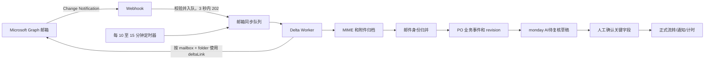
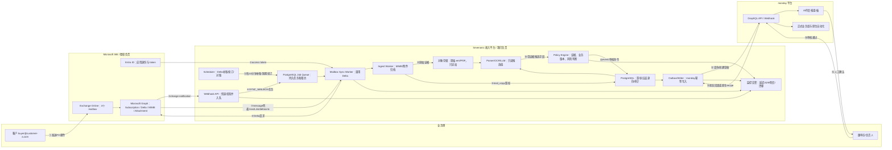
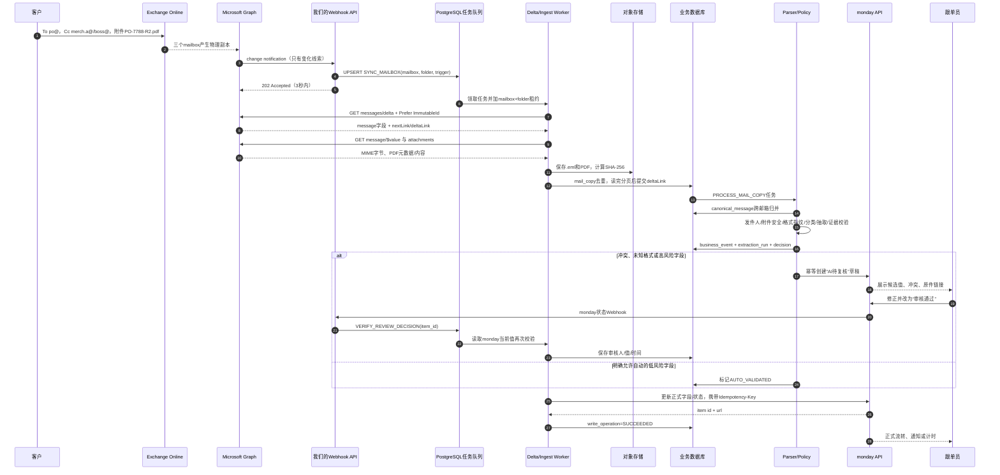
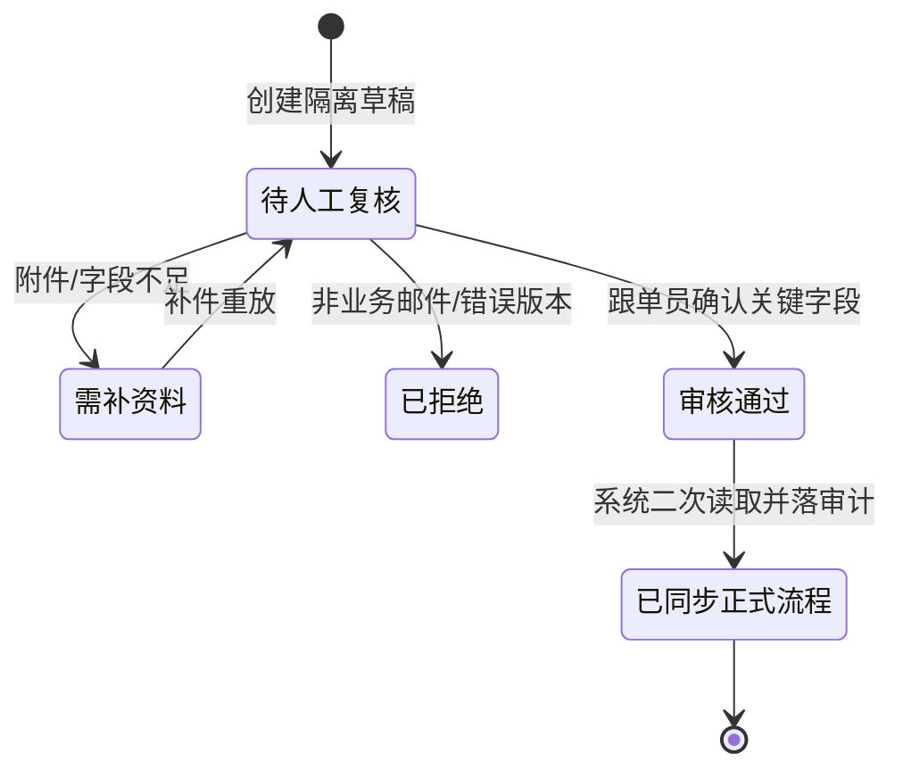
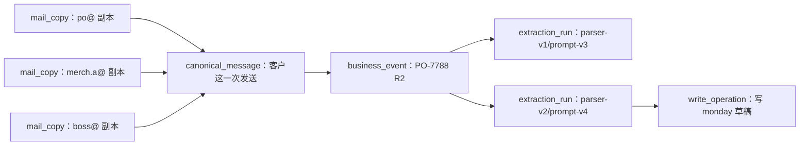
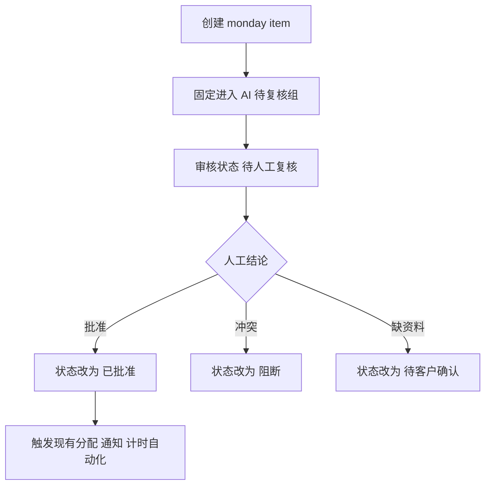
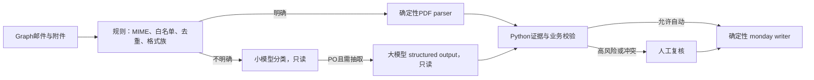

# Sevenonic 多邮箱监听与 monday 幂等写入专项方案

> 范围：以 Sevenonic 的真实 PO 邮件为主线，完整说明多邮箱监听、邮件归档、身份归并、文档解析、业务校验、人工复核、monday 幂等写入和后续自动化。
> 接口口径：Microsoft Graph v1.0、monday Platform API。
> 核验日期：2026-09-10。

## 1. 最终结论

对于目前“邮箱数量不多、由系统统一维护”的业务场景，建议采用：

```text
Graph 基础 Webhook：负责邮件到达后的近实时唤醒
Graph Delta：负责获取变化、断点续传和定时补账
每个 mailbox + folder：独立 subscription、独立 deltaLink
所有邮件处理：先本地归档和去重，再形成业务事件
monday：通过技术安全门后自动写隔离草稿，人工确认后才进入正式流程
```

Webhook 和 Delta 不是两套业务处理逻辑：它们只是同一个 Delta Worker 的两个触发入口。



## 2. 固定业务实例

假定 Sevenonic 统一维护 4 个独立 Microsoft 365 mailbox：

| 邮箱 | 类型 | 是否监听 | 本例收件情况 |
|---|---|---:|---|
| `po@sevenonic.com` | 共享邮箱，客户 PO 主入口 | 是 | To 收件 |
| `merch.a@sevenonic.com` | 跟单 A 个人邮箱 | 是 | Cc 收件 |
| `merch.b@sevenonic.com` | 跟单 B 个人邮箱 | 是 | 未收到 |
| `boss@sevenonic.com` | 老板个人邮箱 | 是 | Cc 收件 |

客户发送：

```text
From: buyer@customer-a.com
To: po@sevenonic.com
Cc: merch.a@sevenonic.com, boss@sevenonic.com
Subject: PO-7788 Revision 2
Attachment: PO-7788-R2.pdf
```

Exchange 会在 `po@`、`merch.a@`、`boss@` 三个 mailbox 中分别保存一个物理副本。Graph 必须读取三个邮箱，但业务系统最终只能形成：

```text
3 个 mail_copy
1 个 canonical_message
1 个 PO-7788 Revision 2 business_event
1 次有效 monday 写入
```

注意：如果多个地址只是同一个共享邮箱的 alias，而不是独立 mailbox，则 Graph 只看到一个邮箱资源。实施前必须确认地址到 mailbox 的真实映射，不能按邮件抄送人数推断订阅数。

### 2.1 先看完整业务流程：业务人员会经历什么

以 `PO-7788 Revision 2` 为贯穿案例，业务上不是“收到邮件后直接让 AI 写 monday”，而是下面这条受控流水线：

| 业务阶段 | 现场发生的事 | 系统给业务人员的结果 | 谁承担责任 |
|---|---|---|---|
| 1. 客户来件 | 客户发 PO 到 `po@`，抄送跟单和老板 | 邮件被系统自动接住，不要求员工转发 | 客户、Microsoft 365 |
| 2. 收件确认 | 同一封邮件在三个邮箱各有一份 | 系统显示“3 个邮箱副本，归并为 1 次客户发送” | 我们平台 |
| 3. 单据识别 | 附件是 `PO-7788-R2.pdf` | 判断为 PO、客户 A、R2；保留原邮件和原附件 | 我们平台 |
| 4. 字段候选 | 解析 PO号、款号、数量、交期、币种等 | 每个候选值都能点回 PDF 页码/原文位置 | parser/LLM 只读处理 |
| 5. 业务校验 | 正文写 1,500，PDF 写 1,600；数据库已有 R1 | 显示字段冲突和 R1→R2 差异，不静默选一个值 | 规则引擎 |
| 6. 待复核草稿 | 生成 `CUSTOMER_A|PO-7788|R2` | 写入 monday 的“AI待复核”区域；不触发生产排期 | 我们平台、monday |
| 7. 人工裁决 | 跟单员确认以 PDF 1,600 为准 | 保存确认人、时间、原因；状态改为“审核通过” | 跟单员 |
| 8. 后续流转 | 审核通过 | monday 才允许移动到正式组、通知采购/生产或启动计时 | monday 自动化/我们平台 |
| 9. 追溯 | 以后发现数据错误或 parser 升级 | 能从 monday item 追到业务事件、解析版本、三份邮箱原件 | 我们平台 |

这里要区分两种“写 monday”：

- **写待复核草稿**：系统允许自动执行，但状态必须是“待人工复核”，且创建动作不能触发生产类自动化。
- **写正式业务状态**：高风险字段经人工确认后才能执行；生产、采购、付款等动作只监听“审核通过”，不能监听 `create_item`。

如果目标 board `18430298578` 已经配置了“创建 item 就自动排期/通知”的 recipe，就不能直接把草稿写进去。必须先停掉该触发条件、改成监听审核状态，或改用独立的“AI事件收件箱”board。

### 2.2 三类边界：依赖平台、我们平台、业务人员

| 边界 | 负责什么 | 不负责什么 | 本项目保存的控制点 |
|---|---|---|---|
| Microsoft Entra ID | 给服务端应用签发 Graph access token | 不决定应用能读哪些业务邮箱 | 应用注册、证书、Exchange Application RBAC |
| Exchange Online | 接收并保存各 mailbox 的邮件副本 | 不替我们做跨邮箱去重和 PO 判断 | mailbox/folder 实际映射、Outlook 规则清单 |
| Microsoft Graph | subscription 通知、Delta 变化、MIME/附件读取 | Webhook 不保证就是完整邮件，也不保证只通知一次 | subscription、deltaLink、ImmutableId、429 重试 |
| 我们的接入平台 | 可靠接收、归档、五层身份、解析、规则、审计和写入控制 | 不替业务人员裁决高风险冲突 | PostgreSQL、对象存储、worker、policy engine、outbox |
| 模型服务 | 对规则无法覆盖的文本分类/抽取给出候选值 | 不直接读 Graph，不持有 monday token，不执行写操作 | structured output、证据位置、版本和用量日志 |
| monday Platform API | 查询 board schema、创建/更新 item、回调状态变化 | 不替我们保证跨日业务幂等和邮件证据完整性 | event_id 列、Idempotency-Key、write_operation |
| 跟单/负责人 | 确认数量、交期、报价、revision 冲突 | 不需要手工重复录入已校验的低风险元数据 | 审核人、审核时间、裁决原因 |
| monday 原生自动化 | 审核后移动组、通知、计时和任务联动 | 不应在“草稿创建”时启动生产或财务动作 | 只以“审核通过”状态作为触发门 |

### 2.3 全系统组件图和数据流向



首期可以把 Webhook API、Scheduler 和 Worker 部署在同一台 VPS、同一个代码仓库中，但它们在逻辑上必须是三个角色：

- API 只快速接收，不能在 HTTP 请求内解析 PDF。
- Scheduler 只产生任务，不直接处理邮件。
- Worker 从持久队列取任务，失败可重试，重启不丢任务。

### 2.4 一封 PO 的全流程时序图



### 2.5 数据不是一次性透传，而是逐层变成不同对象

| 流程位置 | 输入 | 产生的数据 | 存在哪里 | 这一步禁止做什么 |
|---|---|---|---|---|
| Graph Webhook | subscriptionId、resource、changeType | `notification_inbox`、同步任务 | PostgreSQL | 禁止直接拿 notification 创建 monday item |
| Delta 同步 | mailbox、folder、deltaLink | Graph message 摘要、最终 deltaLink | PostgreSQL | 未读完 nextLink 禁止提交新游标 |
| 原件接收 | message id | `.eml`、PDF、附件清单、SHA-256 | 对象存储 + `mail_copy` | 禁止解析失败时丢弃原件 |
| 邮件归并 | 3 个 mail_copy | 1 个 `canonical_message` | PostgreSQL | 禁止只凭跨邮箱 ImmutableId 归并 |
| 业务识别 | 规范邮件、附件 | `business_event=PO-7788 R2` | PostgreSQL | 禁止按款号 S-100 当订单唯一键 |
| 文档解析 | PDF/正文、parser/prompt/rules版本 | `extraction_run` 和字段证据 | PostgreSQL JSONB | 禁止模型输出直接变成写命令 |
| 业务裁决 | 候选值、证据、已有 revision | PASS/REVIEW/BLOCK | PostgreSQL | 冲突时禁止静默信正文或PDF |
| monday 写入 | 已验证 event、目标 schema | `write_operation`、remote item id | PostgreSQL + monday | 禁止不查重直接 create_item |
| 人工批准 | monday item 当前值、审核状态 | 审核记录、正式写命令 | PostgreSQL | 禁止只信一条未验签 webhook |

贯穿案例的数据转换如下：

```text
Graph原始数据
  mailbox=po@, id=AAk-PO-101,
  internetMessageId=<PO-7788-R2...>, subject="PO-7788 Revision 2"
        ↓
mail_copy
  MC-101, evidence_sha256=E1, archive_uri=s3://mail-raw/.../MC-101.eml
        ↓  与merch.a@、boss@副本归并
canonical_message
  CM-501, canonical_content_hash=C77
        ↓  识别客户、单号和版本
business_event
  BE-7788-R2, key=CUSTOMER_A|PO-7788|R2, status=REVIEW_REQUIRED
        ↓  parser-v2/prompt-v4/rules-v5
extraction_run
  ER-9175, quantity=1600, page=2, raw_text="Total Qty 1,600"
        ↓  人工批准+写前查重
write_operation
  WO-3001, action=CREATE_REVIEW_DRAFT, status=SUCCEEDED,
  remote_item_id=9876543210
        ↓
monday item
  event_id=CUSTOMER_A|PO-7788|R2, PO=PO-7788, revision=2,
  quantity=1600, review_status=审核通过
```

### 2.6 定时任务到底怎么运行、传什么参数

#### 2.6.1 需要的六类定时/后台任务

| 任务 | 触发频率 | 输入来源 | 调用外部接口 | 成功产物 |
|---|---|---|---|---|
| `MAILBOX_DELTA_SWEEP` | 每 10～15 分钟 | `mailbox_registry` | 不直接调用；为每个 mailbox+folder 入队 | 多个 `SYNC_MAILBOX` |
| `SYNC_MAILBOX` | Webhook 即时或 sweep | mailbox、folder、trigger | Graph message delta、MIME、attachments | mail_copy、归档原件、新 deltaLink |
| `RENEW_SUBSCRIPTIONS` | 每 6 小时扫描 | 24 小时内到期的 subscription | `PATCH /subscriptions/{id}` | 新 expiration |
| `RECONCILE_SUBSCRIPTIONS` | 每日一次 | 本地 subscription 表 | `GET /subscriptions` | 补建/修正本地状态 |
| `DISPATCH_OUTBOX` | 常驻或每 5 秒 | PENDING write_operation | monday 查询/Mutation | remote item id、SUCCEEDED/UNKNOWN |
| `MONDAY_SCHEMA_GUARD` | 每小时及部署前 | board id、预期 schema hash | monday board query | 可写/阻断标志 |

定时扫描从配置表取数，而不是把四个邮箱写死在代码里：

```sql
SELECT mailbox_id, folder_id, delta_interval, max_concurrency
FROM mailbox_registry
WHERE enabled = true
  AND next_delta_at <= now()
ORDER BY next_delta_at
FOR UPDATE SKIP LOCKED;
```

为 `po@` 生成的实际任务消息：

```json
{
  "job_type": "SYNC_MAILBOX",
  "dedupe_key": "po@sevenonic.com|inbox|2026-09-10T09:10Z",
  "mailbox_id": "po@sevenonic.com",
  "folder_id": "inbox",
  "trigger": "SCHEDULED_RECONCILIATION",
  "requested_at": "2026-09-10T01:10:00Z",
  "correlation_id": "sync-po-20260910-0110"
}
```

Webhook 产生的是同一种任务，只把 `trigger` 改成 `GRAPH_NOTIFICATION`，并携带 `subscription_id`。任务只表示“请同步这个范围”，不把 Webhook 里的 message id 当作唯一事实来源。

#### 2.6.2 Worker 第一次查询传什么

若 `mailbox_cursor` 还没有记录，调用初始 Delta：

```http
GET https://graph.microsoft.com/v1.0/users/po@sevenonic.com/mailFolders/inbox/messages/delta?$select=id,internetMessageId,parentFolderId,subject,from,toRecipients,ccRecipients,receivedDateTime,lastModifiedDateTime,hasAttachments&$top=50
Authorization: Bearer {graph-access-token}
Prefer: IdType="ImmutableId"
Accept: application/json
client-request-id: 1f10968e-7ee9-4d4e-9a12-6bb7a5d16b51
```

选择这些字段的目的：

| Graph 字段 | 用途 |
|---|---|
| `id` | 得到邮箱内 ImmutableId，组成 `mail_copy` 唯一键 |
| `internetMessageId` | 跨邮箱同一次发送的候选归并键，不单独作为最终判断 |
| `parentFolderId` | 确认消息当前所在文件夹，处理移动事件 |
| `subject/from/toRecipients/ccRecipients` | 分类、发件人策略、跨副本内容指纹 |
| `receivedDateTime/lastModifiedDateTime` | 排序、审计、识别后续修改，不能代替 revision |
| `hasAttachments` | 决定是否进入附件枚举流程 |

Graph 返回的是一个变化页：

```json
{
  "value": [{
    "id": "AAk-PO-101",
    "internetMessageId": "<PO-7788-R2.20260910@customer-a.com>",
    "parentFolderId": "AQMk...Inbox",
    "subject": "PO-7788 Revision 2",
    "from": {"emailAddress": {"name": "Customer A Buyer", "address": "buyer@customer-a.com"}},
    "toRecipients": [{"emailAddress": {"address": "po@sevenonic.com"}}],
    "ccRecipients": [
      {"emailAddress": {"address": "merch.a@sevenonic.com"}},
      {"emailAddress": {"address": "boss@sevenonic.com"}}
    ],
    "receivedDateTime": "2026-09-10T01:06:31Z",
    "lastModifiedDateTime": "2026-09-10T01:06:33Z",
    "hasAttachments": true
  }],
  "@odata.nextLink": "https://graph.microsoft.com/v1.0/...?$skiptoken=opaque"
}
```

有 `nextLink` 就原样继续 GET；只有最后一页才出现 `deltaLink`。下一轮不再重新拼查询参数，直接 GET 数据库保存的完整 `deltaLink`：

```http
GET https://graph.microsoft.com/v1.0/.../messages/delta?$deltatoken=opaque
Authorization: Bearer {graph-access-token}
Prefer: IdType="ImmutableId"
```

Graph 可能返回：新消息、已更新消息，或带 `@removed` 的删除/移出文件夹记录。`@removed` 只能更新本地“该副本已不在当前文件夹”的状态，不能删除已归档的原件，也不能撤销已经形成的 PO 业务事件。

#### 2.6.3 拿到 message 摘要以后还要查什么

对第一次见到的 `mailbox_id + immutable_id`：

```http
GET https://graph.microsoft.com/v1.0/users/po@sevenonic.com/messages/AAk-PO-101/$value
Authorization: Bearer {graph-access-token}
Prefer: IdType="ImmutableId"
Accept: message/rfc822
```

返回体是原始 MIME 字节，直接按字节写对象存储并计算 `evidence_sha256`。随后列出附件：

```http
GET https://graph.microsoft.com/v1.0/users/po@sevenonic.com/messages/AAk-PO-101/attachments?$select=id,name,contentType,size,isInline
Authorization: Bearer {graph-access-token}
Prefer: IdType="ImmutableId"
```

示例响应：

```json
{
  "value": [{
    "@odata.type": "#microsoft.graph.fileAttachment",
    "id": "AAMk-ATT-01",
    "name": "PO-7788-R2.pdf",
    "contentType": "application/pdf",
    "size": 84213,
    "isInline": false
  }]
}
```

接收层先检查附件类型和大小，再取得/解码内容。MIME 原件是审计底稿；附件拆分件是解析输入。二者都要保存 hash，不能只把模型抽取结果存数据库。

### 2.7 中间到底要经过哪些判断门

| 门 | 输入 | 主要判断 | 通过后 | 不通过时 |
|---|---|---|---|---|
| G0 回调真实性 | tenantId、subscriptionId、clientState | 是否属于已登记租户/订阅，秘密是否匹配 | 入 `notification_inbox` | 401/拒绝并告警，不产生同步任务 |
| G1 Graph 获取完整性 | HTTP 状态、分页、deltaLink | 429/5xx 是否重试；所有页是否可靠落库 | 提交新 cursor | 保留旧 cursor，按 Retry-After 重试 |
| G2 邮箱物理副本 | mailbox_id、ImmutableId | 该邮箱副本以前是否见过 | 新建/更新 mail_copy | 已存在则不重复归档，只更新状态 |
| G3 跨邮箱归并 | tenant、Message-ID、内容/附件指纹 | 三个副本是否同一次发送 | 关联 canonical_message | Message-ID 相同但内容不同则冲突隔离 |
| G4 安全与来源 | 发件域、MIME、文件类型、大小、恶意内容 | 是否允许进入自动候选流程 | 解包并保存证据 | 非白名单进入人工队列；不自动写 |
| G5 文档类型 | 主题、正文、附件锚点 | PO/报价/新款/评语/其他 | 路由对应 parser | 无法判断则 `UNCLASSIFIED` |
| G6 格式兼容 | 模板指纹、PDF文本/OCR质量 | 已知模板、灰区还是未知格式 | 解析字段 | 未知格式 `UNKNOWN_FORMAT`，停止自动值 |
| G7 字段证据 | value、raw_text、page/bbox | 值是否能从原文确定性复算 | 保存 extraction_run | 无证据字段置空并升级人工 |
| G8 业务版本 | customer、PO、revision、payload hash | 新 PO、新 revision、重发、同版本冲突、迟到版本 | business_event | 冲突/迟到阻断正式写入 |
| G9 monday 写前检查 | board schema、event_id、远端 revision | 列类型是否正确；远端是否已有 | 创建/更新 write_operation | schema 漂移、同键异值则停写 |
| G10 人工批准 | item当前值、审核人、状态 | 是否有权限；关键字段是否都确认 | 正式流转 | 退回、补证据或拒绝 |

门与状态必须在数据库中可见，不能只写日志。例如 G6 失败：

```text
mail_copy.status          = ARCHIVED
canonical_message.status  = CANONICALIZED
business_event.status     = REVIEW_REQUIRED
extraction_run.decision   = UNKNOWN_FORMAT
write_operation           = 不创建正式写入；可创建隔离草稿
```

### 2.8 我们平台内部的中间件和存储怎么分工

| 组件 | 放什么 | 为什么需要 | 首期实现 |
|---|---|---|---|
| PostgreSQL 业务表 | mailbox、subscription、cursor、五层身份、审核、写入 ledger | 需要事务、唯一约束、审计查询 | 必选 |
| PostgreSQL job/outbox | SYNC、PROCESS、WRITE 等持久任务，租约和重试次数 | VPS 重启后任务不能消失；数据库事务和业务状态一起提交 | 首期必选 |
| 对象存储 | 原始 `.eml`、PDF、其他附件、解析中间产物 | 大文件不适合塞业务表；需要不可变原件和重放 | 必选，可用 S3 兼容存储或受控文件存储 |
| Redis | 短缓存、分布式限流、独立消息代理 | 当前吞吐低，PostgreSQL 足够；过早引入会多一套运维 | 首期不需要，达到扩容阈值再引入 |
| Secret Store | Graph 证书私钥、monday token、模型密钥 | 凭据不能进代码、日志或模型上下文 | 必选；具体产品由部署环境决定 |
| Metrics/Logs | correlation_id、P50/P95、429、dead job、重复拦截、格式漂移 | 跨 Graph→worker→monday 定位问题 | 必选 |

对象存储建议路径只使用内部 ID，不把客户、PO号直接暴露在 bucket key：

```text
mail-raw/{tenant_id}/{mail_copy_id}/original.eml
mail-raw/{tenant_id}/{mail_copy_id}/attachments/{attachment_id}.bin
derived/{document_id}/{parser_version}/page-text.json
```

数据库存 `archive_uri + sha256 + size + content_type`。原件只追加；解析结果通过新 `extraction_run` 版本化，不覆盖原件。

### 2.9 monday 端如何承接业务而不误触发自动化

目标 board 在首次写入前必须读取真实 group、column 和 status 配置。建议最少具备：

| monday 列 | 类型 | 示例 | 用途 |
|---|---|---|---|
| `event_id_col` | Text | `CUSTOMER_A|PO-7788|R2` | 远端幂等回查键，隐藏也可以但不能删除 |
| `po_col` | Text | `PO-7788` | 业务查询 |
| `revision_col` | Numbers/Text | `2` | 版本比较；格式必须固定 |
| `customer_col` | Text/Dropdown | `CUSTOMER_A` | 客户路由 |
| `qty_col` | Numbers | `1600` | 人工确认字段 |
| `delivery_col` | Date | `2026-10-15` | 人工确认字段 |
| `evidence_col` | Link | 我们平台证据页 | 查看原文和字段位置 |
| `issue_col` | Long Text/Dropdown | `BODY_ATTACHMENT_CONFLICT` | 显示阻断原因 |
| `review_col` | Status | `待人工复核` | 自动化总闸门 |
| `payload_hash_col` | Text | `sha256:...` | 远端同键异值检查 |

推荐状态机：



monday 原生 recipe 必须是：

```text
当 review_col 变为“审核通过”时
  -> 移动到正式组/通知负责人/启动计时
```

禁止：

```text
当 item 被创建时 -> 直接排产或通知财务
```

如果审核通过后还需要我们平台继续动作，则创建 monday webhook：

```graphql
mutation {
  create_webhook(
    board_id: 18430298578,
    url: "https://automation.sevenonic.com/monday/events",
    event: change_status_column_value,
    config: "{\"columnId\":\"review_col\",\"columnValue\":{\"$any$\":true}}"
  ) {
    id
    board_id
  }
}
```

monday 首次验证 URL 时发送：

```json
{"challenge":"3eZbrw..."}
```

我们的接口原样返回 JSON：

```json
{"challenge":"3eZbrw..."}
```

收到状态事件后不能仅凭 webhook payload 执行。系统用 `pulseId/item id` 再查 monday 当前 `event_id`、审核状态和关键字段，校验审核人权限、业务版本和 payload hash，之后才把本地 `business_event` 标为 APPROVED。

### 2.10 运行时失败分别由哪一层兜底

| 故障 | 表现 | 自动恢复 | 是否允许继续业务写入 |
|---|---|---|---|
| Graph Webhook 丢失 | 没有即时门铃 | 10～15 分钟 Delta sweep 补到 | 补到并校验后允许 |
| Graph 429 | 返回 `Retry-After` | mailbox 级退避加抖动，其他邮箱可继续 | 当前 mailbox 暂停 |
| Delta worker 崩溃 | job 租约超时 | reaper 回收任务，从旧 cursor 重跑 | 去重后继续 |
| PDF 损坏/未知格式 | parser 失败 | 原件隔离，更新 parser 后重放 | 只可建错误草稿，不可正式流转 |
| 模型超时 | extraction_run 失败 | 限次重试；转人工/规则降级 | 不得用空值或猜测值写正式字段 |
| PostgreSQL 不可用 | 无法持久化通知/游标 | Webhook 返回 5xx 让 Graph 重试；告警 | 不允许 |
| 对象存储不可用 | 原件无法落地 | 不提交 deltaLink，稍后重试 | 不允许 |
| monday 429/复杂度错误 | Query/Mutation 失败 | 按响应延迟重试，降低查询字段 | 本地 outbox 保留 PENDING |
| monday 成功但客户端超时 | 本地状态 UNKNOWN | 按 event_id 回查，找到即补记成功 | 未查清前禁止再次 create |
| board 列被管理员修改 | schema hash 不一致 | schema guard 停止 writer 并告警 | 不允许 |

业务层看到的不是一串技术异常，而是可处理状态：`等待同步`、`待人工复核`、`附件无法识别`、`同版本内容冲突`、`monday写入待确认`。每个状态必须给出原件、原因、责任人和下一步。

### 2.11 从 Graph 到 monday 的接口调用清单

这张表用于开发联调时逐项打勾，避免“各接口单独能调，但没有串成业务闭环”：

| 顺序 | 调用方向 | 接口 | 关键传参 | 主要返回 | 返回后写到哪里 |
|---:|---|---|---|---|---|
| 0 | 我们→Entra | `POST /{tenant}/oauth2/v2.0/token` | client_id、证书断言/secret、`.default` scope、client_credentials | access_token、expires_in | 仅安全 token cache，不进业务表 |
| 1 | 我们→Graph | `POST /v1.0/subscriptions` | changeType、notificationUrl、resource、expiration、clientState；请求头 ImmutableId | subscription id、expiration | `graph_subscription` |
| 2 | Graph→我们 | `POST /graph/notifications` | subscriptionId、changeType、resourceData.id、clientState、tenantId | 我们 202 | `notification_inbox` + `SYNC_MAILBOX` job |
| 3 | 我们→Graph | `GET .../messages/delta` | mailbox、folder；首次带 select/top，以后用完整 deltaLink | messages、nextLink 或 deltaLink | `mail_copy`、`mailbox_cursor` |
| 4 | 我们→Graph | `GET .../messages/{id}/$value` | mailbox、ImmutableId | MIME 二进制 | 对象存储 + evidence hash |
| 5 | 我们→Graph | `GET .../messages/{id}/attachments` | mailbox、ImmutableId | 附件 id/name/type/size/content | 对象存储 + `mail_artifact` |
| 6 | 我们内部 | parser/policy | MIME、PDF、已有 business_event、版本配置 | 候选字段、证据、PASS/REVIEW/BLOCK | `canonical_message`、`business_event`、`extraction_run` |
| 7 | 我们→monday | GraphQL `boards` | board id | group/column id、type、settings | schema snapshot/cache |
| 8 | 我们→monday | `items_page_by_column_values` | board id、event_id column/value | 已有 item 及字段 | write_operation 决策：NO_OP/CONFLICT/CREATE |
| 9 | 我们→monday | `create_item` | board、AI review group、name、column_values；Idempotency-Key | item id/name/url | `write_operation.remote_item_id` |
| 10 | monday→我们 | `/monday/events` | challenge 或状态变化 event | challenge 响应/200 | 通知 inbox + `VERIFY_REVIEW_DECISION` job |
| 11 | 我们→monday | item query + `change_multiple_column_values`（如需） | item id、复核后的字段/状态 | item id/字段 | `review_decision` + 正式 write_operation |

任何一行失败都必须停留在本行或前一行的可靠状态，不能跨过中间判断直接调用第 9 或第 11 步。

## 3. 当前每小时 Delta 方案有什么问题

每小时 Delta 本身是合法方案，但作为唯一入口存在以下问题：

| 问题 | 当前表现 | 风险 | 解决方案 |
|---|---|---|---|
| 延迟 | 到信后最多等待约 60 分钟 | 紧急 PO 或 revision 无法及时进入复核 | Webhook 立即唤醒，Delta 定时补账 |
| 游标维度错误 | 全系统只存一个 cursor | 四个邮箱或多个文件夹互相覆盖 | 每个 `mailbox_id + folder_id` 一条完整 deltaLink |
| 游标过早提交 | 第一页成功便保存新游标 | 后续页失败造成永久漏信 | 所有 nextLink 页面成功落库后事务提交 |
| 毒邮件阻塞 | 异常 PDF 每轮都抛错 | 整个邮箱游标无法前移 | 原件归档并隔离，邮件接收与业务批准分离 |
| 文件夹范围 | 只查询 Inbox | Outlook 规则搬走的邮件可能漏取 | 明确实际落点文件夹，分别维护 cursor |
| 主机停机 | 单机或免费实例不运行调度器 | 数小时没有执行查询 | 恢复后沿 deltaLink 补账；订阅过期则重建 |

### 3.1 先用一句大白话解释 Delta 和 Webhook

- **Webhook 像门铃**：微软只告诉系统“某个邮箱有变化了”，让系统赶快起来工作；它不是完整邮件账本。
- **Delta 像对账单**：系统拿着上次保存的 `deltaLink` 问微软“从我上次对账以后，这个邮箱文件夹发生了哪些新增、修改和删除”。
- **正确组合**：门铃响了马上对账；门铃没响或系统当时关机，每 10～15 分钟也主动对账一次。

所以不是 Webhook 收一次、Delta 再处理一次，而是二者都只负责触发同一个同步任务：

```text
Webhook 到达 ─┐
              ├─> 入队 mailbox=po@ + folder=inbox ─> Delta Worker ─> 归档/去重
定时器到点 ───┘
```

如果同一分钟 Webhook 和定时器都触发，任务可以合并；同一个 `mailbox + folder` 同时只允许一个 Delta Worker 运行。

### 3.2 场景一：为什么“每小时主动查一次”业务上太慢

假设系统在 09:00 查完 `po@`，下一次计划是 10:00：

```text
09:00  Delta 查询完成，保存游标 D-po-inbox-0900
09:06  客户发来 PO-7788 R2，要求 09:30 前确认
09:07  Webhook 通知到达
09:07  系统立即用 D-po-inbox-0900 做 Delta 查询
09:08  邮件完成归档，跟单员收到复核任务
```

若只有每小时 Delta，跟单员最快 10:00 才看到，已经错过 09:30。Webhook 的价值就是把等待时间从“最多一小时”降为通常几分钟；Delta 仍负责真正取得完整邮件和补漏。

### 3.3 场景二：四个邮箱为什么不能共用一个游标

09:00，四个邮箱分别完成查询，数据库实际应保存四条状态：

| mailbox | folder | 自己的 deltaLink（缩写） |
|---|---|---|
| `po@sevenonic.com` | Inbox | `D-PO-0900` |
| `merch.a@sevenonic.com` | Inbox | `D-MA-0900` |
| `merch.b@sevenonic.com` | Inbox | `D-MB-0900` |
| `boss@sevenonic.com` | Inbox | `D-BOSS-0900` |

09:06 的同一封 PO 同时进入 `po@`、`merch.a@` 和 `boss@`。系统要分别带各自的 deltaLink 查询：

```text
po@      : D-PO-0900   -> 返回副本 AAk-PO-101   -> 新游标 D-PO-0907
merch.a@ : D-MA-0900   -> 返回副本 AAk-MA-882   -> 新游标 D-MA-0907
boss@    : D-BOSS-0900 -> 返回副本 AAk-BOSS-016 -> 新游标 D-BOSS-0907
merch.b@ : D-MB-0900   -> 没有变化               -> 新游标 D-MB-0907
```

`deltaLink` 是微软针对某一个查询范围生成的不透明状态，不能自己拼，也不能把 `po@` 的游标拿去查 `boss@`。若数据库只有一个全局 cursor，最后完成的邮箱会覆盖前面邮箱的状态，轻则重复读取，重则无法从正确位置继续。

### 3.4 deltaLink 到底是什么：把它理解成“这个文件夹的对账书签”

#### 3.4.1 它不是邮件 ID，也不是一个时间戳

第一次查询 `po@` 的 Inbox 时，我们请求：

```http
GET https://graph.microsoft.com/v1.0/users/po@sevenonic.com/mailFolders/inbox/messages/delta?$select=id,subject,internetMessageId,receivedDateTime&$top=50
Prefer: IdType="ImmutableId"
```

Graph 可能先返回若干页 `@odata.nextLink`。全部读完后，最后一页才返回：

```json
{
  "value": [],
  "@odata.deltaLink": "https://graph.microsoft.com/v1.0/users/po@sevenonic.com/mailFolders/inbox/messages/delta?$deltatoken=eyJ...opaque..."
}
```

这个完整 URL 就是 deltaLink。大白话讲：

> 微软告诉我们：“`po@` 的 Inbox，我已经和你对账到状态 S100。下次把这张书签原样交回来，我只告诉你 S100 之后的变化。”

它内部包含微软生成的不透明状态 token，也编码了第一次查询的 `$select` 等条件。我们的系统只负责**整条加密保存、整条取出、整条原样 GET**，不解析 `$deltatoken`，不把它改成自己的时间戳，也不追加或删除查询参数。

数据库保存的不是：

```text
last_sync_time = 2026-09-10 09:00:00
```

而是：

```text
mailbox_cursor
mailbox_id            = po@sevenonic.com
folder_id             = inbox
delta_link            = https://graph.microsoft.com/v1.0/...?$deltatoken=eyJ...opaque...
last_success_at        = 2026-09-10T01:00:00Z
last_full_sync_at      = 2026-09-01T00:00:00Z
status                 = ACTIVE
```

仅记“上次查询时间”无法代替 deltaLink：不同服务器的时间边界、同一秒多封邮件、延迟提交和更新/删除事件都可能让按时间筛选出现缝隙；deltaLink 才是 Graph 的服务端同步状态。

#### 3.4.2 下一轮拿 deltaLink 会得到什么

09:06 客户发来 PO-7788 R2。09:10 定时任务从数据库取出完整 deltaLink：

```http
GET https://graph.microsoft.com/v1.0/users/po@sevenonic.com/mailFolders/inbox/messages/delta?$deltatoken=eyJ...opaque...
Prefer: IdType="ImmutableId"
```

Graph 返回“自 S100 之后”的变化：

```json
{
  "value": [{
    "id": "AAk-PO-101",
    "subject": "PO-7788 Revision 2",
    "internetMessageId": "<PO-7788-R2.20260910@customer-a.com>",
    "receivedDateTime": "2026-09-10T01:06:31Z"
  }],
  "@odata.deltaLink": "https://graph.microsoft.com/v1.0/users/po@sevenonic.com/mailFolders/inbox/messages/delta?$deltatoken=eyJ...S101..."
}
```

系统先可靠保存消息和原件，再把数据库中的 S100 URL 替换为 S101 URL。下一次又从 S101 继续。若返回 `nextLink`，说明这一轮还没读完，正式 cursor 仍保持 S100，直到最终拿到新的 deltaLink。

#### 3.4.3 folder_id 在这里到底起什么作用

`folder_id` 决定“对哪个邮件集合做增量对账”。同一个邮箱的 Inbox、客户归档目录和 Archive 是三个不同集合，所以有三本不同的对账账簿：

| mailbox_id | folder_id | 人能看到的目录 | 独立 deltaLink |
|---|---|---|---|
| `po@sevenonic.com` | `inbox` | 收件箱 | `D-PO-INBOX-S101` |
| `po@sevenonic.com` | `AQMk...CustomerA` | `Orders/Customer-A` 自定义文件夹 | `D-PO-CUSTA-S66` |
| `po@sevenonic.com` | `archive` | Microsoft 预定义 Archive | `D-PO-ARCHIVE-S12` |

`inbox`、`archive` 是微软提供的 well-known name，可以直接放在 URL。用户自建的 `Orders/Customer-A` 没有通用名称，需要先枚举文件夹，取得真实 ID：

```http
GET https://graph.microsoft.com/v1.0/users/po@sevenonic.com/mailFolders?$select=id,displayName,parentFolderId,wellKnownName
```

假设先找到 `Orders` 的 ID，再查它的子目录：

```http
GET https://graph.microsoft.com/v1.0/users/po@sevenonic.com/mailFolders/{orders-folder-id}/childFolders?$select=id,displayName,parentFolderId,wellKnownName
```

得到：

```json
{
  "value": [{
    "id": "AQMk...CustomerA",
    "displayName": "Customer-A",
    "parentFolderId": "AQMk...Orders",
    "wellKnownName": null
  }]
}
```

然后目标文件夹的 Delta URL 是：

```http
GET /v1.0/users/po@sevenonic.com/mailFolders/AQMk...CustomerA/messages/delta
```

不能把 Inbox 返回的 `$deltatoken` 拼到 `Customer-A` 的 URL 上。那张书签记录的是 Inbox 集合的状态，不是整个邮箱状态。

#### 3.4.4 邮件从 Inbox 搬到 Customer-A 时会发生什么

假设 PO-7788 在同一个 `po@` mailbox 内被 Outlook 规则搬走：

```text
09:06:31  邮件进入 Inbox
09:06:33  Outlook 规则移动到 Orders/Customer-A
09:10:00  两个文件夹的 Delta Worker 分别对账
```

可能看到的变化是：

```text
Inbox delta：AAk-PO-101 带 @removed，表示它已删除或移出这个集合
Customer-A delta：AAk-PO-101 作为加入该集合的消息返回
```

由于所有请求都带 `Prefer: IdType="ImmutableId"`，邮件留在同一 mailbox 内移动文件夹时，消息 ImmutableId 保持 `AAk-PO-101`。因此：

- `mailbox_id + immutable_id` 仍命中同一条 `mail_copy`，不会重新归档成第二封。
- `mail_copy.current_folder_id` 更新成 `AQMk...CustomerA`。
- Inbox 的 `@removed` 不能被解释成“客户撤销 PO”，它只说明邮件离开了 Inbox 集合。
- 如果系统没有监听 `Customer-A` 文件夹，只靠 Inbox Delta 不能长期跟踪移动后的状态。

由此可见，`folder_id` 解决的是**技术同步范围**，不是客户分类、PO 归属或业务状态。

#### 3.4.5 一个邮箱到底应该配几个 folder_id

不是所有文件夹都监听，而是根据真实 Exchange/Outlook 规则列出“邮件可能实际落到的业务入口”：

```yaml
mailboxes:
  - mailbox_id: po@sevenonic.com
    folders:
      - folder_id: inbox
        purpose: 未分拣客户来件
      - folder_id: AQMk...CustomerA
        purpose: Outlook规则归档的客户A来件
  - mailbox_id: merch.a@sevenonic.com
    folders:
      - folder_id: inbox
        purpose: 跟单A直接收件
  - mailbox_id: boss@sevenonic.com
    folders:
      - folder_id: inbox
        purpose: 负责人抄送副本
```

上述配置会产生 4 条 `mailbox_cursor`；如果四个邮箱都再监听两个目录，就是 8 条。数量计算公式是“受管 mailbox 与实际目标 folder 的组合数”，不是抄送人数，也不是一个租户一条。

#### 3.4.6 deltaLink 能解决什么、不能解决什么

| deltaLink 能解决 | deltaLink 不能解决 | 由谁补上 |
|---|---|---|
| 不用每次重扫整个文件夹，只取上次完整同步后的变化 | 不负责低延迟通知；只有定时查询仍会等待 | Webhook 立即唤醒 |
| 断电恢复后从已提交状态继续 | token 不是永久有效，可能收到 40x/`syncStateNotFound` 或 410 | 触发该 mailbox+folder 全量重建，再生成新 deltaLink |
| 返回新增、更新以及移出/删除集合的变化 | 同一变化仍可能重放，也不保证业务上只处理一次 | `mail_copy` 唯一约束和五层身份模型 |
| 记住某个文件夹集合的同步状态 | 不能覆盖另一个邮箱或另一个文件夹 | 每个 mailbox+folder 独立 cursor |
| 初次同步后持续维护本地镜像 | 第一次调用通常会返回当前集合中已有邮件，不天然只取“上线后的新邮件” | 上线时确定回溯窗口/基线策略，并做好幂等 |
| 告诉系统邮件资源发生了技术变化 | 不知道这是新 PO、重发、R2、客户撤单或普通已读状态变化 | canonical/business_event/policy 层 |
| 在同 mailbox 内配合 ImmutableId 识别移动后的同一邮件 | 不会归并不同 mailbox 的三份副本 | Message-ID 候选 + 内容/附件指纹 |

因此 `mailbox_id + folder_id + deltaLink` 只解决“从 Graph 哪个账簿、从哪里继续读”的问题，不能替代后面的跨邮箱去重、PO 版本判断、人工审核和 monday 幂等。

### 3.5 场景三：为什么必须读完所有分页再提交游标

假设老板邮箱积压了 120 封变化，Graph 每页返回 50 封：

```text
第 1 页：50 封 + @odata.nextLink=N2
第 2 页：50 封 + @odata.nextLink=N3
第 3 页：20 封 + @odata.deltaLink=D-BOSS-NEW
```

`nextLink` 表示“还有下一页”，最终 `deltaLink` 才表示“这轮完整对账结束后的新起点”。正确动作是：

1. 第 1 页邮件落入 `mail_copy`，继续请求 N2，不修改正式 cursor。
2. 第 2 页处理时程序崩溃；旧 cursor 仍是 `D-BOSS-OLD`。
3. 程序恢复后从旧 cursor 重跑。前 50 封虽然再次返回，但被 `mailbox_id + immutable_id` 唯一约束拦住。
4. 三页全部安全落库后，才在同一事务中把正式 cursor 更新成 `D-BOSS-NEW`。

如果处理完第 1 页就把正式 cursor 向前提交，第 2、3 页在故障后可能再也查不到，这就是“游标过早提交造成永久漏信”。

### 3.6 场景四：一份坏 PDF 不能堵住整个邮箱

09:10，`po@` 一轮 Delta 返回三封邮件：

| 顺序 | 邮件 | 结果 |
|---:|---|---|
| 1 | PO-7788.pdf | 正常 |
| 2 | PO-7790.pdf | PDF 结构损坏，parser 报错 |
| 3 | PO-7791.pdf | 正常 |

错误做法是“只要第 2 封解析失败，整轮报错，不保存 cursor”。这样每 10 分钟都会重新撞到 PO-7790，第 3 封永远进不来。

正确做法把接收和业务解析拆开：

```text
Graph 接收层：三封原始 MIME/附件都归档，三条 mail_copy 都成功落库
业务任务层：PO-7788=READY，PO-7790=QUARANTINED，PO-7791=READY
同步状态层：确认三封都已可靠保存后，允许提交新 deltaLink
人工队列：PO-7790 显示 PDF_PARSE_FAILED，保留原件，可修复后重放
```

这里“允许游标前进”不等于“坏 PO 已获业务批准”，只代表“系统已经可靠接住它，不会丢”。

### 3.7 场景五：Outlook 规则搬邮件和主机停机

客户邮件 09:06 到达 Inbox，但 Outlook 规则 09:06:02 就把它搬到 `Orders/Customer-A`。如果系统 10:00 才只查 Inbox，它可能只看到删除/移动变化，甚至拿不到可用于业务处理的当前邮件；而目标文件夹从未查询。因此实施前需要问清真实规则，并为实际落点建立独立的 `mailbox_id + folder_id + deltaLink`。

再假设 VPS 从 09:00 停到 13:00：Webhook 在停机时无法叫醒系统。恢复后系统不能从“当前时间”重新查，而应拿 09:00 保存的旧 deltaLink 补齐四小时内的变化。若 subscription 也已失效，则重建 subscription，但历史缺口仍由 Delta 补，不靠 Webhook 补历史。

另一方面，只使用 Webhook 也不成立：通知可能重复、乱序、延迟或出现 `missed`；subscription 也有到期时间。因此正确选择是“Webhook 唤醒 + Delta 对账”。

### 3.8 截图 2、截图 3 与截图 4 的方案对比

为避免把三张图中的“当前技术选择”“首期交付物”和“分阶段上线”混成一件事，先给它们重新命名：

- **方案 A（截图 2）**：每小时按邮箱做 Graph Delta；不使用 Change Notifications；`ImmutableId + internetMessageId + 版本号` 哈希去重；写入前查重。
- **方案 B（截图 3）**：首期交付 PO 确定性校验器、280 封评测框架和邮件管道 L1 影子模式；影子阶段不碰 monday。
- **治理框架 C（截图 4）**：L0 基线→L1 影子→L2 隔离板→L3 分类型进入生产→L4 稳态抽检。这不是另一套获取技术，而是控制上线风险的阶段框架。

#### 3.8.1 总体对比

| 对比维度 | 方案 A：每小时 Delta + 原哈希 | 方案 B：校验器/评测/L1影子 | 本文修正版 |
|---|---|---|---|
| 核心目标 | 用最少运维实现定时收件 | 先证明解析质量，不产生外部副作用 | 既保证邮件可靠接收，又分阶段证明业务正确和 monday 安全 |
| 邮件时效 | 最坏约 60 分钟 | 仍取决于 Delta 调度频率 | Webhook 即时唤醒 + 10～15 分钟 Delta 补账 |
| 断电/漏通知 | Delta 可沿游标补账 | 影子模式可重跑 | Delta 是权威账本；Webhook 只做门铃；持久 job 和旧游标恢复 |
| 邮箱范围 | 说“按邮箱各自游标”，但未说明 folder | 只写“主业务邮箱” | 每个 `mailbox + 实际落点folder` 独立 subscription/cursor；RBAC 限权 |
| 跨邮箱抄送 | 原哈希含不同 ImmutableId，会生成不同键 | 留出集可测试，但未给生产身份模型 | 3 个 mail_copy→1 canonical_message→1 business_event |
| 客户重发/转发 | internetMessageId 改变时可能漏判 | 可作为评测样例 | 用业务键和 payload 判断 RESENT_DUPLICATE/CONFLICT |
| prompt/rules 升级 | 哈希带版本号，可能错误产生新业务 ID | 影子评测可以比较版本 | 只新增 extraction_run，不新增 event，不自动重写 monday |
| PO 字段正确性 | 去重设计本身不解决 | 纯 Python 校验器对已知模板很强 | 已知模板走确定性 parser；不确定内容才用只读 LLM；全部走证据与业务门 |
| monday 风险 | 写前查重，但外部超时和跨日重放说明不足 | L1 完全不写，安全但没验证写链路 | L2 隔离草稿 + 本地 ledger + monday idempotency + event_id 回查 |
| 能否验证真实副作用 | 可以，但若直接写正式板风险高 | 不能；影子只验证读和解析 | L2 专门验证 create/update/超时/重复，但不触发生产 automation |
| 运维复杂度 | 最低，但以延迟换简单 | 中等；需要数据集与评测工具 | 中等偏上；多 subscription、续租、公网回调、任务队列和告警 |
| 适用条件 | 业务明确接受 60 分钟延迟，且 VPS 调度稳定 | 项目尚未证明准确率时必须先做 | 作为最终目标；按治理框架 C 分阶段上线 |

#### 3.8.2 方案 A 能解决与不能解决的

方案 A 能解决：

- 无需公网 Webhook，部署简单；系统恢复后可从各邮箱 deltaLink 补历史变化。
- 邮箱量少、业务接受小时级延迟时，API 请求量低。
- 如果真的按 `mailbox + folder` 正确保存游标并读完分页，可以做到可靠增量抓取。

方案 A 不能解决：

- 每小时轮询天然无法满足紧急 PO/revision 的分钟级复核。
- “免费实例可能被回收”同样会让 cron 不运行；不用 Webhook 不代表没有运行环境风险。
- 原公式 `sha256(immutableId | internetMessageId | prompt_version | ruleset_version)` 不能跨邮箱归并，并把解析版本错误混进业务身份。
- Delta 只描述邮件资源变化，不判断客户重发、PO revision、正文/PDF冲突或 monday 副作用。
- 若只写 mailbox 而未写 folder，Outlook 自动搬件后同步范围仍不完整。

因此方案 A 不是非法方案，而是**可作为无公网回调时的降级获取方式**；必须修正 cursor 维度和五层身份，不能原样用于正式去重。

#### 3.8.3 方案 B 能解决与不能解决的

方案 B 的三个交付物分别解决不同问题：

| 交付物 | 能解决 | 不能解决 |
|---|---|---|
| PO 交叉校验器 | 对已知 PDF/HTML 格式做表格、合计、范围和正文/PDF差异校验；结果确定、好解释 | 客户换 ERP、扫描件、自由文本或复杂版式时可能失效；它不负责收件和 monday 幂等 |
| 280 封评测框架 | 在上线前量化分类、字段、证据和幻觉/错误；让 parser/prompt 升级可回归 | 数据集偏差、未来模板漂移和罕见故障仍存在；评测通过不等于生产永不出错 |
| L1 邮件影子模式 | 在不碰 monday 的条件下验证 Graph 获取、分类、解析、耗时和重复拦截 | 没有真实 create/update，无法验证 monday schema、幂等键、超时回查和 automation 误触发 |

方案 B 里“PO 校验器纯 Python 零 AI”适合定义为**已知模板的确定性主路径**，不宜扩大成“所有客户所有 PO 永远不用 AI”。一旦出现未知版式，正确动作是停写/人工或进入受控 LLM 候选流程，而不是硬解析出垃圾。

方案 B 的 L1 若只拉主邮箱，可以先证明单邮箱接入，但无法实测跨邮箱抄送去重。要验收本文的三层邮件身份，影子期至少应同时读取 `po@` 和一个真实 Cc 邮箱；推荐直接读取 RBAC 白名单内的全部受管邮箱，但仍只落日志/本地库，不写 monday。

#### 3.8.4 治理框架 C 应怎样承载本文方案

截图 4 的 L0～L4 思路应保留，但每个阶段填入本文的具体技术内容：

| 阶段 | 实际开启的能力 | 业务人员看到什么 | 本阶段解决的问题 | 仍未解决/禁止进入下一阶段的条件 |
|---|---|---|---|---|
| L0 基线 | 人工处理 10 封真实 PO；记录每步耗时、正确值、邮箱规则 | 仍按现流程工作 | 得到真实基线和规则，不凭想象设计 | 样本、责任人和 mailbox/folder 未确认，不进 L1 |
| L1 影子 | Graph Webhook+Delta、原件归档、五层身份、parser/LLM候选、评测日志；不调用 monday mutation | 收到每日对照报告，不改变工作方式 | 验证收件完整性、跨邮箱归并、字段质量和耗时 | PO 文档级全对率、零无证据自动写入、重复重放等门槛未过，不进 L2 |
| L2 隔离板 | 开启 monday schema guard、event_id 查重、`create_item`，只写 AI 待复核区 | 在隔离区看草稿、证据和冲突，人工裁决 | 验证真实 monday 写入、超时、重试和复核体验 | 任何 create 触发生产动作、重复 item、UNKNOWN 无法回收，不进 L3 |
| L3 分类型生产 | 先放开 PO 类；审核通过后才进入正式组，其余仍排队/影子 | 已批准 PO 自动流转，其他邮件维持人工 | 控制爆炸半径，验证端到端价值 | 该类型文档准确率、人工打回率、SLA 或审计不达标即退回 L2 |
| L4 稳态 | 逐类型开放、每周随机抽检、模板漂移告警、版本回滚 | 只处理异常和抽检 | 长期监控真实漂移 | 抽样错误率 >3% 或关键错误 >0 时，受影响类别立即回到 L3/L2 |

#### 3.8.5 最终推荐不是三选一，而是组合

```text
获取底座：采用本文修正后的 Webhook + 每 mailbox/folder Delta
确定性解析：采用截图3的 PO 交叉校验器
质量证明：采用截图3的分组评测集和一键复跑
上线治理：采用截图4的 L0→L4 阶段门
身份与副作用：采用本文五层身份 + monday 三层幂等
```

部署约束若暂时无法提供稳定公网 HTTPS 和 subscription 续租，可在 L1 临时使用 10～15 分钟 Delta-only，而不是每小时；它是明确的降级模式，业务上接受更高延迟。等 Webhook 运维条件满足后，只增加“即时唤醒入口”，不改变 Delta Worker、五层身份和后续业务流程。

## 4. 多邮箱监听配置

### 4.1 Entra 应用和权限

后台服务使用一个 Entra 单租户应用，通过 OAuth 2.0 client credentials 获取应用令牌：

```http
POST https://login.microsoftonline.com/{tenant-id}/oauth2/v2.0/token
Content-Type: application/x-www-form-urlencoded

client_id={app-id}&
client_secret={secret}&
scope=https%3A%2F%2Fgraph.microsoft.com%2F.default&
grant_type=client_credentials
```

响应：

```json
{
  "token_type": "Bearer",
  "expires_in": 3599,
  "access_token": "eyJ0eXAiOiJKV1QiLCJ..."
}
```

权限建议：

- 读取正文和附件：Application `Mail.Read`。
- 如果需要用 Graph 发测试邮件：再增加 `Mail.Send`。
- Application `Mail.Read` 默认可以读取所有邮箱，因此还要通过 Exchange Online Application RBAC 把应用限制到指定 mail-enabled security group。
- 该安全组只包含 `po@`、`merch.a@`、`merch.b@` 和 `boss@`；以后新增邮箱先入组再加入配置表。

### 4.2 邮箱配置表

```text
mailbox_registry
```

| mailbox_id | folder_id | enabled | delta_interval | max_concurrency |
|---|---|---:|---:|---:|
| `po@sevenonic.com` | `inbox` | true | 10 分钟 | 2 |
| `merch.a@sevenonic.com` | `inbox` | true | 10 分钟 | 2 |
| `merch.b@sevenonic.com` | `inbox` | true | 10 分钟 | 2 |
| `boss@sevenonic.com` | `inbox` | true | 10 分钟 | 2 |

Graph Outlook 的公开限流按 `app ID + mailbox` 组合计算：

- 每个组合 10,000 个 API 请求/10 分钟。
- 每个组合最多 4 个并发请求。
- 上传上限 150 MB/5 分钟。

本方案把同邮箱并发限制为 2。4 个邮箱每 10 分钟各执行一次空 Delta，每天基础请求约为：

```text
4 × 6 × 24 = 576 次/天
```

远低于公开限流。真正需要控制的是邮件突发时 MIME 和附件的并发下载。

## 5. Graph Subscription 怎么订阅

### 5.1 为什么必须创建 Subscription

Subscription 是一份有期限的通知租约，用于告诉 Graph：

- 哪个应用在监听。
- 监听哪个邮箱和资源。
- 关注 `created`、`updated` 还是 `deleted`。
- 通知发送到哪个公网 HTTPS URL。
- 订阅何时到期。

本例有 4 个独立 mailbox，因此建立 4 条 subscription。不能用 `/users/*/messages` 一次订阅所有邮箱。

普通 Outlook message 基础通知当前最长为 `10,080 分钟`，即不足 7 天。截图中的 `4,230 分钟` 不是普通邮件订阅的时限。建议每次申请 6 天，在剩余 24 小时时续租。

### 5.2 创建主 PO 邮箱订阅

```http
POST https://graph.microsoft.com/v1.0/subscriptions
Authorization: Bearer {access-token}
Content-Type: application/json
Prefer: IdType="ImmutableId"

{
  "changeType": "created,updated",
  "notificationUrl": "https://automation.sevenonic.com/graph/notifications",
  "lifecycleNotificationUrl": "https://automation.sevenonic.com/graph/lifecycle",
  "resource": "/users/po@sevenonic.com/mailFolders('inbox')/messages",
  "expirationDateTime": "2026-09-16T01:00:00Z",
  "clientState": "3f426a...服务端随机秘密...9d10",
  "latestSupportedTlsVersion": "v1_2"
}
```

参数说明：

| 参数 | 含义 | 本方案要求 |
|---|---|---|
| `changeType` | 触发通知的变化类型 | 首期 `created,updated`；删除不触发业务写入 |
| `notificationUrl` | 普通变化通知地址 | 公网 HTTPS，不能是 localhost |
| `lifecycleNotificationUrl` | 订阅生命周期通知地址 | 处理 missed、removed、重新授权 |
| `resource` | 监听资源 | 每个 mailbox + folder 分别创建 |
| `expirationDateTime` | 租约失效时间 | 设置 UTC；本方案申请约 6 天 |
| `clientState` | 回调共享秘密 | 系统随机生成、加密保存、回调恒定时间比较 |
| `Prefer: IdType="ImmutableId"` | 指定 Outlook ID 形式 | 创建订阅时必须带；旧订阅需重建才能切换 |

`ImmutableId` 是微软原生支持的 ID，不是业务系统生成的 UUID。它只保证 item 留在同一 mailbox 时移动文件夹 ID 不变。

### 5.3 Graph 验证回调 URL

创建 subscription 时，Graph 会先向通知地址发送：

```http
POST /graph/notifications?validationToken=Validation%3A+Testing+client+application
```

系统必须在 10 秒内返回 URL 解码后的原始 token：

```http
HTTP/1.1 200 OK
Content-Type: text/plain

Validation: Testing client application
```

验证完成后，创建接口才返回：

```http
HTTP/1.1 201 Created
```

```json
{
  "id": "e79751b7-9f1d-4b8e-a4d4-001122334455",
  "resource": "/users/po@sevenonic.com/mailFolders('inbox')/messages",
  "changeType": "created,updated",
  "clientState": "3f426a...9d10",
  "notificationUrl": "https://automation.sevenonic.com/graph/notifications",
  "expirationDateTime": "2026-09-16T01:00:00Z",
  "applicationId": "{app-id}"
}
```

系统把 `id`、mailbox、resource、expiration 保存到 `graph_subscription`。

## 6. 邮件到达后 Webhook 拿到什么

客户邮件到达 `po@` 后，基础通知示例：

```http
POST https://automation.sevenonic.com/graph/notifications
Content-Type: application/json
```

```json
{
  "value": [
    {
      "subscriptionId": "e79751b7-9f1d-4b8e-a4d4-001122334455",
      "subscriptionExpirationDateTime": "2026-09-16T01:00:00Z",
      "changeType": "created",
      "resource": "Users/po@sevenonic.com/Messages/AAk-PO-101",
      "resourceData": {
        "@odata.type": "#Microsoft.Graph.Message",
        "id": "AAk-PO-101"
      },
      "clientState": "3f426a...9d10",
      "tenantId": "{tenant-id}"
    }
  ]
}
```

基础通知没有完整主题、正文、收件人和 PDF。Webhook 只能执行：

1. 限制请求体大小并解析 `value` 数组。
2. 按 `subscriptionId` 查询本地订阅和 mailbox。
3. 校验 `tenantId`。
4. 恒定时间比较 `clientState`。
5. 计算 notification hash 并持久化到 `notification_inbox`。
6. 把 `mailbox_id + folder_id` 放入同步队列。
7. 在 3 秒内返回：

```http
HTTP/1.1 202 Accepted
Content-Length: 0
```

不能在 Webhook 线程中做 PDF 下载、模型解析或 monday 写入。微软会重试失败的通知，但通知仍可能重复、乱序或出现 `missed`，所以 notification 只是“唤醒信号”。

## 7. Subscription 续租和异常恢复

续租接口：

```http
PATCH https://graph.microsoft.com/v1.0/subscriptions/{subscription-id}
Authorization: Bearer {access-token}
Content-Type: application/json

{
  "expirationDateTime": "2026-09-22T01:00:00Z"
}
```

| 场景 | Graph 表现 | 系统动作 |
|---|---|---|
| 正常续租 | 200 + 更新后的 subscription | 更新本地 `expiration_utc` |
| 限流 | 429 + `Retry-After` | 按 Retry-After 加抖动重试 |
| 订阅已不存在 | PATCH 404 | 重新 POST 创建，然后立即执行 Delta |
| `missed` | 生命周期通知 | 202 后高优先级 Delta 对账 |
| `subscriptionRemoved` | 生命周期通知 | 重建订阅，然后 Delta 对账 |
| `reauthorizationRequired` | 生命周期通知 | PATCH 续租并重新授权 |

每天还要调用 `GET /subscriptions` 与本地 `graph_subscription` 对账，不能只记录“续租任务执行过”。

## 8. Delta 主动查询接口

### 8.1 首次查询

```http
GET https://graph.microsoft.com/v1.0/users/po@sevenonic.com/mailFolders/inbox/messages/delta
    ?$select=id,internetMessageId,subject,from,toRecipients,ccRecipients,
             receivedDateTime,body,hasAttachments
    &$top=50
Authorization: Bearer {access-token}
Prefer: IdType="ImmutableId", outlook.body-content-type="text"
```

响应：

```json
{
  "value": [
    {
      "id": "AAk-PO-101",
      "internetMessageId": "<PO-7788.20260910@customer-a.com>",
      "subject": "PO-7788 Revision 2",
      "from": {
        "emailAddress": {
          "name": "Customer A Buyer",
          "address": "buyer@customer-a.com"
        }
      },
      "toRecipients": [
        {"emailAddress": {"address": "po@sevenonic.com"}}
      ],
      "ccRecipients": [
        {"emailAddress": {"address": "merch.a@sevenonic.com"}},
        {"emailAddress": {"address": "boss@sevenonic.com"}}
      ],
      "receivedDateTime": "2026-09-10T01:26:31Z",
      "hasAttachments": true
    }
  ],
  "@odata.nextLink": "https://graph.microsoft.com/v1.0/...?$skiptoken=opaque"
}
```

程序原样请求完整 `@odata.nextLink`，不得自行解析或修改 `$skiptoken`。最后一页返回：

```json
{
  "value": [],
  "@odata.deltaLink": "https://graph.microsoft.com/v1.0/.../delta?$deltatoken=opaque"
}
```

下一轮直接 GET 完整 `deltaLink`，不重新拼 `$select`、`$top` 或 `$filter`。

### 8.2 游标提交规则

```text
请求当前 deltaLink
  -> 遍历所有 nextLink
  -> 每封邮件保存原始证据和 mail_copy
  -> 异常邮件保存为隔离状态，不允许静默跳过
  -> 全部页面完成
  -> 事务性替换 mailbox_cursor.delta_link
```

业务审核可以晚于 cursor 提交。只要邮件原件和接收状态已经可靠落库，就不应让一个待人工审核的 PO 阻塞整个邮箱的 Delta 游标。

### 8.3 读取 MIME 和附件

```http
GET /v1.0/users/po@sevenonic.com/messages/AAk-PO-101/$value
Prefer: IdType="ImmutableId"

GET /v1.0/users/po@sevenonic.com/messages/AAk-PO-101/attachments
Prefer: IdType="ImmutableId"
```

附件响应：

```json
{
  "value": [
    {
      "@odata.type": "#microsoft.graph.fileAttachment",
      "id": "AAMk-ATT-01",
      "name": "PO-7788-R2.pdf",
      "contentType": "application/pdf",
      "size": 84213,
      "contentBytes": "JVBERi0xLjQKJ..."
    }
  ]
}
```

程序需要区分 `fileAttachment`、`itemAttachment` 和 `referenceAttachment`，不能假定所有附件都直接带 `contentBytes`。

## 9. 三个邮箱实际会拿到什么

| mailbox | ImmutableId | internetMessageId | PDF SHA256 | 物理含义 |
|---|---|---|---|---|
| `po@` | `AAk-PO-101` | `<PO-7788...>` | `PDF-HASH-77` | 副本 1 |
| `merch.a@` | `AAk-MA-882` | `<PO-7788...>` | `PDF-HASH-77` | 副本 2 |
| `boss@` | `AAk-BOSS-016` | `<PO-7788...>` | `PDF-HASH-77` | 副本 3 |
| `merch.b@` | 无 | 无 | 无 | 没收到，不建记录 |

三个 ImmutableId 不同是正常现象。ImmutableId 解决“同一个 mailbox 中邮件移动后 ID 变化”，不解决跨 mailbox 归并。

## 10. 原去重公式为什么有问题

原方案：

```text
sha256(immutableId | internetMessageId | prompt_version | ruleset_version)
```

代入本例：

```text
po@      = sha256(AAk-PO-101   | <PO-7788...> | prompt-v3 | rules-v4)
merch.a@ = sha256(AAk-MA-882   | <PO-7788...> | prompt-v3 | rules-v4)
boss@    = sha256(AAk-BOSS-016 | <PO-7788...> | prompt-v3 | rules-v4)
```

三个键必然不同，所以这个公式不能实现跨邮箱去重。

当 prompt 从 v3 升到 v4 时，即使原邮件完全没变，哈希又会变化。如果这个值兼作业务事件 ID 或 monday 写入键，规则升级复跑就可能生成第二条业务记录。

问题不是 SHA256 不够强，而是把五个不同生命周期的对象混成了一个身份。

## 11. 正确的五层身份模型

| 层 | 唯一约束 | 本例记录数 | 解决的问题 |
|---|---|---:|---|
| `mail_copy` | `mailbox_id + immutable_id` | 3 | 同邮箱移动、Delta 重放不重复归档 |
| `canonical_message` | 同租户 Message-ID 候选 + 内容指纹校验 | 1 | 归并三个邮箱收到的同一封邮件 |
| `business_event` | `event_type + customer + PO + revision` | 1 | 形成一个 PO-7788 R2 业务版本 |
| `extraction_run` | `event_id + parser/prompt/rules version` | 可多条 | 规则升级只产生新解析结果 |
| `write_operation` | `target + event_id + action + payload_hash` | 最多一次成功写意图 | 防止 monday 重复副作用 |

### 11.1 先用大白话理解：五层不是把一封邮件存五遍

这五层回答的是五个完全不同的问题：

| 层 | 大白话问题 | 类比 |
|---|---|---|
| `mail_copy` | “这个具体邮箱里的这份东西，我接到过没有？” | 三个收件人的三只信封 |
| `canonical_message` | “三只信封里装的是不是客户同一次发出的同一封信？” | 把复印件归到同一份来函 |
| `business_event` | “这封信在业务上要我们处理什么？” | PO-7788 的第 2 版变更单 |
| `extraction_run` | “用哪个版本的程序读出了哪些字段？” | 同一张单据的多次识别报告 |
| `write_operation` | “这次向 monday 写卡片的动作做过没有？” | 对外操作回执 |

它们组成一条可追溯链：



### 11.2 把 PO-7788 R2 从收到到写入完整走一遍

#### 第一步：三个邮箱确实产生三份物理副本

客户发送一次，但 Exchange 在三个 mailbox 中各存一份：

```text
po@      收到 Graph immutable_id = AAk-PO-101
merch.a@ 收到 Graph immutable_id = AAk-MA-882
boss@    收到 Graph immutable_id = AAk-BOSS-016
```

系统不能只保留一条，否则无法回答“老板邮箱那份是否成功归档”；也不能把三条都当成三个订单。因此先建三条 `mail_copy`：

```text
MC-101 | po@      | AAk-PO-101   | ARCHIVED
MC-102 | merch.a@ | AAk-MA-882   | ARCHIVED
MC-103 | boss@    | AAk-BOSS-016 | ARCHIVED
```

如果跟单员把 `po@` 的邮件从 Inbox 移到 Archive，Graph 下次又返回它，`po@ + AAk-PO-101` 仍命中 MC-101，所以不会再次下载归档。这里 ImmutableId 是微软返回的邮箱内稳定 ID，但同一邮件在不同邮箱的 ImmutableId 本来就不同。

#### 第二步：判断三份副本是不是同一次发送

三条副本都带：

```text
internetMessageId = <PO-7788-R2.20260910@customer-a.com>
canonical_content_hash = C77
attachment_sha256 = PDF-HASH-77
```

`internetMessageId` 相同只是候选，系统再核对规范化正文和附件 hash。两者一致后，建立一个 `canonical_message`：

```text
CM-501 | <PO-7788-R2.20260910@customer-a.com> | C77
CM-501 <- MC-101
CM-501 <- MC-102
CM-501 <- MC-103
```

这一步把“抄送给三个人造成的三份邮箱副本”压成“一次客户发送”，但还没有决定它是新订单、重发还是 revision。

#### 第三步：把一次发送解释成业务事件

系统从已验证附件抽取：

```text
customer = CUSTOMER_A
event_type = PO
po_no = PO-7788
revision = 2
quantity = 1600
```

查数据库发现已有 `PO-7788 R1`，没有 R2，于是建立：

```text
BE-7788-R2 | PO | CUSTOMER_A | PO-7788 | revision=2 | REVIEW_REQUIRED
```

如果客户第二天又转发完全相同的 R2，新邮件会有新的 `canonical_message`，但业务键仍是 `CUSTOMER_A + PO-7788 + R2`。系统把它标为 `RESENT_DUPLICATE`，不会再建一个订单。

反过来，若附件仍写 R2，但数量从 1600 变成 1800，业务键相同而 payload hash 不同，这不是普通重复，而是 `BUSINESS_CONFLICT`，必须让跟单员判断客户是否漏改 revision。

#### 第四步：规则或模型升级只新增识别报告

第一次解析使用：

```text
ER-9001 | BE-7788-R2 | parser-v1 | prompt-v3 | rules-v4 | quantity=1600
```

一周后团队修复了交期解析规则，用新版本重放同一原件：

```text
ER-9175 | BE-7788-R2 | parser-v2 | prompt-v4 | rules-v5 | quantity=1600
```

这时业务事件仍只有一个 `BE-7788-R2`。新建的是“第二份解析报告”，不是第二个 PO，也不会因为 prompt 版本变了就再次写 monday。旧报告必须保留，方便解释前后差异。

#### 第五步：monday 请求超时也不能重复建卡

ER-9175 通过技术安全门后，系统先在本地建立“创建隔离草稿”的写入意图。此时还没有业务批准，草稿状态固定为“待人工复核”：

```text
WO-3001
target       = monday:board:18430298578
event_id     = BE-7788-R2
action       = CREATE_REVIEW_DRAFT
payload_hash = M-PAYLOAD-88
status       = PENDING
```

系统调用 monday `create_item`，monday 实际已成功创建 item `9876543210`，但网络在返回响应前断开。本地不能立刻再调一次，否则会多一张卡。正确流程是：

```text
WO-3001: PENDING -> SENT -> UNKNOWN
按 event_id=BE-7788-R2 查询 monday
查到 item 9876543210
WO-3001: UNKNOWN -> SUCCEEDED，记录 remote_item_id=9876543210
```

只有明确查不到时才使用相同幂等键重试。这样 Graph 重放、worker 重试、HTTP 超时都不会制造重复 monday 卡片。跟单员随后批准时，再建立一条不同动作的写入记录：

```text
WO-3002 | event=BE-7788-R2 | action=APPLY_HUMAN_APPROVAL
        | approved_by=merch-a | status=SUCCEEDED
```

`CREATE_REVIEW_DRAFT` 和 `APPLY_HUMAN_APPROVAL` 是两个不同副作用，各自有唯一约束和审计记录。

### 11.3 三种经常被混淆、但处理完全不同的“重复”

| 现场情况 | 邮件层判断 | 业务层判断 | monday 动作 |
|---|---|---|---|
| 一封邮件 To `po@`，Cc 两人 | 3 个 mail_copy，合成 1 个 canonical | 1 个 event | 只写 1 次 |
| 客户第二天转发同一 R2 | 新 mail_copy、新 canonical | `RESENT_DUPLICATE` | 不写 |
| 客户发 R3，把数量从 1600 改为 1800 | 新 mail_copy、新 canonical | 新 revision event | 人工确认后更新/新增 revision |
| prompt-v3 升到 prompt-v4 重跑原件 | 邮件层不变 | event 不变，只多 extraction_run | 不自动重写 |
| monday 已创建但接口超时 | 邮件和 event 都不变 | event 不变 | 回查 write_operation，不重复 create |

一句话总结：**邮件去重不能代替订单版本判断，订单版本判断也不能代替 monday 写入幂等。**

### 11.4 五层逐层能解决什么、不能解决什么

#### 第一层 mail_copy：只回答“这个邮箱副本接过没有”

输入例子：

```text
mailbox_id  = po@sevenonic.com
immutable_id = AAk-PO-101
folder_id   = inbox
```

能解决：

- Delta 或 Webhook 重复触发 10 次，`po@ + AAk-PO-101` 仍只有一条记录。
- 邮件在 `po@` 内从 Inbox 搬到 Customer-A，因为 ImmutableId 不变，仍更新同一条 mail_copy。
- 能证明 `po@`、`merch.a@`、`boss@` 哪些邮箱确实收到并归档了原件。

不能解决：

- 三个 mailbox 的 ImmutableId 不同，mail_copy 不知道它们是同一次客户发送。
- 客户第二天重发相同 PO 会产生新邮件副本，mail_copy 不知道业务上应不应该新建订单。
- 它不判断 PDF 数量是否正确，也不阻止 monday 重复写入。

下一层补什么：由 `canonical_message` 做跨邮箱同一次发送归并。

#### 第二层 canonical_message：只回答“是不是客户同一次发送”

输入例子：

```text
MC-101 po@      -> Message-ID=<PO-7788-R2...>, content_hash=C77
MC-102 merch.a@ -> Message-ID=<PO-7788-R2...>, content_hash=C77
MC-103 boss@    -> Message-ID=<PO-7788-R2...>, content_hash=C77
```

三者归到 `CM-501`。

能解决：

- 同一次 To/Cc 在多个受管邮箱形成的副本只分类、解析一次。
- Message-ID 一样但正文/附件不同会报冲突，防止只信 Message-ID 错误合并。
- 保留“一次客户发送关联了哪些邮箱原件”的证据链。

不能解决：

- 客户使用转发或邮件网关重写 Message-ID 时，同一业务重发可能形成新的 canonical_message。
- 两封完全不同的邮件都可能在业务上指向 `PO-7788 R2`。
- 它不知道这是 PO、报价、评语，还是 R1/R2。

下一层补什么：由 `business_event` 使用客户、业务类型、PO号和 revision 判断业务身份。

#### 第三层 business_event：回答“业务上是不是同一件事”

输入例子：

```text
event_type = PO
customer   = CUSTOMER_A
po_no      = PO-7788
revision   = 2
payload_hash = H-1600
```

能解决：

- 客户换一个 Message-ID 重发相同 R2，仍识别为同一个业务版本并标记 `RESENT_DUPLICATE`。
- R1→R2→R3 被识别为同一 PO 的不同 revision，不会按附件文件名随意覆盖。
- 同款号 S-100 出现在 PO-7788 和 PO-7799 时，仍是两个订单事件。
- 同为 R2 但 payload 不同会标记 `BUSINESS_CONFLICT`；R3 已存在时迟到 R2 被阻断。

不能解决：

- 如果客户附件根本没写 revision，业务规则仍需人工判断。
- 业务键相同不代表抽取值一定正确；错误 parser 也可能生成错误 payload。
- 它不记录“哪个 prompt/parser 得到这个结果”，也不保证 monday 只写一次。

下一层补什么：`extraction_run` 记录识别版本与证据，`write_operation` 控制外部副作用。

#### 第四层 extraction_run：回答“这一次是怎么识别出来的”

输入例子：

```text
ER-9001 = BE-7788-R2 + parser-v1 + prompt-v3 + rules-v4
ER-9175 = BE-7788-R2 + parser-v2 + prompt-v4 + rules-v5
```

能解决：

- parser、prompt 或规则升级后，可以用归档原件重跑并保存新结果，不覆盖旧结果。
- 能比较旧结果“交期为空”和新结果“交期 2026-10-15”的差异。
- 能把每个字段追溯到 PDF 页码、bbox 和原文，支持评测和人工复核。

不能解决：

- 模型给出三个相同答案不代表它们真实；没有证据仍须拒绝。
- 新 extraction_run 不代表新业务事件，也不得自动触发第二次 monday 写入。
- 它不决定哪次结果已由人批准；需要业务审核状态。

下一层补什么：policy 选择可用 extraction_run，人工确认关键字段，再产生 write_operation。

#### 第五层 write_operation：只回答“对外写动作做过没有”

输入例子：

```text
target       = monday:board:18430298578
event_id     = BE-7788-R2
action       = CREATE_REVIEW_DRAFT
payload_hash = M-PAYLOAD-88
```

能解决：

- worker 重试、HTTP 超时、程序重启或 Graph 重放时，不重复 `create_item`。
- 保存 PENDING、SENT、UNKNOWN、SUCCEEDED 状态；UNKNOWN 时先按 event_id 回查 monday。
- 区分 `CREATE_REVIEW_DRAFT` 与 `APPLY_HUMAN_APPROVAL` 两种不同外部动作。

不能解决：

- 如果送入的 payload 本身就是错的，它只能保证“稳定地只写错一次”，不能保证业务正确。
- 人工在 monday 手工删除 event_id 列或复制 item，单靠本地表无法完全阻止远端脏数据。
- 不同 payload_hash 的同一事件不会自动视为重复，必须先做业务冲突判断。

下一层补什么：写前 schema guard、event_id 远端回查、业务版本规则和上线后审计共同兜底。

#### 五层整体仍然不能承诺的事

即使五层全部实现，系统仍不能独自解决以下问题：

- 未被授权或未登记的邮箱，Graph 根本不会返回，必须先修复权限/配置。
- 客户本身发错附件、伪造发件地址或漏写 revision，需要发件人策略与人工确认。
- Outlook 规则把邮件移到未登记 folder，当前同步范围仍会漏掉目标位置。
- PDF 格式全新且无法识别，只能安全停写，不能凭空恢复正确字段。
- 人工审核人选错值，技术只能保留责任链、双人复核和回滚证据，不能替代业务责任。
- Microsoft Graph 或 monday 长时间不可用，系统可以排队与恢复，但不能保证外部平台即时可用。

所以五层模型是**重复与追溯框架**，不是邮件权限、文档正确性、人工责任和外部平台 SLA 的万能替代品。

### 11.5 两种哈希必须分开

```text
evidence_sha256 = sha256(原始 MIME 字节)
```

每个邮箱的 `Received`、`Delivered-To` 等传输头可能不同，所以三个 evidence hash 可以不同，用于证明三个原件没有被改动。

```text
canonical_content_hash = sha256(
    normalized_from
  + normalized_subject
  + sent_datetime
  + normalized_body_text
  + sorted(attachment_name + attachment_sha256)
)
```

规范内容指纹排除 mailbox 特有的 `Received`、`Delivered-To`、路由 `X-*` 头和 MIME boundary。

归并规则：

- 同租户、`internetMessageId` 相同、内容指纹相同：同一 canonical message。
- `internetMessageId` 相同但内容指纹不同：`MESSAGE_ID_CONTENT_CONFLICT`，不能静默合并。
- `internetMessageId` 缺失：用发件人、发送时间窗口、主题和附件哈希生成候选，只能进入人工复核。

### 11.6 PO 业务版本规则

| 已有状态 | 新邮件 | 处理结果 |
|---|---|---|
| 没有 PO-7788 | PO-7788 R1 | 新建待复核事件 |
| 已有 R1 | PO-7788 R2 | 新建 revision，展示字段差异 |
| 已有 R2 且 payload 相同 | 再次收到 R2 | `RESENT_DUPLICATE`，不写 monday |
| 已有 R2 但 payload 不同 | 同为 R2 | `BUSINESS_CONFLICT`，人工裁决 |
| monday 已是 R3 | 迟到的 R2 | `STALE_REVISION_BLOCKED`，禁止回滚 |
| 相同款号 S-100，PO 不同 | PO-7799 R1 | 新业务事件，不能按款号去重 |

## 12. 数据库怎么存

### 12.1 表结构

```sql
CREATE TABLE mailbox_registry (
  mailbox_id        text NOT NULL,
  folder_id         text NOT NULL,
  enabled           boolean NOT NULL,
  delta_interval    interval NOT NULL DEFAULT interval '10 minutes',
  next_delta_at     timestamptz NOT NULL DEFAULT now(),
  max_concurrency   integer NOT NULL DEFAULT 2,
  PRIMARY KEY (mailbox_id, folder_id)
);

CREATE TABLE graph_subscription (
  subscription_id   uuid PRIMARY KEY,
  mailbox_id        text NOT NULL,
  folder_id         text NOT NULL,
  resource           text NOT NULL,
  expiration_utc     timestamptz NOT NULL,
  client_state_hash  text NOT NULL,
  status              text NOT NULL,
  last_notification_utc timestamptz
);

CREATE TABLE mailbox_cursor (
  mailbox_id       text NOT NULL,
  folder_id        text NOT NULL,
  delta_link       text NOT NULL,
  updated_at       timestamptz NOT NULL,
  PRIMARY KEY (mailbox_id, folder_id)
);

CREATE TABLE notification_inbox (
  notification_hash text PRIMARY KEY,
  subscription_id   uuid NOT NULL,
  payload_json      jsonb NOT NULL,
  received_at       timestamptz NOT NULL,
  processed_at      timestamptz
);

-- Webhook、定时器和业务处理统一写入的持久任务队列
CREATE TABLE job (
  id             bigserial PRIMARY KEY,
  job_type       text NOT NULL,
  dedupe_key     text NOT NULL UNIQUE,
  payload_json   jsonb NOT NULL,
  status         text NOT NULL DEFAULT 'READY',
  priority       integer NOT NULL DEFAULT 0,
  run_after      timestamptz NOT NULL DEFAULT now(),
  leased_until   timestamptz,
  worker_id      text,
  attempt        integer NOT NULL DEFAULT 0,
  max_attempts   integer NOT NULL DEFAULT 8,
  last_error     text,
  created_at     timestamptz NOT NULL DEFAULT now(),
  finished_at    timestamptz
);

CREATE TABLE mail_copy (
  id                  bigserial PRIMARY KEY,
  mailbox_id          text NOT NULL,
  folder_id           text NOT NULL,
  current_folder_id   text NOT NULL,
  immutable_id        text NOT NULL,
  internet_message_id text,
  evidence_sha256     text NOT NULL,
  archive_uri         text NOT NULL,
  received_at         timestamptz,
  status              text NOT NULL,
  UNIQUE (mailbox_id, immutable_id)
);

-- 邮件原件和每个附件的对象存储索引；大文件不直接塞进业务表
CREATE TABLE mail_artifact (
  id             bigserial PRIMARY KEY,
  mail_copy_id   bigint NOT NULL REFERENCES mail_copy(id),
  artifact_type  text NOT NULL,
  original_name  text,
  content_type   text NOT NULL,
  size_bytes     bigint NOT NULL,
  sha256         text NOT NULL,
  archive_uri    text NOT NULL,
  created_at     timestamptz NOT NULL DEFAULT now(),
  UNIQUE (mail_copy_id, artifact_type, sha256)
);

CREATE TABLE canonical_message (
  id                     bigserial PRIMARY KEY,
  tenant_id              text NOT NULL,
  internet_message_id    text,
  canonical_content_hash text NOT NULL,
  status                 text NOT NULL
);

-- 一次客户发送可以对应多个邮箱物理副本；一个物理副本只能归入一次发送
CREATE TABLE canonical_message_copy (
  canonical_message_id bigint NOT NULL REFERENCES canonical_message(id),
  mail_copy_id         bigint NOT NULL UNIQUE REFERENCES mail_copy(id),
  PRIMARY KEY (canonical_message_id, mail_copy_id)
);

CREATE TABLE business_event (
  id             bigserial PRIMARY KEY,
  event_type     text NOT NULL,
  customer_id    text NOT NULL,
  po_no          text NOT NULL,
  revision       integer NOT NULL,
  payload_hash   text NOT NULL,
  payload_json   jsonb NOT NULL,
  status         text NOT NULL,
  UNIQUE (event_type, customer_id, po_no, revision)
);

-- 同一业务版本可能关联原始发送、重发、补充说明等多封规范邮件
CREATE TABLE business_event_message (
  event_id             bigint NOT NULL REFERENCES business_event(id),
  canonical_message_id bigint NOT NULL REFERENCES canonical_message(id),
  relation_type        text NOT NULL,
  PRIMARY KEY (event_id, canonical_message_id)
);

CREATE TABLE extraction_run (
  id              bigserial PRIMARY KEY,
  event_id        bigint NOT NULL,
  parser_version  text NOT NULL,
  prompt_version  text NOT NULL,
  ruleset_version text NOT NULL,
  result_json     jsonb NOT NULL,
  evidence_json   jsonb NOT NULL,
  UNIQUE (event_id, parser_version, prompt_version, ruleset_version)
);

-- monday 中的人工结论回写本地，保留确认前后值和责任人
CREATE TABLE review_decision (
  id                    bigserial PRIMARY KEY,
  event_id              bigint NOT NULL REFERENCES business_event(id),
  monday_item_id         text NOT NULL,
  decision              text NOT NULL,
  before_payload_json   jsonb NOT NULL,
  resolved_payload_json jsonb NOT NULL,
  reason_code           text,
  reviewer_user_id      text NOT NULL,
  reviewed_at           timestamptz NOT NULL,
  UNIQUE (event_id, monday_item_id, reviewed_at)
);

CREATE TABLE write_operation (
  id                 bigserial PRIMARY KEY,
  target             text NOT NULL,
  event_id           bigint NOT NULL,
  action             text NOT NULL,
  payload_hash       text NOT NULL,
  idempotency_key    uuid NOT NULL,
  remote_item_id     text,
  status             text NOT NULL,
  UNIQUE (target, event_id, action, payload_hash)
);
```

### 12.2 本例最终记录

```text
mail_copy
1 | po@      | inbox | AAk-PO-101   | <PO-7788...> | E1 | ARCHIVED
2 | merch.a@ | inbox | AAk-MA-882   | <PO-7788...> | E2 | DUPLICATE_COPY
3 | boss@    | inbox | AAk-BOSS-016 | <PO-7788...> | E3 | DUPLICATE_COPY

mail_artifact
11 | mail_copy 1 | MIME       | original.eml      | message/rfc822  | E1          | s3://.../1/original.eml
12 | mail_copy 1 | ATTACHMENT | PO-7788-R2.pdf    | application/pdf | PDF-HASH-77 | s3://.../1/att-01.bin

canonical_message
CM-501 | tenant T1 | <PO-7788...> | content C77

canonical_message_copy
CM-501 | mail_copy 1
CM-501 | mail_copy 2
CM-501 | mail_copy 3

business_event
BE-7788-R2 | PO | CUSTOMER_A | PO-7788 | revision 2 | REVIEW_REQUIRED

business_event_message
BE-7788-R2 | CM-501 | ORIGINAL

extraction_run
ER-1 | BE-7788-R2 | parser-v1 | prompt-v3 | rules-v4

write_operation
WO-3001 | BE-7788-R2 | CREATE_REVIEW_DRAFT | M-PAYLOAD-88 | SUCCEEDED | item 9876543210
人工批准后再增加 WO-3002 | BE-7788-R2 | APPLY_HUMAN_APPROVAL | SUCCEEDED

review_decision
RD-81 | BE-7788-R2 | item 9876543210 | APPROVED | reviewer merch-a | quantity 1500 -> 1600
```

## 13. monday 写入前怎么查询

目标 board：`18430298578`。

### 13.1 读取真实列和分组

```http
POST https://api.monday.com/v2
Authorization: {monday-token}
Content-Type: application/json
API-Version: 2026-07
```

```graphql
query BoardSchema($ids: [ID!]) {
  boards(ids: $ids) {
    id
    name
    groups { id title }
    columns { id title type settings_str }
  }
}
```

```json
{
  "ids": [18430298578]
}
```

响应形态：

```json
{
  "data": {
    "boards": [
      {
        "id": "18430298578",
        "name": "PO Tracking",
        "groups": [
          {"id": "ai_review", "title": "AI 待复核"}
        ],
        "columns": [
          {"id": "event_id_col", "title": "事件编号", "type": "text"},
          {"id": "po_col", "title": "PO号", "type": "text"},
          {"id": "revision_col", "title": "版本", "type": "numbers"},
          {"id": "qty_col", "title": "总数量", "type": "numbers"},
          {"id": "review_col", "title": "审核状态", "type": "status"}
        ]
      }
    ]
  }
}
```

这是接口实例，不代表目标 board 当前一定存在这些 ID。实际写入必须先读取 board 的真实 `group id`、`column id`、类型和状态标签。

`event_id` 建议使用 Text 列。官方 `items_page_by_column_values` 支持 Text 查询，而 Mirror、Formula、File 等列不能作为可靠的远程幂等查询键。

### 13.2 按 event_id 回查

```graphql
query ExistingEvent(
  $boardId: ID!,
  $columnId: String!,
  $values: [String]!
) {
  items_page_by_column_values(
    board_id: $boardId
    limit: 10
    columns: [{column_id: $columnId, column_values: $values}]
  ) {
    items {
      id
      name
      column_values { id text value }
    }
  }
}
```

```json
{
  "boardId": 18430298578,
  "columnId": "event_id_col",
  "values": ["CUSTOMER_A|PO-7788|R2"]
}
```

决策：

- 找到相同 event_id 且 payload hash 相同：`NO_OP`。
- 找到相同 event_id 但 payload 不同：`CONFLICT`。
- event_id 不存在：再按 `PO-7788` 查询现有 revision。
- 远端是 R1、新事件是 R2：进入 revision 差异复核。
- 远端是 R3、新事件是 R2：禁止回滚。

## 14. monday 怎么创建草稿

先在数据库创建 `write_operation=PENDING` 和固定 `idempotency_key`，然后调用：

```http
POST https://api.monday.com/v2
Authorization: {monday-token}
Content-Type: application/json
API-Version: 2026-07
Idempotency-Key: 6f8ee9c4-...首次生成后永久复用
```

```graphql
mutation CreateDraft(
  $boardId: ID!,
  $groupId: String!,
  $name: String!,
  $values: JSON!
) {
  create_item(
    board_id: $boardId
    group_id: $groupId
    item_name: $name
    column_values: $values
  ) {
    id
    name
    url
  }
}
```

```json
{
  "boardId": 18430298578,
  "groupId": "ai_review",
  "name": "PO-7788 R2 / S-100",
  "values": "{\"event_id_col\":\"CUSTOMER_A|PO-7788|R2\",\"po_col\":\"PO-7788\",\"revision_col\":\"2\",\"qty_col\":\"1600\",\"review_col\":{\"label\":\"待人工复核\"}}"
}
```

响应：

```json
{
  "data": {
    "create_item": {
      "id": "9876543210",
      "name": "PO-7788 R2 / S-100",
      "url": "https://hugenshen520s-team.monday.com/boards/18430298578/pulses/9876543210"
    }
  }
}
```

收到成功响应后：

```text
write_operation.status = SUCCEEDED
write_operation.remote_item_id = 9876543210
```

## 15. monday 幂等操作为什么要三层

| 保护层 | 作用 | 限制 |
|---|---|---|
| 本地 `write_operation` 唯一约束 | 永久保存同一业务写入意图 | 单独不能证明远端是否已经成功 |
| monday `Idempotency-Key` | 处理网络重试和并发 mutation | 官方响应缓存只有 30 分钟 |
| 远程 event_id + PO/revision 回查 | 处理跨日重放、数据库恢复和 UNKNOWN | 要求远程列配置正确 |

monday 官方幂等行为：

- 第一次 mutation 正常执行，响应缓存 30 分钟。
- 30 分钟内相同 key 重试，返回缓存响应，并带 `Idempotency-Replayed: true`。
- 并发相同 key 返回 409 和 `Retry-After`。
- 超过 30 分钟，相同 key 可以重新执行，因此不能把它当永久业务唯一约束。

### 15.1 调用超时怎么处理

```text
1. 调用前：write_operation = PENDING
2. 成功响应：SUCCEEDED + remote_item_id
3. 网络超时：UNKNOWN，不能立即重新 create_item
4. 用 event_id 查询 monday
5. 找到 item：补记 SUCCEEDED
6. 未找到：确认原请求未产生副作用后，复用原 Idempotency-Key 重试
```

绝不能在每次重试时生成新的 Idempotency-Key。

## 16. monday 后续自动化怎么衔接

首期不允许 `create_item` 直接触发分配、通知、计时或生产动作。



如果现有 monday automation 以“新建 item”为触发条件，那么写入草稿组也可能触发它。解决方式二选一：

1. 修改现有自动化，增加“审核状态变为已批准”的条件。
2. 首期写入独立隔离 board，批准后再同步生产 board。

不能只凭“写入草稿区”四个字认定不会产生业务副作用。

## 17. 技术栈白名单：约束边界、选型和替换成本

### 17.1 先纠正“禁框架”的范围

本项目首期不是普通聊天机器人，而是一个涉及邮件授权、可靠接收、附件解析、业务校验和外部写入的审计型管道。若把所有框架和成熟库都禁掉，团队将被迫自行实现 OAuth token 缓存、HTTP 连接池、Webhook 校验、PDF 坐标提取、数据库迁移等基础能力，安全和维护风险反而更高。

因此白名单应写成：

> **允许成熟、单一职责、可替换的基础设施库；首期禁用 Agent/工作流编排框架和隐藏业务控制流的抽象层。**

这里的“禁框架”针对 LangChain、LlamaIndex、AutoGen、CrewAI 一类 LLM/Agent 编排层，不针对 FastAPI、MSAL、数据库驱动、PDF 解析器等基础组件。任何新增依赖须提交一页 ADR，说明用途、许可证、维护状态、退出方案和契约测试。

### 17.2 Sevenonic 首期白名单

| 层 | 首期选择 | 在本场景中的职责 | 为什么不手写 | 包装与替换边界 |
|---|---|---|---|---|
| 运行时 | Python 3.12 | Graph/monday 接入、规则、任务与评测 | 统一开发和部署基线 | 业务逻辑不得依赖解释器私有特性 |
| Webhook 服务 | FastAPI + Uvicorn | `/graph/notifications`、健康检查；请求体校验 | 自写 HTTP 服务、并发与校验没有业务价值 | 仅暴露 `NotificationReceiver` 接口；替换为 Starlette/Flask 约 2～4 人日 |
| Microsoft 身份 | MSAL for Python | client credentials、token 缓存和刷新 | OAuth 是安全边界，不应自行实现 | 封装 `GraphTokenProvider`；替换成本高，预计 5～10 人日并需安全回归 |
| HTTP 客户端 | HTTPX | Graph 和 monday 的连接池、超时、重试分类 | 避免手写网络层 | `GraphClient`、`MondayClient` 两个适配器；替换约 2～3 人日 |
| Schema | Pydantic v2 / JSON Schema | Graph 入参、LLM structured output、内部命令验证 | 防止未验证字典沿管道传播 | Schema 是系统契约；更换库不改变 JSON Schema |
| 状态库 | PostgreSQL + psycopg 3 | mailbox 游标、事件、证据、outbox、write ledger | 事务、唯一约束、行锁不能由内存状态代替 | 使用显式 SQL migration，不引入 ORM 隐式行为 |
| 后台任务 | 首期使用 PostgreSQL job/outbox 表 | Delta、续订、解析、monday 写入 | 现有约 762 封/月，不需要先引入 Redis 集群 | worker 只依赖 `JobQueue`；达到扩容阈值后可换 Dramatiq + Redis |
| PDF 文本/表格 | pypdf + pdfplumber | 页信息、文本、表格、坐标与可视调试 | PDF 对象结构和表格重建不宜手写 | 封装 `DocumentParser`；每种格式由 fixture 契约测试保护 |
| 扫描件 OCR | OCRmyPDF/Tesseract，可选且隔离 | 仅处理确认需要 OCR 的扫描件 | OCR 不是规则可以替代的能力 | OCR 输出仍须通过证据定位与业务校验，不能直接写 monday |
| 测试 | pytest + Hypothesis | 回归、性质测试、格式扰动测试 | 需要可重复失败样例和边界生成 | 无生产时依赖 |
| 可观测性 | 标准 logging + OpenTelemetry/Prometheus client | correlation_id、延迟、限流、重复拦截、LLM 使用量 | 不能只靠文本日志定位跨系统故障 | 使用统一指标名，后端可替换 |

首期明确不引入：

- LangChain/LlamaIndex：本期无 RAG、工具选择或多步骤 Agent；直接调用模型 structured output 更透明。
- AutoGen/CrewAI：模型没有自主规划或执行外部动作的权限，引入 Agent 与安全模型冲突。
- Celery/Airflow：当前吞吐不需要第二套调度和消息基础设施。若单机 worker 连续两周 P95 排队超过 5 分钟，或需要多节点消费，再做 ADR。
- 自研 OAuth、PDF parser、JSON Schema validator：这些属于成熟基础能力，禁止重复造轮子。

### 17.3 PostgreSQL 任务队列不是“随便写个轮询”

首期 worker 领取任务时使用租约，而不是简单更新状态：

```sql
WITH picked AS (
  SELECT id
  FROM job
  WHERE status = 'READY'
    AND run_after <= now()
  ORDER BY priority DESC, run_after
  FOR UPDATE SKIP LOCKED
  LIMIT 1
)
UPDATE job
SET status = 'RUNNING',
    leased_until = now() + interval '2 minutes',
    worker_id = :worker_id,
    attempt = attempt + 1
WHERE id IN (SELECT id FROM picked)
RETURNING *;
```

worker 崩溃后，reaper 只把 `leased_until < now()` 的任务放回 READY；达到最大重试次数进入 DEAD 并告警。monday 写入仍受 `write_operation` 唯一约束保护，因此任务至少一次执行不会变成业务重复写入。

### 17.4 依赖准入与退出标准

每个非标准库至少满足：OSI 兼容许可证已由甲方确认、近 12 个月有维护活动、无未处置高危漏洞、版本锁定、有 SBOM、有封装接口、有失败与降级测试。依赖升级先跑第 19 节的冻结评测集，再进生产。

对 PyMuPDF 这类高性能但许可证可能影响分发模式的方案，不作为默认白名单；只有在 pdfplumber 性能不达标且法务确认许可证或采购商业授权后才引入。这样既不因“少数成熟库”重造 PDF 引擎，也不把许可风险带进首期。

---

## 18. LLM 使用方式：从具体邮件到可审计候选值

### 18.1 本项目的推荐组合，不是一把模型做到底

以“客户采购部将 PO-7788 同时发到 `orders@`、抄送 `merch@` 和老板邮箱”为例，处理链如下：

1. Python 先完成 MIME 解包、发件域校验、附件 hash、三层邮件去重和已知模板识别。
2. 规则能确定 `PO`、PDF 格式族和表格坐标时，直接走确定性 parser；不调用 LLM。
3. 规则不能稳定分类时，小模型只判断 `PO / 报价 / 新款 / 评语 / 其他 / 无法判断`，输出枚举和证据句。
4. 只有 PO 且确定性 parser 覆盖不足时，大模型抽取候选字段，但必须同时返回原文证据位置。
5. Python 对候选值运行正文/PDF一致性、金额、合计、范围、revision 和数据库状态校验。
6. 只有非高风险字段且全部校验通过时，才形成 `MondayWriteCommand`；PO号、数量、交期、报价、发票金额仍进入人工确认。



### 18.2 Structured output 的真实业务对象

模型不得只返回 `po_no: PO-7788`。每个值必须带证据；没有证据必须返回 `null`：

```json
{
  "document_type": "PO",
  "document_type_evidence": {
    "source": "attachment:PO-7788-R2.pdf",
    "page": 1,
    "raw_text": "PURCHASE ORDER"
  },
  "fields": {
    "po_no": {
      "value": "PO-7788",
      "source": "attachment:PO-7788-R2.pdf",
      "page": 1,
      "bbox": [438.2, 71.6, 523.5, 86.3],
      "raw_text": "PO No: PO-7788"
    },
    "revision": {
      "value": 2,
      "source": "attachment:PO-7788-R2.pdf",
      "page": 1,
      "bbox": [438.2, 88.1, 504.4, 102.7],
      "raw_text": "Revision: 2"
    },
    "quantity": {
      "value": 1600,
      "source": "attachment:PO-7788-R2.pdf",
      "page": 2,
      "bbox": [401.0, 132.4, 468.0, 151.2],
      "raw_text": "Total Qty 1,600"
    }
  },
  "issues": [
    {
      "code": "BODY_ATTACHMENT_CONFLICT",
      "field": "quantity",
      "body_value": 1500,
      "attachment_value": 1600
    }
  ],
  "decision": "REVIEW"
}
```

校验器必须在保存前验证：`raw_text` 确实存在于指定页的抽取结果中；bbox 在页面范围内；标准化后的 `value` 能从 `raw_text` 确定性解析出来。任一条件不成立，该字段状态为 `UNSUPPORTED`，不能进入自动写入。

### 18.3 “幻觉 0%”的可验收定义

不能承诺模型内部永不产生错误。项目可承诺的是：

> **零无证据自动写入：任何找不到原文证据、证据和值不一致、或未通过确定性校验的字段，均不得进入 monday 自动写入。**

因此验收指标必须拆开：

- `unsupported_auto_write_rate = 0`：没有原文支持的字段自动写入次数为零。
- `critical_false_accept = 0`：高风险字段错误自动放行次数为零。
- `coverage`：系统能给出候选值的比例，可以低于 100%。
- `abstention_rate`：模型主动返回无法确定/系统升级人工的比例，不把合理拒答算幻觉。

如果甲方坚持“所有邮件都自动处理且幻觉 0%”，这是不可同时满足的目标；正确选择是牺牲覆盖率，把不确定样例送人工。

### 18.4 模型没有写权限如何落到工程上

- 模型进程只接收脱敏后的正文片段、页面文本和坐标，不持有 Graph、monday、数据库写 token。
- 模型无 tools/function calling；邮件中的“忽略规则、删除订单、修改账户”等文字一律是数据。
- 推理服务网络出口只允许模型 API；不能访问 Graph 或 monday。
- LLM 输出进入 `extraction_run`，不是 `write_operation`。
- 只有 Python policy engine 能产生强类型 `MondayWriteCommand`，writer 使用独立凭据执行。

示例写入命令：

```json
{
  "command_type": "UPSERT_PO_DRAFT",
  "event_id": "01J...",
  "board_id": "18430298578",
  "business_key": "customer_a|PO-7788|R2",
  "approved_by": "user:merch-07",
  "validated_extraction_run_id": "xr_20260910_0042",
  "payload_hash": "sha256:8dd..."
}
```

### 18.5 小模型、大模型、多次采样、本地模型和微调的取舍

| 方案 | 首期结论 | 原因与启用条件 |
|---|---|---|
| 规则 + 小模型分类 + 按需大模型抽取 | 推荐 | 降低成本，分类和抽取可分别评测；复杂 PO 才进入大模型 |
| 同一模型多次采样多数投票 | 不作为正确性机制 | 同源模型错误高度相关；三个错误答案投票仍是错误。仅可在灰区触发第二模型复核，最终仍看证据和规则 |
| 本地小模型 | 非默认 | 每月约 762 封邮件难以摊薄 GPU、补丁、监控和评测成本；仅在数据驻留/离线要求明确时试点 |
| 微调 | 首期不做 | 先积累按格式族标注的稳定错误集；只有相同错误持续出现、提示与规则无法解决且样本量足够时再立项 |
| LLM-as-judge | 不用于关键字段验收 | PO号、数量、金额、日期都有客观真值，必须以人工金标和原文证据评测 |

LangChain 的 structured output 能处理 provider/tool strategy，但本项目直接使用供应商 JSON Schema 已够用；额外编排层只有在未来出现多供应商路由、复杂工具链且收益由评测证明后再考虑。DSPy 更适合在已有评测函数和数据集后优化 LM pipeline，不应在首期替代业务规则、审计或权限边界。

---

## 19. 评测方法：冻结数据、分组切分和一键复跑

### 19.1 280 封不能简单随机三等分

同一封邮件可能存在于三个邮箱，同一 PO 还可能有 R1/R2、撤回重发和线程回复。如果逐邮件随机切分，相近副本会同时进入开发集和留出集，造成虚假的高准确率。

先形成 `case_group_id`：

```text
case_group_id = hash(
  customer_id |
  normalized_thread_or_subject |
  po_number |
  template_family |
  revision_chain
)
```

同一 `case_group_id` 的所有邮箱副本、重发和 revision 必须在同一数据分区。建议：

| 数据集 | 数量 | 用途 | 是否可用于调参 |
|---|---:|---|---|
| 开发集 | 120 封 | 写规则、调 prompt、定位错误 | 可以 |
| 留出集 | 80 封 | 版本验收和回归 | 不可以；发布前才运行 |
| 仲裁集 | 80 封 | 边界、争议和上线门禁，含难例 | 不可以；由甲方保管标签 |

此外另建不计入 280 封的“灾难场景套件”，包含重复抄送、R2 迟到、跨 PO 同款号、扫描件、提示词注入、monday 成功但超时等确定性用例；每次提交都必须运行。

### 19.2 金标怎么做

每封邮件至少由一名业务标注员标字段值和证据位置；所有高风险字段与分歧样例由第二人复核，仍不一致时由甲方业务责任人仲裁。金标至少包含：

```json
{
  "sample_id": "mail-0093",
  "case_group_id": "cg-PO7788",
  "mailboxes_seen": ["orders@...", "merch@...", "owner@..."],
  "document_type": "PO",
  "template_family": "customer_a_erp_x",
  "labels": {
    "po_no": {"value": "PO-7788", "page": 1, "raw_text": "PO No: PO-7788"},
    "quantity": {"value": 1600, "page": 2, "raw_text": "Total Qty 1,600"}
  },
  "expected_decision": "REVIEW",
  "expected_issue_codes": ["BODY_ATTACHMENT_CONFLICT"],
  "label_version": "1.1",
  "raw_artifact_sha256": "..."
}
```

原始邮件、附件、manifest 和金标均按 SHA-256 冻结。修正错误标签必须增加 `label_version` 并保留变更记录，不能直接覆盖过去的金标。

### 19.3 指标必须按层报告

| 层 | 指标 | 上线门槛建议 |
|---|---|---|
| 文档分类 | 每类 precision、recall、F1；macro-F1；无法判断率 | PO recall ≥ 95%；不能只看总准确率 |
| 字段抽取 | 字段 exact match、标准化 match、证据命中率 | PO号/数量/交期等逐字段报告 |
| 整文档 | 所有必填字段 exact match | PO 文档级全对率 ≥ 85%（L1 影子期门槛） |
| 安全门 | unsupported auto write、critical false accept | 均为 0 |
| 去重 | mail_copy/event/write_operation 唯一性 | 重放 10 次仍只产生 1 个业务动作 |
| 运营 | 人工复核 P50/P90、自动覆盖率、升级原因 | 不能用高拒答率伪造高精确率 |

比例指标报告 95% Wilson 区间；文档级复合指标可用按 `case_group_id` 分层 bootstrap。280 封对罕见错误的统计能力有限，所以“样本中 0 次错误”不能表述成理论错误率为 0，必须同时保留安全门和上线后抽检。

报告还须按客户、模板族、文档类型、扫描/文本 PDF、月份拆分。只给一个总体准确率会掩盖“客户 A 全对、客户 B 全错”。

### 19.4 非开发人员一键复跑

仓库提供两个入口：Windows 的 `run_eval.ps1` 和 macOS 的 `run_eval.command`；二者调用同一个容器化命令：

```bash
docker compose run --rm eval \
  ./scripts/evaluate.sh \
  --dataset eval_manifest_v1.jsonl \
  --config model_config_frozen.json \
  --output runs/2026-09-10-release-candidate
```

每次运行必须生成：

```text
runs/2026-09-10-release-candidate/
├── run_manifest.json       # git commit、镜像 digest、依赖锁、prompt/ruleset/parser 版本
├── predictions.jsonl       # 每封邮件的预测和证据
├── metrics.json            # 机器可读指标与置信区间
├── differences.csv         # 只列错误和变化，供业务人员筛选
├── report.html             # 双击即可查看，含原文/预测/金标对照
└── checksums.sha256        # 保证结果未被改写
```

密钥从 secret store/环境注入，不写进脚本；评测配置锁定 temperature、模型版本、prompt version、ruleset version。非开发人员只双击脚本、选择数据集，最后看到 PASS/FAIL 和差异页，不需要改 Python。

### 19.5 当前方案容易漏掉的偏差

- 邮箱副本泄漏：同一封邮件的 To/CC 副本跨数据集。
- 线程/revision 泄漏：R1 用于开发，几乎相同的 R2 被放入留出集。
- 客户与模板不均衡：邮件多的客户支配总指标。
- 选择偏差：只标注历史上人工成功处理的“干净”邮件。
- 时间漂移：新 ERP 模板只出现在生产，历史随机留出无法模拟。
- 扫描质量偏差：漏掉倾斜、旋转、模糊、手写和混合语言 PDF。
- 标注者偏差：业务人员对正文/PDF冲突、revision 的理解不一致。
- 反馈污染：把 monday 中已被人工修正的值当作未经说明的原始真值。

解决办法是按组切分、按客户/时间分层采样、保留失败件和未知格式，并记录标签来源与仲裁人。

---

## 20. PO 校验器“信谁”：来源裁决与格式漂移

### 20.1 不是笼统地“永远信 PDF”

PDF 也可能是旧版、错附件、伪造附件或无法可靠解析。正确规则是：

> **已认证业务发件人发送的、格式已识别且通过语义校验的最新正式 PO 附件，是 PO 字段的优先证据；正文承担版本意图和补充说明。任何冲突都阻断自动写入，由业务责任人裁决。**

| 字段/意图 | 优先证据 | 冲突处置 |
|---|---|---|
| PO号、SKU、款号、数量、单价、币种、交期、收货方 | 已识别的正式 PO PDF | 正文不同：`BODY_ATTACHMENT_CONFLICT`，整单进入人工复核 |
| “请忽略上一版”“以附件 R2 为准” | 正文可证明 revision 意图，但不能单独证明新数值 | 必须存在对应 R2 正式附件；否则 `MISSING_REVISION_ATTACHMENT` |
| 取消订单、换银行账户、修改付款指令 | 不允许任何来源自动执行 | 强制双人或既有线下流程确认 |
| monday 已有值 | 仅用于版本与幂等比较，不是新数据真值 | 迟到版本不得覆盖；同 revision 内容不同则冲突 |

实例：正文写“数量改为 1,500”，附件 `PO-7788-R2.pdf` 写 1,600。系统不能静默取 PDF 后写入，而应生成：

```json
{
  "event_key": "customer_a|PO-7788|R2",
  "decision": "REVIEW",
  "blocking_issues": [{
    "code": "BODY_ATTACHMENT_CONFLICT",
    "field": "quantity",
    "body": {"value": 1500, "evidence": "please change total qty to 1,500"},
    "attachment": {"value": 1600, "page": 2, "evidence": "Total Qty 1,600"}
  }],
  "monday_write_allowed": false
}
```

人工裁决必须保存 `resolved_value`、`reason_code`、`resolver_user_id`、时间和两边原始证据；不能只把最终值覆盖回抽取记录。

### 20.2 格式指纹不是文件 hash

文件 SHA-256 用于证明“这是同一个附件”，不能识别“同一种 ERP 模板”。PDF 重新压缩、字体子集变化或元数据时间变化都会使文件 hash 完全不同。

格式指纹按 `template_family + fingerprint_version` 管理，组合以下特征：

- 必须锚点：如 `PURCHASE ORDER`、`PO No`、`Ship To`。
- 表头顺序与同义词：`Style/SKU`、`Qty`、`Unit Price`、`Amount`。
- 归一化坐标：坐标除以页面宽高，允许小范围位移，不能使用像素级完全相等。
- 页面数量范围、文本页/扫描页比例、旋转方向。
- 字体/编码和表格线特征，只作为弱信号，不能单独决定。
- parser 健康度：必填字段是否有唯一证据、表格是否闭合、行列数是否合理。

建议判定：必须锚点或关键表头缺失直接阻断；硬门通过后再计算兼容度。`score >= 0.90` 进入正常解析，`0.75～0.90` 进入格式审查，`< 0.75` 标记未知格式并停止。阈值必须用真实模板扰动集校准，不能凭经验直接上线。

```json
{
  "template_family": "customer_a_erp_x",
  "fingerprint_version": "fp-3",
  "compatibility_score": 0.71,
  "hard_gates": {
    "purchase_order_anchor": true,
    "required_headers": false
  },
  "drift_reasons": [
    "expected header 'Unit Price' not found",
    "quantity column moved outside learned region",
    "page 2 changed from text to scan"
  ],
  "decision": "UNKNOWN_FORMAT",
  "auto_write_allowed": false
}
```

### 20.3 防止误报与静默垃圾的两组测试

第一组是“外观变化但业务结构未变”，应该继续识别，避免误报：

- PDF 创建时间、producer、对象顺序变化。
- 文件重新压缩或字体改成不同 subset 名称。
- 整体表格平移 1～3%，页边距略变。
- 增加水印、页脚或一个空白页。
- 同一字段出现千分位、不同日期显示格式，但标准化值一致。

第二组是“业务结构或可解析性改变”，必须停止或升级，避免静默产出垃圾：

- `Qty` 与 `Unit Price` 列交换或表头改名。
- 合并单元格导致一行数量错配到另一 SKU。
- 文本 PDF 变成扫描件、页面旋转、字体编码使字符丢失。
- 一个 PDF 中出现两个 PO，或 PO 跨多页分批到达。
- 小计、税、运费、总额关系改变。
- 同 PO/revision 内容 hash 改变，或 revision 倒退。

格式指纹之后仍必须运行独立业务不变量：

```text
sum(line.quantity) == declared_total_quantity
sum(line.amount) == subtotal
subtotal + tax + freight == grand_total
all monetary fields use one validated currency
PO number is consistent across header, pages and filename evidence
incoming_revision >= stored_revision
every critical value has exactly one traceable source span
```

格式识别通过但不变量失败时，仍然 `REVIEW`，绝不能因为“这是老模板”而放行。

### 20.4 漂移上线和回滚流程

1. 未知格式进入隔离队列，原邮件和附件保持不变，monday 不写。
2. 业务人员确认这是合法新模板还是异常文件。
3. 开发人员新增 `template_family/version` 或兼容规则，并补充真实脱敏 fixture。
4. 旧 parser 与新 parser 对完整留出集做 shadow compare，输出字段级差异。
5. 第 19 节评测全部通过后灰度；先只产候选结果，不写 monday。
6. 一旦 `critical_false_accept > 0` 或未知格式激增，按 parser version 回滚；历史 extraction_run 不覆盖，可重放生成新版本。

数据库为每次解析保留：

```text
document_id, artifact_sha256, template_family, fingerprint_version,
fingerprint_features_json, compatibility_score, drift_reasons_json,
parser_name, parser_version, extraction_run_id, decision
```

这样客户更换 ERP 后，系统的正确表现是可见地停止并告警；修复后从已归档原件重放，而不是继续向 monday 静默写入错位字段。

---

## 21. 完整端到端时序

| 时刻 | 动作 | 数据结果 | monday 副作用 |
|---|---|---|---|
| 09:00:00 | 客户 To po@，Cc merch.a@、boss@ | Exchange 形成 3 个副本 | 无 |
| 09:00:20 | Graph 向 3 条 subscription 通知 | 3 个 notification 记录 | 无 |
| 09:00:21 | 回调校验并返回 202 | 唤醒 3 个 mailbox worker | 无 |
| 09:00:25 | 各 worker 调用自己的 deltaLink | 3 个 mail_copy | 无 |
| 09:00:30 | 下载 3 份 MIME 和 PDF | 3 个 evidence，1 个 canonical message | 无 |
| 09:00:34 | 提取 PO-7788 R2 | 1 个 business_event | 无 |
| 09:00:36 | 所有页面完成 | 提交 3 个独立 cursor | 无 |
| 09:05:00 | 跟单确认字段和 revision | event=APPROVED | 无 |
| 09:05:02 | 查询 monday event_id、PO 和 revision | 远端不存在 | 只读 |
| 09:05:03 | 创建 write_operation 并调用 create_item | 保存 remote item ID | 创建 1 条草稿 item |
| 09:10:00 | 第二个邮箱通知被重放 | 命中 mail_copy 和 event | 不再次写入 |

## 22. 必测场景

| 场景 | 预期结果 |
|---|---|
| 同一通知重放 10 次 | notification 可重复到达，业务事件和 monday item 各 1 条 |
| Webhook 完全丢失 | 10 至 15 分钟 Delta 找回 |
| created、updated 乱序 | 以 Delta 当前状态为准，不依赖通知顺序 |
| 邮件从 Inbox 移到子文件夹 | 同 mailbox 的 ImmutableId 不变，不创建新副本 |
| 同一邮件抄送 3 个受管邮箱 | 3 个 mail_copy、1 个 canonical message、1 个 event |
| 重发时 internetMessageId 改变 | 业务键仍识别 PO 和 revision；内容差异进入冲突 |
| 同款号跨两个 PO | 形成两个业务事件，不能按款号去重 |
| prompt 或规则版本升级 | 新 extraction_run，不创建新 event，不写 monday |
| monday 已有 R3，迟到 R2 | 阻断 R2，不允许覆盖 |
| monday create_item 服务端成功但客户端超时 | UNKNOWN 后按 event_id 回查，不重复创建 |
| 24 小时后重放同一邮件 | monday 30 分钟缓存虽已失效，本地 ledger 仍阻止重复 |
| 管理员删除并重建 monday 列 | schema 预检发现 column ID/type 改变并停止写入 |

## 23. 视频会议需要甲方确认

1. 受管地址分别是个人邮箱、共享邮箱、分发组还是 alias。
2. 是否真的需要监听老板个人邮箱；能否统一路由到共享邮箱。
3. 每个邮箱实际要监听 Inbox 还是客户文件夹；Outlook/Exchange 规则是否会立即搬走邮件。
4. 正常量、峰值量、最大附件、要求多久出现在待复核区；目前“每月 762 封”的统计范围是什么。
5. 哪些客户域名可自动进入候选流程；供应商、个人邮箱或转发邮件如何处理。
6. PO、报价、新款、评语的识别优先级；一封邮件多附件、多 PO 时如何拆分。
7. 正文与 PDF 冲突、同 revision 内容改变、迟到 revision 分别由哪个岗位裁决。
8. PO revision 在 monday 中覆盖 item、创建新 item、创建 subitem，还是一条 item 保存当前版本。
9. Board `18430298578` 的真实 group ID、column ID、列类型、状态 label/index 和权限。
10. 现有 monday automation 的每个触发条件；是否有任何 `create_item` 直接触发生产、通知或计时。
11. 是使用同一 board 的隔离 group，还是独立“AI事件收件箱”board；批准后如何进入正式区。
12. 哪些字段必须人工确认，哪些低风险字段可直接带入草稿；缺字段是否允许创建不完整草稿。
13. 审核人如何认证、谁有批准权限、修改后的值和裁决原因是否必须回存本地审计。
14. 原始 MIME/PDF 保存位置、保留期限、加密、脱敏、删除和业务人员查看权限。
15. Webhook 公网 HTTPS、Graph/monday 凭据、VPS/数据库/对象存储、备份、监控和告警分别由谁维护。

## 24. 官方依据

- [Microsoft Graph Change Notifications 概览与订阅时限](https://learn.microsoft.com/en-us/graph/change-notifications-overview)
- [Microsoft Graph Webhook 投递与响应要求](https://learn.microsoft.com/en-us/graph/change-notifications-delivery-webhooks)
- [创建 Subscription](https://learn.microsoft.com/en-us/graph/api/subscription-post-subscriptions?view=graph-rest-1.0)
- [Subscription 生命周期事件](https://learn.microsoft.com/en-us/graph/change-notifications-lifecycle-events)
- [Message Delta](https://learn.microsoft.com/en-us/graph/api/message-delta?view=graph-rest-1.0)
- [Microsoft Graph Delta Query 工作机制、状态 token、重放与同步重置](https://learn.microsoft.com/en-us/graph/delta-query-overview)
- [Microsoft Graph mailFolder 资源与 well-known folder](https://learn.microsoft.com/en-us/graph/api/resources/mailfolder?view=graph-rest-1.0)
- [枚举自定义邮件文件夹 childFolders](https://learn.microsoft.com/en-us/graph/api/mailfolder-list-childfolders?view=graph-rest-1.0)
- [Outlook Immutable ID](https://learn.microsoft.com/en-us/graph/outlook-immutable-id)
- [Microsoft Graph Outlook 限流](https://learn.microsoft.com/en-us/graph/throttling-limits)
- [Exchange Online Application RBAC](https://learn.microsoft.com/en-us/exchange/permissions-exo/application-rbac)
- [monday Items 和 create_item](https://developer.monday.com/api-reference/reference/items)
- [monday items_page_by_column_values](https://developer.monday.com/api-reference/reference/items-page-by-column-values)
- [monday Idempotency-Key](https://developer.monday.com/api-reference/docs/idempotency)
- [monday Rate Limits](https://developer.monday.com/api-reference/docs/rate-limits)
- [monday API Versioning](https://developer.monday.com/api-reference/docs/api-versioning)
- [monday Webhooks、URL challenge 与重试](https://developer.monday.com/api-reference/reference/webhooks)
- [monday 修改多列 change_multiple_column_values](https://developer.monday.com/api-reference/reference/columns)
- [FastAPI 官方仓库](https://github.com/fastapi/fastapi)
- [MSAL for Python 官方仓库](https://github.com/AzureAD/microsoft-authentication-library-for-python)
- [HTTPX 官方文档](https://www.python-httpx.org/)
- [Pydantic Models 与 JSON Schema](https://docs.pydantic.dev/latest/concepts/models/)
- [psycopg 3 官方文档](https://www.psycopg.org/psycopg3/docs/)
- [pdfplumber 官方仓库与表格/坐标能力](https://github.com/jsvine/pdfplumber)
- [pypdf 文本抽取与 OCR 能力边界](https://pypdf.readthedocs.io/en/stable/user/extract-text.html)
- [Dramatiq 官方文档（达到扩容阈值后的候选）](https://dramatiq.io/)
- [LangChain Structured Output 官方文档（首期不采用的对比依据）](https://docs.langchain.com/oss/python/langchain/structured-output)
- [DSPy FAQ（与工作流框架的定位差异）](https://github.com/stanfordnlp/dspy/blob/main/docs/docs/faqs.md)
