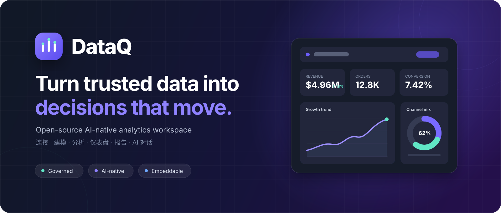
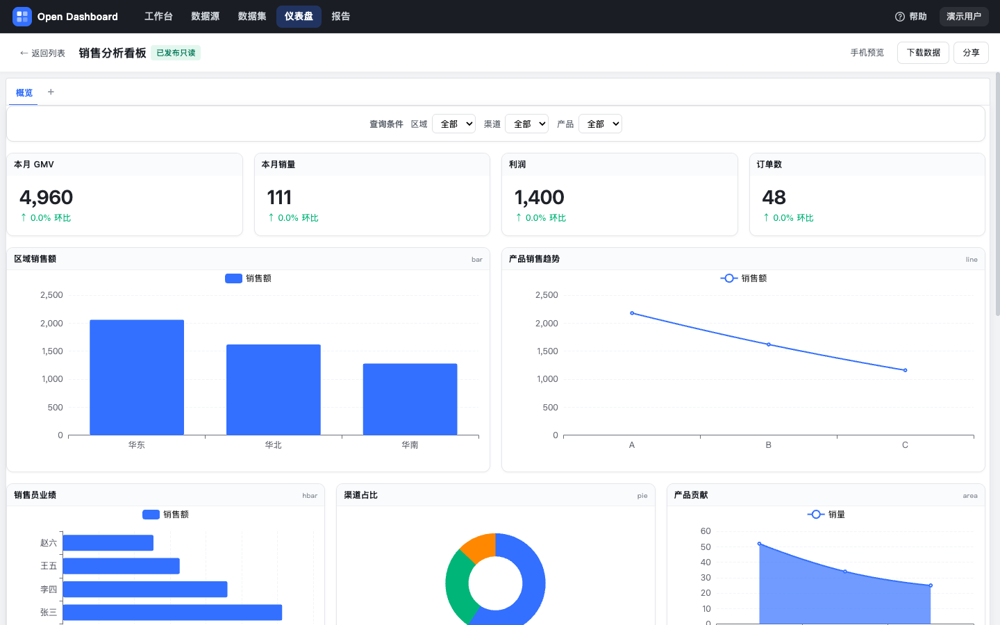
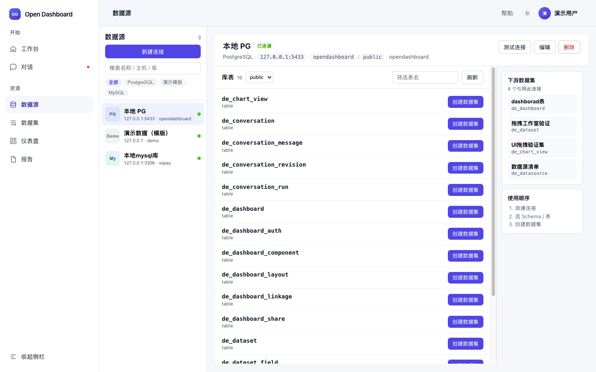
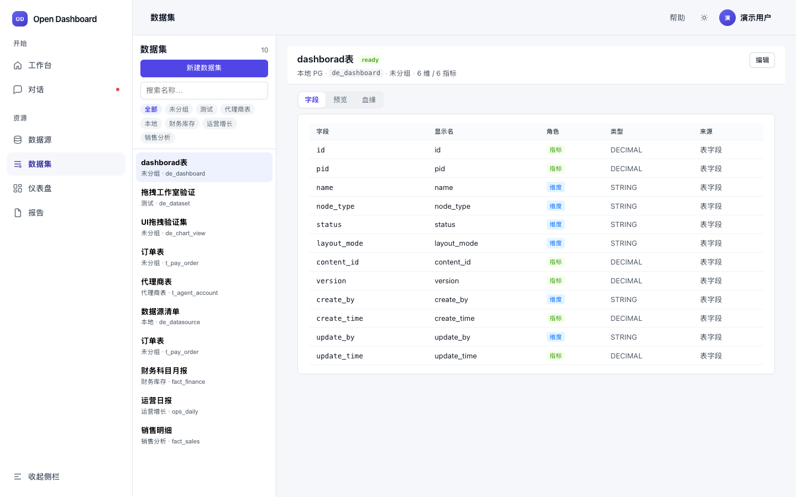
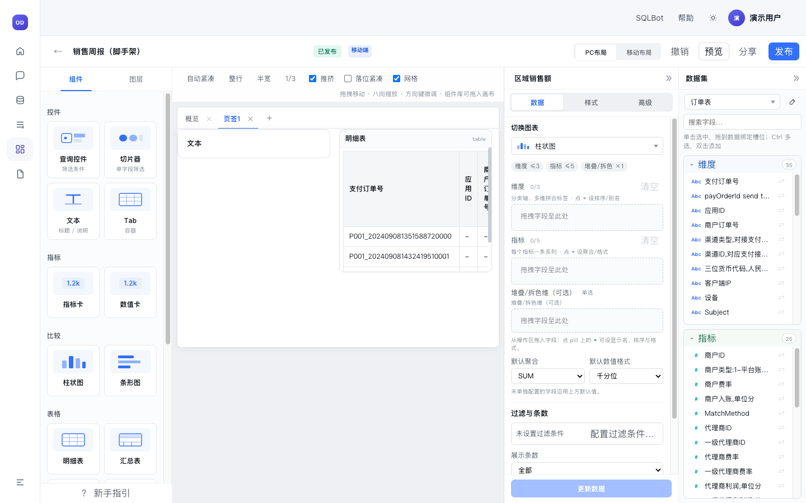
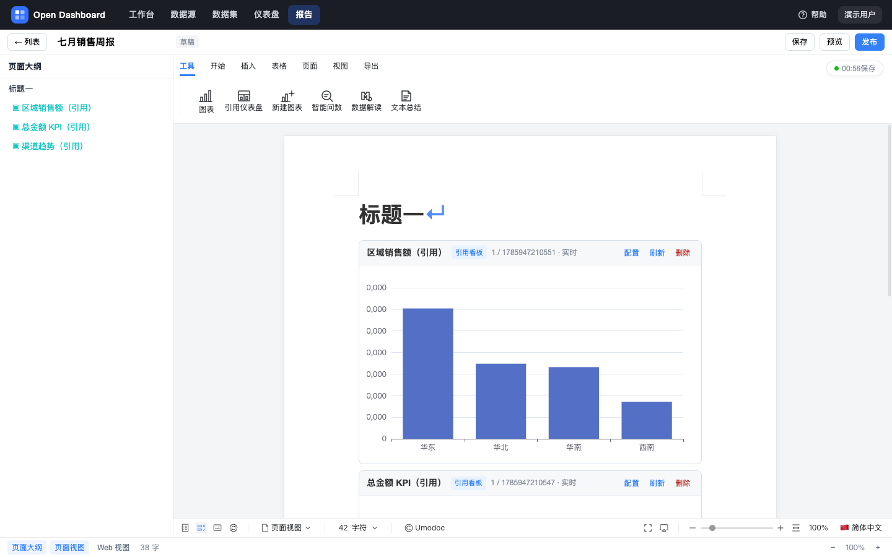
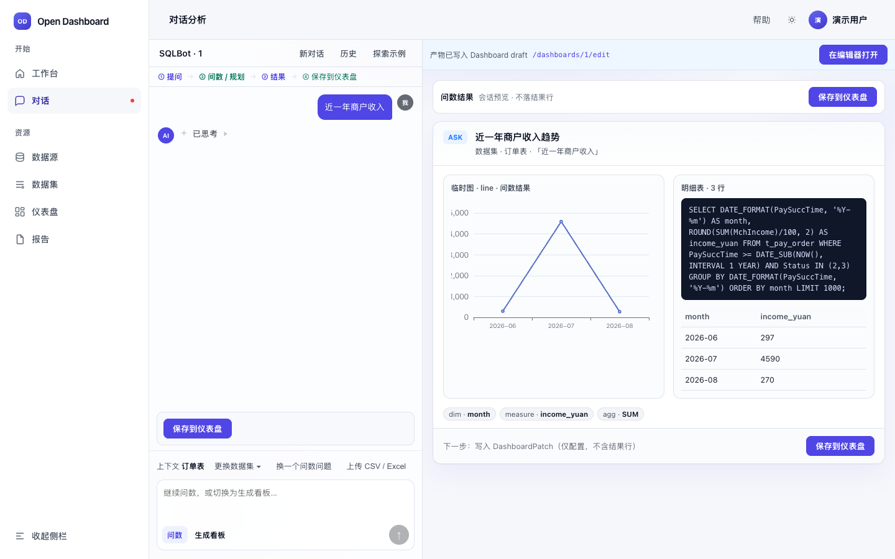
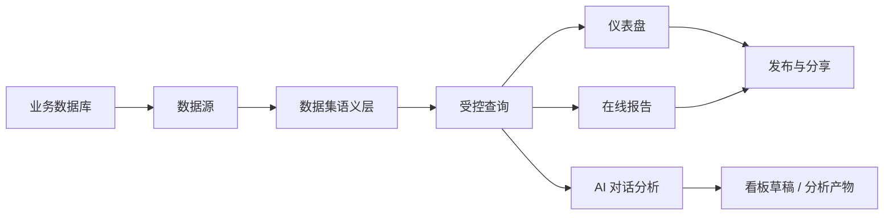

<p align="center">
  
</p>

<h1 align="center">DataQ</h1>

<p align="center">
  <strong>开源、可嵌入的 AI 原生数据分析工作台</strong>
</p>

<p align="center">
  让团队从可信数据出发，完成连接、建模、分析、可视化与决策交付。
</p>

<p align="center">
  <a href="#快速开始">快速开始</a>
  ·
  <a href="#产品全景">产品全景</a>
  ·
  <a href="./.teamai/docs/proposals/P018-workbuddy-open-capabilities/req/dataq-workbuddy-introduction.html">产品愿景</a>
  ·
  <a href="./open-dashboard-frontend/deploy.md">部署文档</a>
</p>

<p align="center">
  
  
  
  
  
</p>

---

## 不只是做一张图，而是完成一次可信的数据决策

DataQ 是一套面向分析师、业务团队与数据产品开发者的开源 BI 系统。它把分散的数据工作收拢到同一条受治理的链路：

> **连接真实数据 → 建立统一语义 → 完成分析探索 → 生产仪表盘与报告 → 发布给业务使用**

数据不绕开语义层，AI 不脱离事实链路，编辑中的草稿也不会被误当成正式发布结果。你可以把 DataQ 独立部署，也可以将它嵌入现有业务系统，作为企业自己的智能分析底座。



## 产品全景

| | DataQ 带来的能力 |
|---|---|
| **连接与建模** | 接入 MySQL / PostgreSQL，探查表结构与样例数据，用数据集统一维度、指标和计算字段 |
| **可视化分析** | 用拖拽式画布组合指标卡、图表、明细表、筛选器和文本，支持模板与多页面 |
| **多端交付** | PC 与移动端独立编排；草稿、预览、发布和分享各有明确边界 |
| **在线报告** | 在正文中引用实时看板图，或直接创建新图表，形成可持续更新的数据报告 |
| **对话分析** | 从自然语言问题得到查询、图表、明细和依据，并将确认后的结果沉淀为看板草稿 |
| **开放集成** | 身份可插拔、能力可嵌入，适合作为现有门户、业务系统或 AI 工作台的数据能力层 |

### 从数据库到统一语义

DataQ 先解决“数据从哪里来、口径是什么”，再进入图表和 AI。所有业务查询经过数据集，避免同一个指标在不同看板里各算一遍。

| 数据源连接与探库 | 数据集字段与语义 |
|:---:|:---:|
|  |  |

### 从分析画布到业务发布

分析师在画布中完成结构、数据和样式编排；业务用户看到的是稳定、清晰、可筛选的发布版本。编辑体验与消费体验彼此独立，又共享同一份可信数据。

| 专业分析画布 | 发布后的业务看板 |
|:---:|:---:|
|  |  |

### 从实时图表到叙事报告

图表不仅存在于 Dashboard。报告作者可以把 live 图与业务解读写在一起，形成适合周报、经营复盘和管理层汇报的在线内容。



## AI-native，而不是给传统 BI 套一层聊天框

DataQ 的 AI 能力复用数据集、查询、权限和资产生命周期。Agent 可以帮助理解问题、规划分析并生成草稿，但不能绕过治理链路直接制造“看起来合理”的答案。



- **结果有来源**：展示使用的数据集、查询逻辑、筛选范围与结果明细。
- **过程可修正**：先确认意图和规划，再执行查询或生成看板。
- **资产可继续经营**：对话结果可以保存为 Dashboard 草稿，回到专业编辑器继续调整。
- **失败必须诚实**：空结果、权限不足和查询失败不会被包装成虚构结论。

> 对话问数、对话出板和分析报告仍在持续完善，目前作为预览能力提供。传统 BI 主链已经可以独立使用。

## 一条事实链，服务多种交付



DataQ 坚持五个产品原则：

1. **数据集是统一取数入口**：图表和 Agent 都不能绕过语义层直连业务库。
2. **配置与查询分离**：画布描述“看什么、怎么展示”，查询服务负责“如何正确出数”。
3. **草稿与发布分离**：创作过程可以快速迭代，对外内容必须经过明确发布。
4. **身份可插拔，权限不缺席**：DataQ 可被集成，但每次读写都要保留用户与权限上下文。
5. **AI 结果可验证、可继续编辑**：AI 是分析协作者，不是不可追溯的答案生成器。

## 能力状态

| 稳定能力 | 预览与演进中 |
|---|---|
| MySQL / PostgreSQL 数据源 | 完整的对话问数体验 |
| 数据集、维度、指标与计算字段 | 可解释、可修改的对话式出板 |
| 仪表盘编辑、查询、发布与分享 | 对话分析报告与过程工作区 |
| PC / 移动端独立布局 | 工作区、资源 ACL 与知识治理增强 |
| 在线报告与实时图表 | WorkBuddy Connector / Skill |
| Docker 一键启动与示例数据 | 更多数据源和开放集成形态 |

想了解 DataQ 如何进入通用 AI 工作入口，以及我们对产品边界和开放路径的思考，可阅读：

### [DataQ × WorkBuddy：让可信数据能力进入 AI 工作入口 →](./.teamai/docs/proposals/P018-workbuddy-open-capabilities/req/dataq-workbuddy-introduction.html)

## 快速开始

使用 Docker 一次启动 PostgreSQL、DataQ API、Web 和示例数据：

```bash
git clone https://github.com/hugenshen/open-dashboard.git
cd open-dashboard
chmod +x scripts/*.sh
./scripts/up.sh
```

启动完成后访问：

- DataQ Web：http://127.0.0.1:8088
- DataQ API：http://127.0.0.1:8080/api

```bash
./scripts/smoke.sh    # 验证核心链路
./scripts/logs.sh     # 查看服务日志
./scripts/down.sh     # 停止服务并保留数据
```

端口和密码配置见 [`.env.example`](./.env.example)。生产部署与服务拆分请阅读 [前端部署](./open-dashboard-frontend/deploy.md) 和 [后端部署](./open-dashboard-backend/deploy.md)。

<details>
<summary><strong>本地开发</strong></summary>

本机 5432 端口被占用时，可使用 Homebrew PostgreSQL 5433，或通过 Docker 仅启动数据库 5434。

```bash
# 数据库
./scripts/setup-pg-local.sh          # 或 ./scripts/setup-pg-docker.sh

# 后端
cd open-dashboard-backend
mvn -pl open-dashboard-start -am spring-boot:run \
  -Dspring-boot.run.arguments='--spring.profiles.active=local --server.port=8082'

# 前端（代理 /api → 8082，可用 OD_API_PROXY 覆盖）
cd ../open-dashboard-frontend
npm install
npm run dev
# → http://127.0.0.1:5173
```

无数据库联调可以使用 `--spring.profiles.active=stub`。该模式只提供 API stub，不执行真实 JDBC 查询。

</details>

<details>
<summary><strong>启动对话 Agent</strong></summary>

对话问数、生成看板与分析报告由 [opendashboard-dsh-harness](./opendashboard-dsh-harness/README.md) 提供，需要单独启动 dsh 运行时并与 DataQ 后端联调。

```bash
cd opendashboard-dsh-harness
pnpm install
pnpm approve-builds --all
./start.sh
```

</details>

## 技术架构

| 层 | 技术选型 |
|---|---|
| Web | Vue 3 · Vite · TypeScript · Pinia · Vue Router · ECharts |
| API | JDK 21 · Spring Boot 3 · Spring JDBC · Flyway |
| Architecture | COLA 多模块架构 |
| Storage | PostgreSQL 16 |
| Agent Runtime | [@deepseek-ai/dsh](https://www.npmjs.com/package/@deepseek-ai/dsh) + DataQ plugins |

```text
open-dashboard/
├── open-dashboard-frontend/      # DataQ Web
├── open-dashboard-backend/       # DataQ API / COLA 多模块
├── opendashboard-dsh-harness/    # DataQ 对话 Agent 运行时
├── scripts/                      # 启停、冒烟与数据库初始化
└── .env.example
```

---

<p align="center">
  <strong>DataQ</strong> · Make data trustworthy, analysis accessible, and decisions actionable.
</p>
