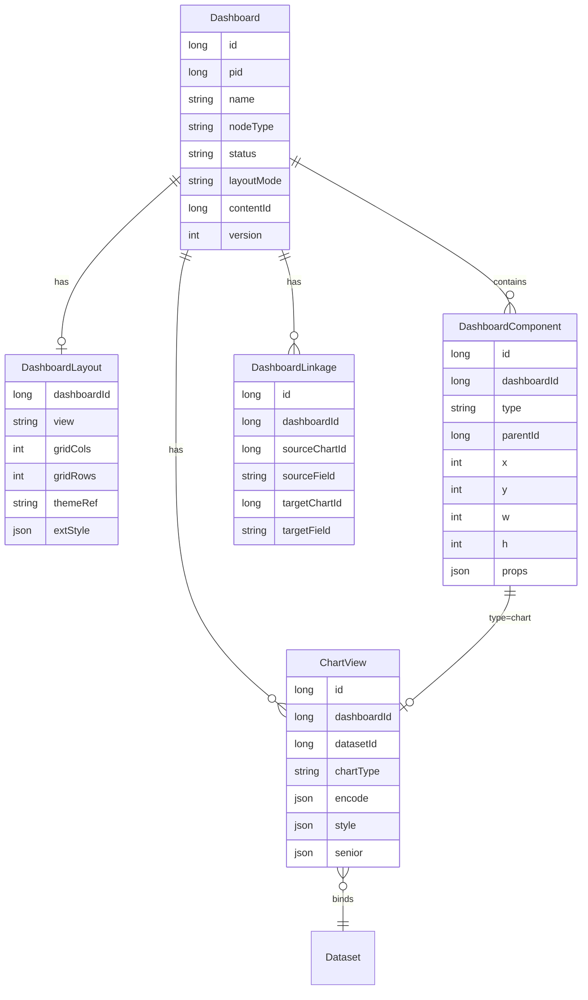
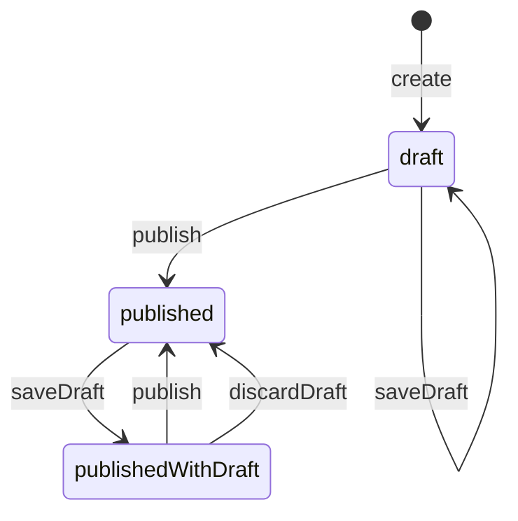

# 仪表盘领域模型

## 实体关系



## 发布状态机

对外只暴露三种状态（实现可用双副本表，但不暴露 `resourceTable`）：

| 状态 | 含义 |
|------|------|
| `draft` | 从未发布；观看不可见或仅编辑者可见 |
| `published` | 草稿与已发布一致（或无未发布改动） |
| `publishedWithDraft` | 已发布过，当前草稿有未发布改动 |



### 副本策略（实现建议）

- **draft 副本**：编辑读写默认目标。
- **published 副本**：观看 / 分享只读目标。
- `publish`：draft 全量覆盖 published，status → `published`。
- `discardDraft`：published 覆盖 draft，status → `published`。
- `save*` 在 status=`published` 时 → `publishedWithDraft`。

## 组件类型（一期）

| type | 说明 |
|------|------|
| `chart` | 绑定 ChartView |
| `filter` | 筛选器；写入统一 filterState |
| `text` | 静态文本 |
| `image` | 静态图片 |
| `tabs` | 容器（二期可深化） |

## 查询上下文

```json
{
  "dashboardId": "1",
  "filters": [
    { "componentId": "f1", "field": "region", "operator": "eq", "value": "华东" }
  ],
  "linkages": [
    { "sourceChartId": "c1", "sourceField": "product", "value": "A", "targetChartId": "c2", "targetField": "product_name" }
  ]
}
```

`chartQuery`（应用层）将 filters + linkages 合并为 Dataset 层过滤条件，再执行聚合。
