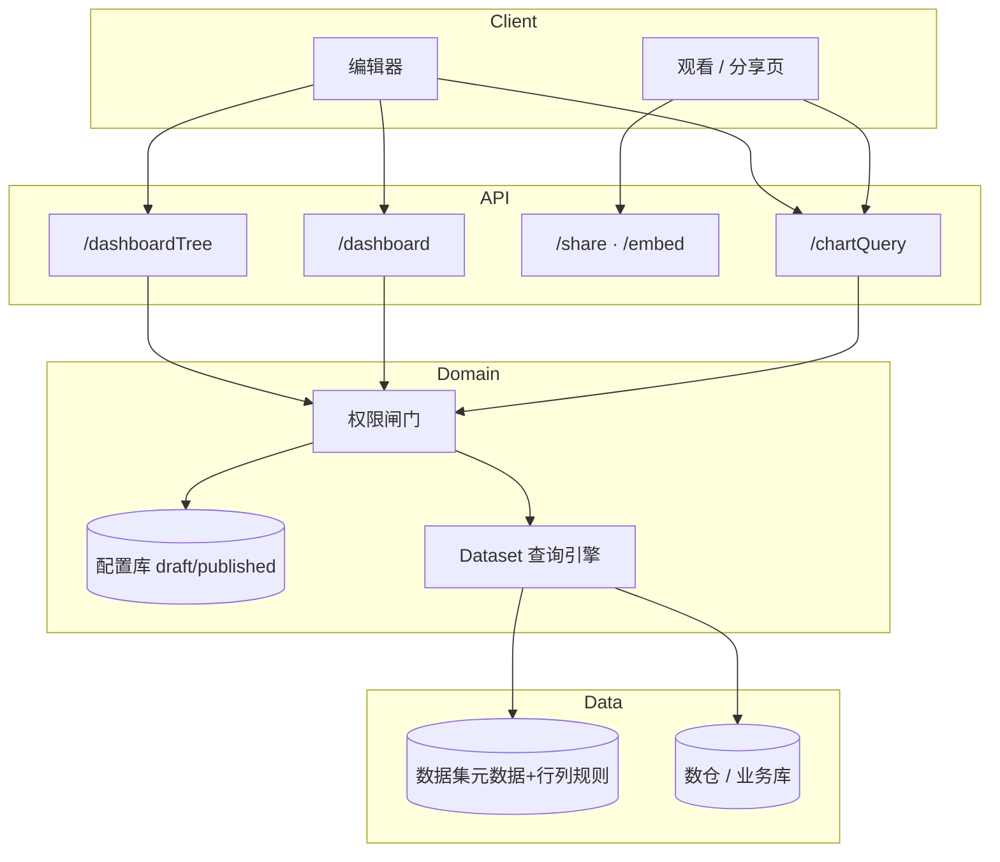

# 后端架构：配置、取数与权限

> 对齐商用高保原型（`frontend/hi-fi/dashboard-commercial.html`）与飞书 / Quick BI 常见治理模型。  
> 相关：[`data-query-architecture.md`](./data-query-architecture.md)（数据源/数据集/取数全链路）· [`domain.md`](./domain.md) · [`schema.sql`](./schema.sql) · [`dashboard-api.md`](./dashboard-api.md) · [`openapi.yaml`](./openapi.yaml)

## 1. 分层原则

| 层 | 职责 | 禁止 |
|----|------|------|
| **配置层** | 仪表盘树、布局、组件、图表 encode/style、联动、分享策略 | 直接查业务库 |
| **查询层** | `chartQuery`：按图类型拼 Dataset 查询计划并执行 | 信任前端传来的「可见字段」 |
| **数据集层** | 字段元数据、连接、SQL/引擎执行 | 关心柱状/透视 UI |
| **权限层** | 仪表盘 ACL、分享 Token、数据集 ACL、行列权限（RLS/CLS） | 只在前端藏字段 |



---

## 2. 配置如何存储

### 2.1 核心表（见 `schema.sql`）

| 表 | 对应前端 | 说明 |
|----|----------|------|
| `de_dashboard` | 列表树节点 | status / content_id / version |
| `de_dashboard_layout` | 主题、网格 | `copy_type` = draft \| published |
| `de_dashboard_component` | 画布组件框 | x,y,w,h、type、chart_view_id、props |
| `de_chart_view` | 单图配置 | dataset_id、chart_type、encode/style/senior JSON |
| `de_dashboard_linkage` | 图间联动 | source/target chart + field |

**双副本**：编辑只写 `draft`；观看/分享只读 `published`；`publish` 用 draft 覆盖 published。

### 2.2 权限与分享表（扩展）

```sql
-- 仪表盘授权：用户 / 角色 / 部门
CREATE TABLE IF NOT EXISTS de_dashboard_auth (
    id              BIGINT       NOT NULL PRIMARY KEY,
    dashboard_id    BIGINT       NOT NULL,
    subject_type    VARCHAR(16)  NOT NULL COMMENT 'user | role | dept',
    subject_id      VARCHAR(64)  NOT NULL,
    perm            VARCHAR(16)  NOT NULL COMMENT 'manage | edit | view',
    create_by       VARCHAR(64)  NULL,
    create_time     BIGINT       NULL,
    UNIQUE KEY uk_dash_subject (dashboard_id, subject_type, subject_id),
    INDEX idx_auth_subject (subject_type, subject_id)
) COMMENT='仪表盘访问控制';

-- 分享 / 嵌入 Token
CREATE TABLE IF NOT EXISTS de_dashboard_share (
    id              BIGINT       NOT NULL PRIMARY KEY,
    dashboard_id    BIGINT       NOT NULL,
    token           VARCHAR(64)  NOT NULL,
    visibility      VARCHAR(16)  NOT NULL DEFAULT 'org' COMMENT 'public | org | password',
    perm            VARCHAR(16)  NOT NULL DEFAULT 'view' COMMENT 'view | edit',
    password_hash   VARCHAR(128) NULL,
    expire_at       BIGINT       NULL,
    enabled         TINYINT      NOT NULL DEFAULT 1,
    create_by       VARCHAR(64)  NULL,
    create_time     BIGINT       NULL,
    UNIQUE KEY uk_share_token (token),
    INDEX idx_share_dashboard (dashboard_id)
) COMMENT='分享与嵌入链接';
```

数据集的**行权限 / 列权限**表应在数据集模块维护（本项目复用，不重复造轮子）。查询时由 Dataset 引擎注入。

### 2.3 JSON 字段约定（对齐高保原型）

**encode_json**

```json
{
  "category": "region",
  "colDim": "product",
  "value": "amount",
  "color": null,
  "agg": "SUM",
  "format": "thousand",
  "calc": "yoy",
  "fieldRoles": { "amount": "dim" }
}
```

| 图类型 | 必要 encode |
|--------|-------------|
| bar / line / area / pie / hbar | category + value |
| kpi | value |
| table（明细） | 可选；列以数据集可见字段为准 |
| grouptable | category + value |
| pivot | category + colDim + value |

**style_json**：背景、标题、图例、分页、合计行/列、KPI 字号色等。  
**senior_json**：下钻路径、告警阈值、跳转、监控。  
**fieldRoles**：分析层维度⇄指标转换（永洪式），覆盖字段物理类型。

---

## 3. 接口与前端交互映射

### 3.1 配置 API

| 前端动作 | API |
|----------|-----|
| 打开编辑器 | `GET /dashboard/{id}?view=draft` |
| 拖拽/缩放落位 | `PUT /dashboard/{id}/components`（可 debounce） |
| 改维度/指标/样式 | `PUT /dashboard/{id}/charts/{chartId}` |
| 主题 | `PUT /dashboard/{id}/layout` |
| 联动 | `PUT /dashboard/{id}/linkages` |
| 发布 | `POST /dashboard/{id}/publish` |
| 分享 | `POST /dashboard/{id}/share` |

乐观锁：写请求带 `contentId`，冲突返回 409。

### 3.2 取数 API（每图独立，避免整板刷新）

```http
POST /chartQuery/query
```

```json
{
  "dashboardId": "1",
  "chartId": "c_bar",
  "view": "draft",
  "context": {
    "filters": [
      { "componentId": "f1", "field": "region", "operator": "eq", "value": "华东" }
    ],
    "linkages": [
      {
        "sourceChartId": "c_bar",
        "sourceField": "region",
        "value": "华东",
        "targetChartId": "c_pivot",
        "targetField": "region"
      }
    ]
  }
}
```

- 编辑预览：`view=draft`  
- 观看 / 分享：`view=published`  
- 未保存试算：可传 `inline: { datasetId, chartType, encode }`  
- 透视：服务端 `GROUP BY category, colDim`  
- 明细：可见列 + LIMIT/分页  
- 字段银行：`GET /dataset/{id}/fields`（服务端已按列权限过滤）

完整契约见 [`dashboard-api.md`](./dashboard-api.md)。

---

## 4. 查询权限流水线（必须服务端强制）

```text
ChartQueryManage.query(req, user | shareToken):
  1. dash = load(dashboardId, view)
  2. assertDashboardAccess(user/token, dash, need=view|edit)
  3. chart = loadChart(chartId, view)   // 或 inline
  4. assertDatasetUse(user, chart.datasetId)
  5. cols = visibleColumns(user, datasetId)          // CLS
  6. assert encode 用到的字段 ⊆ cols
  7. rowRules = rowPermissions(user, datasetId)      // RLS
  8. filter = AND(rowRules, boardFilters, linkages, drill)
  9. plan = buildByChartType(chart, filter, cols)
 10. return DatasetQuery.execute(datasetId, plan)
```

### 4.1 合并顺序

```
最终过滤 = RLS ∧ 看板筛选 ∧ 联动 ∧ 下钻
```

用户不能通过看板筛选器绕过行权限。

### 4.2 列权限

| 场景 | 行为 |
|------|------|
| 字段银行 | 只返回可见字段 |
| encode 含不可见字段 | 400 / 业务错误码 |
| 明细表 | SELECT 收成可见列，禁止 `*` 裸奔 |
| 导出 CSV | 再检一次 CLS |

### 4.3 仪表盘访问档位

| 场景 | 入口 | 鉴权 |
|------|------|------|
| 组织协作 | 工作台打开 | `de_dashboard_auth`：manage / edit / view |
| 对外分享 | `/share/{token}` | token + 可选密码/过期；只读 published |
| 嵌入 | `/embed/{token}` | 同上；可加域名白名单 |

**看看板 ≠ 看全表行**：有 dashboard `view` 仍须过数据集行列权限（除非产品明文「分享旁路」，默认不建议）。

资源鉴权名统一：`DASHBOARD`（与已重构 Dataset 风格一致）。

---

## 5. 发布与副本

对外只暴露：`draft` | `published` | `publishedWithDraft`。

| 操作 | 行为 |
|------|------|
| save* | 写 draft；若原 published → publishedWithDraft |
| publish | draft 覆盖 published → published |
| discardDraft | published 覆盖 draft → published |
| 分享观看 | 强制 published 副本 |

详见 [`domain.md`](./domain.md)。

---

## 6. 服务分层（代码落点）

```
api/*Api          ← OpenAPI / 契约
server/*Server    ← 薄 Controller（鉴权注解）
manage/*
  DashboardTreeManage
  DashboardCanvasManage
  DashboardPublishManage
  DashboardShareManage
  ChartQueryManage      ← 合并 filter + 调 Dataset
  ChartExplainManage    ← 查看 SQL
dao / store
```

参考实现（TypeScript 垂直切片）：`backend/manage/*`、`backend/demo/*`。  
Java 契约标记：`backend/java/io/product/dashboard/api/*`。

反例：巨型 `DataVisualizationServer` + 整页 `component_data` blob。

---

## 7. 落地顺序建议

1. 建表：`schema.sql` + 上文 auth/share 表  
2. Tree / Canvas / Publish CRUD + 双副本  
3. `chartQuery` 接入现有 Dataset 引擎（先 bar/kpi/table，再 pivot）  
4. 查询链路挂行列权限（复用数据集模块）  
5. 分享 Token + published 只读页  
6. 字段银行改为服务端过滤后的 fields API  
7. 导出、告警、跳转按 Phase B/C 增量

---

## 8. 安全清单

- [ ] 所有取数走服务端，前端 encode 仅作意图  
- [ ] RLS/CLS 在 Dataset 执行前注入  
- [ ] 分享默认 published，且仍校验数据集权限  
- [ ] Token 可吊销、可过期、可密码  
- [ ] contentId 乐观锁防覆盖  
- [ ] 审计：谁发布、谁分享、谁导出（建议二期）
