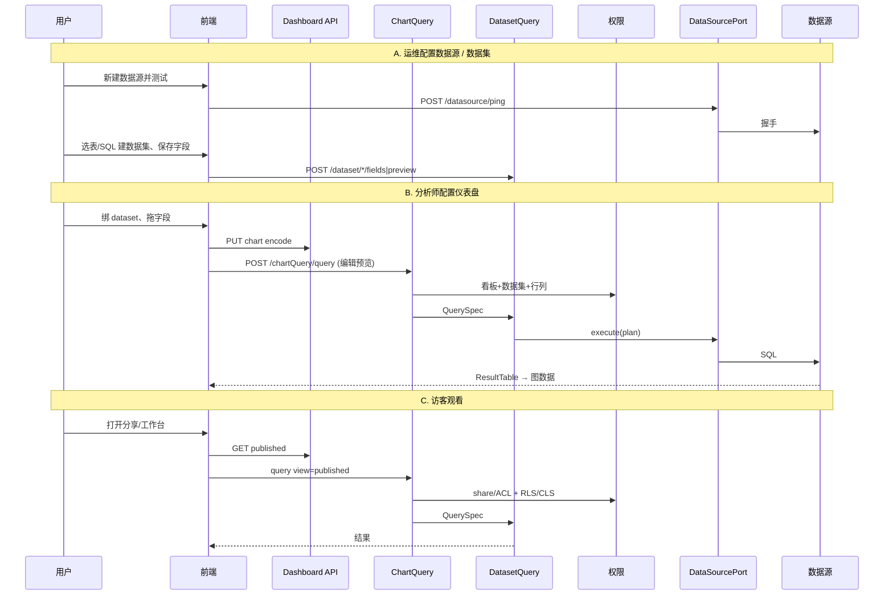

# 数据源取数架构（自研）

> 参考 DataEase `POST /chartData/getData` 的能力边界，**不照搬**其 `ChartViewDTO` 上帝对象与「配置+查询+结果」混传模型。  
> 关联：[backend-architecture.md](./backend-architecture.md) · [dashboard-api.md](./dashboard-api.md) · [schema.sql](./schema.sql)

本文梳理完整链路：

**数据源类型 → 维护数据集 → 仪表盘配置与取数 → 用户访问**

---

## 0. 和 DataEase getData 的关系（差异）

> 更完整的理念 / 接口 / 后端流水线对照见 HTML：[`chart-getdata-comparison.html`](./chart-getdata-comparison.html)

| DataEase（参考） | 本方案（自研） |
|------------------|----------------|
| `POST /chartData/getData`，body≈整份 `ChartViewDTO` | `POST /datasetQuery/execute` + `POST /chartQuery/query` **两层** |
| 配置、运行时筛选、结果写回同一 DTO | **QuerySpec / QueryResult** 与图表配置分离 |
| 图表 Handler 内再拼 SQL、再出图 | Dataset 只出 **标准结果表**；Chart 层只做编码/塑形 |
| Provider 特例多（Calcite/ES/Excel/API 分叉） | 统一 `DataSourcePort`：`ping` / `listSchemas` / `listTables` / `listColumns` / `execute` |
| 行列权限在 calcData 中段字符串注入 | **FilterAST** 一等公民，权限规则先合并再编译 |

原则：**仪表盘不直连数据源**；只认 Dataset。数据源能力收敛在连接器层。

---

## 1. 全链路总览



分层职责：

| 模块 | 一句话 |
|------|--------|
| **Datasource** | 连得上、能探元数据、能执行受控 SQL |
| **Dataset** | 业务语义表：字段类型、维度/指标、预览、统一查询入口 |
| **ChartQuery** | 读图表配置 + 看板上下文 → 编译成 Dataset QuerySpec |
| **Dashboard Auth** | 谁能看/编这块看板；分享 Token |
| **Dataset Auth** | 谁能用该数据集；行/列规则 |

---

## 2. 数据源：支持类型与连接器

### 2.1 一期建议支持的类型

| 类别 | 类型 | 说明 |
|------|------|------|
| 关系库 | `mysql`, `postgresql`, `sqlserver`, `oracle` | JDBC + 方言 |
| 分析库 | `clickhouse`, `doris`, `starrocks` | JDBC；注意分页/限流 |
| 文件 | `excel`, `csv` | 导入后进**引擎库**（内嵌或托管表）再查 |
| API | `http_api` | 同步/缓存为引擎表，或只做枚举/小结果直查（一期建议同步） |
| 内置 | `duckdb` / `h2`（引擎） | Excel/API 落地与跨源联合查询 |

二期：`elasticsearch`、跨源联合（Calcite/DuckDB）、插件连接器 SPI。

### 2.2 连接器接口（自研，非 Provider 照搬）

```ts
interface DataSourcePort {
  ping(cfg: DatasourceConfig): Promise<{ ok: boolean; message?: string; latencyMs?: number }>
  listSchemas(cfg): Promise<string[]>
  listTables(cfg, schema?: string): Promise<TableMeta[]>
  listColumns(cfg, tableRef): Promise<ColumnMeta[]>
  /** 仅允许由 DatasetQuery 编译出的计划执行，禁止前端任意 SQL 直打生产 */
  execute(cfg, plan: PhysicalPlan): Promise<ResultTable>
}
```

**PhysicalPlan**（引擎内部）：

```ts
{
  dialect: 'mysql' | 'pg' | ...
  sql: string              // 参数化后的语句
  params: unknown[]
  timeoutMs: number
  maxRows: number          // 硬顶，防拖库
}
```

**ResultTable**（全系统统一出数形状）：

```ts
{
  columns: Array<{ name: string; dataType: 'string'|'number'|'time'|'bool'; originType?: string }>
  rows: unknown[][]        // 行列二维表，不用 Map 地狱
  truncated: boolean
  stats?: { rowCount: number; elapsedMs: number }
}
```

### 2.3 数据源 API（配置期）

| Method | Path | 用途 |
|--------|------|------|
| POST | `/datasource/ping` | 测试连通（对应 DE validate，但只返回健康信息） |
| POST | `/datasource` | 创建（configuration **加密存储**） |
| PUT | `/datasource/{id}` | 更新 |
| GET | `/datasource/{id}/schemas` | 探 schema |
| GET | `/datasource/{id}/tables` | 探表 |
| GET | `/datasource/{id}/tables/{table}/columns` | 探字段 |
| POST | `/datasource/{id}/preview` | 表级预览（限行，需 manage） |

鉴权资源名：`DATASOURCE`（manage / use）。

> 图表运行时**禁止**调用 `/datasource/*/preview` 旁路；必须走 Dataset。

---

## 3. 数据集：维护与统一查询入口

### 3.1 数据集是什么

对分析师暴露的**逻辑表**：

- 绑定一个（一期）数据源上的表 / 自定义 SQL / 文件表  
- 维护字段：`name`、显示名、`physicalType`、`semanticType`（dim/quota）、聚合默认值  
- 可选：计算字段、基础过滤（始终 AND）

二期再做多表 join / union 模型（可参考 DE union，但独立 AST）。

### 3.2 数据集 API

| Method | Path | 用途 |
|--------|------|------|
| CRUD 树 | `/datasetTree/*` | 目录与数据集节点（对齐你们已重构风格） |
| GET | `/dataset/{id}` | 详情（含字段列表，**已按列权限过滤**） |
| PUT | `/dataset/{id}/fields` | 保存字段语义、计算字段 |
| POST | `/dataset/{id}/preview` | 编辑器预览（带可选 filters） |
| GET | `/dataset/{id}/fieldValues` | 枚举值（切片器/筛选器用） |
| **POST** | **`/datasetQuery/execute`** | **核心取数（所有出数的唯一底层入口）** |

### 3.3 核心：`POST /datasetQuery/execute`

这是自研的「瘦 getData」——**只描述要什么数据，不描述柱状图长什么样**。

**Request: `DatasetQueryRequest`**

```ts
{
  datasetId: string
  /** 需要的列（物理/逻辑字段名）；明细用；聚合时与 dims/measures 二选一体系 */
  columns?: string[]

  /** 维度（GROUP BY） */
  dimensions?: Array<{ field: string; alias?: string }>

  /** 指标 */
  measures?: Array<{
    field: string
    agg: 'SUM' | 'COUNT' | 'CNT_DISTINCT' | 'AVG' | 'MAX' | 'MIN' | 'RAW'
    alias?: string
  }>

  /** 过滤 AST（看板筛选、联动、下钻、行权限最终都归并到此） */
  filters?: FilterNode

  orderBy?: Array<{ field: string; direction: 'asc' | 'desc' }>
  limit?: number
  offset?: number

  /** 透视：额外列维度 → 引擎可展开或返回长表由上层 pivot */
  pivot?: { columnField: string }

  options?: {
    includeSql?: boolean      // 仅 manage / 调试
    timeoutMs?: number
  }
}
```

**FilterNode（AST，非字符串拼接）：**

```ts
type FilterNode =
  | { op: 'and' | 'or'; children: FilterNode[] }
  | {
      op: 'eq' | 'ne' | 'in' | 'notIn' | 'gt' | 'gte' | 'lt' | 'lte'
         | 'like' | 'between' | 'isNull' | 'isNotNull'
      field: string
      value?: unknown
    }
```

**Response: `DatasetQueryResult`**

```ts
{
  columns: Array<{ name: string; dataType: string; field?: string; agg?: string }>
  rows: unknown[][]
  truncated: boolean
  sql?: string            // 可选，权限控制
  elapsedMs: number
}
```

### 3.4 DatasetQuery 内部流水线

```text
DatasetQueryManage.execute(req, user):
  1. assertDatasetPermission(user, datasetId, USE)
  2. meta = loadDataset(datasetId) + datasource config
  3. cols = applyColumnPermission(user, meta.fields)     // CLS：裁剪/脱敏标记
  4. validate req.dimensions/measures/columns ⊆ cols
  5. rls = loadRowPermissionTree(user, datasetId)       // RLS → FilterNode
  6. filters = and(rls, dataset.baseFilter, req.filters)
  7. logical = buildLogicalPlan(meta, req, filters)      // 与方言无关
  8. physical = dialect.compile(logical, dsType)         // PhysicalPlan
  9. table = DataSourcePort.execute(cfg, physical)
 10. table = applyDesensitization(table, cols)           // 若有脱敏
 11. return DatasetQueryResult
```

---

## 4. 仪表盘：配置如何变成取数

### 4.1 配置侧（已有）

图表只存 **意图**：

```json
{
  "datasetId": "ds_1",
  "chartType": "pivot",
  "encode": {
    "category": "region",
    "colDim": "product",
    "value": "amount",
    "agg": "SUM",
    "fieldRoles": {}
  },
  "style": {},
  "senior": {}
}
```

不把查询结果、SQL、权限中间态写回配置表。

### 4.2 运行侧：`POST /chartQuery/query`

**ChartQuery = 编译器 + 薄塑形**，内部只调用 `datasetQuery.execute`。

```text
ChartQueryManage.query(req, user|token):
  dash = loadDashboard(req.dashboardId, req.view)   // draft|published
  assertDashboardAccess(...)
  chart = loadChart(req.chartId) | req.inline
  assertDatasetUse(user, chart.datasetId)

  ctxFilters = compileBoardContext(req.context)
       // filters + linkages(for this chart) + drill → FilterNode

  spec = encodeToQuerySpec(chart.chartType, chart.encode, ctxFilters)
  raw = DatasetQueryManage.execute(spec, user)

  return shapeForChart(chart.chartType, chart.encode, raw)
       // bar/line → categories+series
       // pivot → matrix
       // table → columns+rows
       // kpi → single value (+ optional compare stub)
```

**`encodeToQuerySpec` 示例**

| chartType | QuerySpec |
|-----------|-----------|
| bar/line/area/pie/hbar | dims=[category], measures=[{value, agg}] |
| kpi | measures=[{value, agg}], limit=1 |
| grouptable | dims=[category], measures=[…] |
| pivot | dims=[category, colDim], measures=[…]（或 pivot.columnField） |
| table | columns=可见字段（或 encode 指定列），无聚合 |

### 4.3 看板上下文如何进 FilterAST

```ts
context: {
  filters: [{ field, operator, value, componentId? }],
  linkages: [{ targetChartId, targetField, value, ... }],
  drill?: [{ field, value }]
}
```

编译规则：

1. 只应用 **命中当前 chartId** 的 linkage  
2. operator → FilterNode.op 映射表（禁止前端传原始 SQL）  
3. 与 RLS `and` 合并（见 §3.4）

### 4.4 响应：`ChartQueryResult`（给前端绑 ECharts）

```ts
{
  chartId: string
  chartType: string
  /** 标准表（调试/表格/导出共用） */
  table: { columns: [...], rows: unknown[][] }
  /** 可选：已按类型塑形，减少前端分支 */
  view?: {
    categories?: string[]
    series?: Array<{ name: string; data: number[] }>
    kpi?: { value: number; compare?: number }
    pivot?: { rowKeys: string[]; colKeys: string[]; matrix: number[][]; rowTotals?; colTotals? }
  }
  meta?: { truncated: boolean; elapsedMs: number; sql?: string }
}
```

前端编辑器：**改 encode → 只打当前图的 chartQuery**（你们 hi-fi 已按此交互），不要整板 getData。

---

## 5. 用户访问全路径

### 5.1 角色与入口

| 角色 | 入口 | view | 调用 |
|------|------|------|------|
| 管理员 | 数据源/数据集后台 | — | datasource* / dataset* |
| 分析师 | 仪表盘编辑器 | `draft` | canvas save + chartQuery |
| 组织内访客 | 工作台打开看板 | `published` | GET dashboard + chartQuery |
| 外部分享 | `/share/{token}` | `published` | token 换身份 + chartQuery |
| 嵌入 | `/embed/{token}` | `published` | 同上，可加域名白名单 |

### 5.2 每次取数的鉴权顺序（不可颠倒）

```text
1. 身份：登录用户 | 分享 Token（映射为只读主体）
2. 仪表盘：manage|edit|view（或 share.perm）
3. 副本：draft 仅编辑者；分享强制 published
4. 数据集：USE/READ
5. 列权限：裁剪字段银行 + 校验 encode
6. 行权限：并入 FilterAST
7. 执行 + 限流（timeout / maxRows / QPS）
8. 脱敏后返回
```

### 5.3 「别人访问」与数据安全

- 有看板 `view` **不能**绕过数据集 RLS/CLS  
- 分享默认仍走数据集权限；若产品要「链接可看全量」，需**显式旁路开关 + 审计**，默认关闭  
- 导出 CSV：复用同一 `chartQuery` / `datasetQuery` 结果路径，再检 CLS  

---

## 6. 模块与 API 清单（汇总）

```text
/datasource/*
  ping | CRUD | schemas | tables | columns | preview

/datasetTree/*  /dataset/*
  CRUD | fields | preview | fieldValues

/datasetQuery/execute          ← 唯一底层取数
/datasetQuery/explain          ← 可选：返回 SQL（manage）

/dashboardTree/*  /dashboard/*
  画布配置、发布、分享（见 dashboard-api.md）

/chartQuery/query              ← 看板运行时（编译 encode → datasetQuery）
/chartQuery/explainSql         ← 可选
```

推荐包结构：

```text
datasource/
  api / manage / connector(mysql|pg|...|excel)
dataset/
  api / manage / query(DatasetQueryManage) / permission
dashboard/
  api / manage(canvas|publish|share)
chart/
  api / manage(ChartQueryManage = compile + shape)
```

---

## 7. 落地里程碑

| 阶段 | 交付 |
|------|------|
| M1 | Datasource：mysql/pg + ping/探表；加密配置 |
| M2 | Dataset：单表/SQL；fields；`datasetQuery.execute`（明细+聚合） |
| M3 | 行列权限挂 FilterAST；字段银行走服务端 fields |
| M4 | ChartQuery：bar/kpi/table；看板 filters |
| M5 | pivot/grouptable；linkage；publish/share 观看链路 |
| M6 | Excel/API→引擎；explainSql；导出 |

---

## 8. 反例清单（不要做成 DataEase 那样）

1. 不要让「图表配置 DTO」同时当查询请求和响应。  
2. 不要在图表 Handler 里直接拼最终 SQL 再查库——**一律 DatasetQuery**。  
3. 不要前端传原始 SQL / 任意 datasourceId 跑数。  
4. 不要用 `Map<fieldName, value>` 作为主结果协议，用 **columns + rows[][]**。  
5. 不要把行权限做成「查完再 filter」——必须进查询计划。  
6. 不要图表层实现第二套连接器。

---

## 9. 与高保原型的对应

| 原型行为 | 后端调用 |
|----------|----------|
| 字段银行 | `GET /dataset/{id}`（CLS 后字段） |
| 维度⇄指标 | 存 `encode.fieldRoles`；查询按角色编译 dim/measure |
| 改槽位刷新单图 | `POST /chartQuery/query`（仅该 chartId） |
| 切片器/查询控件 | context.filters → FilterAST |
| 点击联动 | context.linkages → 目标图再次 query |
| 透视表 | encode → dimensions[2]+measure → view.pivot |
| 分享预览 | token + `view=published` + 同上 query |

此文档是 Open Dashboard **数据面**的设计基线；实现时可先用内存/DuckDB 打通 M2–M4，再换真实 JDBC 连接器。
