# AI 能力架构（对照三开源 · 问数优先）

> 产品契约入口：`docs/design/`。  
> 对照仓（不入本仓 git）：`/Users/shen/backdashboard/refs/`（DataEase / DeerFlow / JoyAgent `data_agent`）。  
> 关联：[conversation.md](./conversation.md) · [dashboard-generation.md](./dashboard-generation.md) · [ai-harness.md](./ai-harness.md) · 提案 [P004](../proposals/P004-conversation.md) · [P006](../proposals/P006-ask-data.md)

## 结论（先回答「问数要不要先做」）

**要。对话默认能力是问数；仪表盘是问数结果的显式落地，不是问数的前置条件。**

| 问题 | 结论 |
|------|------|
| 是否必须先有问数，才有仪表盘生成？ | **产品顺序：问数优先。** 用户先得到可复核的答案（表/临时图），再选择「保存到仪表盘」或「直接生成仪表盘」。 |
| 是否等于不能直出看板？ | **否。** 「直接生成仪表盘」仍是一等意图（快捷路径），内部可复用问数规划出的 encode / 字段证据，而不是跳过 Schema。 |
| 工程上谁先落地？ | **共享底座（Schema Guard + datasetQuery/chartQuery + SSE Harness）→ 问数 ephemeral 结果 → 采纳为 Patch → 整页生成。** 已有的 Patch 闭环可与问数并行补齐，但高保/产品叙述以问数为默认。 |

理由（对照三仓）：

1. **JoyAgent DataAgent**：会话主路径是 NL2SQL → 结果 + 内联图；报告/诊断是后续产物。OD 应对齐「先答再落配置」。  
2. **DataEase SQLBot**：问数是**嵌入旁路**，吃 DS/Dataset 元数据，**不**直接写 DV 画布。社区仓只有加载器（`assistant.vue` → 远端 `assistant.js`）；实现在独立仓 [dataease/SQLBot](https://github.com/dataease/SQLBot)（本地 `refs/sqlbot`，不入本仓 git）。OD **不** iframe 整套 SQLBot（用户/工作空间/RAG/任意 SQL），把编辑器浮层壳迁过来，接到现有 `intent=ask` harness。  
3. **DeerFlow**：提供 Lead + 中间件 + SSE run + Plan/澄清；不提供 BI 真相。OD 只抄 Harness，不抄沙箱产物当看板。

**硬边界不变：** 看板真相是 Dashboard draft 配置；会话内结果行可展示，**禁止**把结果行持久化进布局 / HTML。采纳时只写 `DashboardPatch`（encode + 布局），运行时再 `chartQuery`。

---

## 三仓对照（架构取舍）

```mermaid
flowchart TB
  subgraph de [DataEase]
    DS[Datasource] --> DT[Dataset]
    DT --> CV[ChartView]
    CV --> DV[Canvas_DV]
    SQLBot[SQLBot_Embed] -.->|读元数据| DT
    SQLBot -.->|不写画布| ChatDE[问数旁路]
  end
  subgraph df [DeerFlow]
    Lead[LeadAgent] --> MW[Middleware]
    MW --> Tools[Tools_Skills_Sandbox]
    Lead --> SSE[SSE_Runs]
  end
  subgraph ja [JoyAgent_DataAgent]
    Java[Java_SSE_JDBC] --> Py[Python_NL2SQL_Insights]
    Java --> UI[Chat_ECharts_ephemeral]
    Py --> Report[HTML_PPT_报告]
  end
  subgraph od [OpenDashboard]
    Conv[Conversation] --> Ask[问数轨_默认]
    Ask --> Ephem[会话结果_表或临时图]
    Ephem -->|保存到仪表盘| Patch[DashboardPatch]
    Ephem -->|直接生成仪表盘| Patch
    Conv -->|快捷意图| Gen[整页生成]
    Gen --> Patch
    Patch --> Draft[Dashboard_draft]
    Draft --> CQ[chartQuery_live]
    Conv --> Insight[洞察报告_v0.6]
  end
```



| 维度 | DataEase | DeerFlow | JoyAgent | **OD 采用** |
|------|----------|----------|----------|-------------|
| 问数 | SQLBot 嵌入，旁路 | 非 BI | NL2SQL 主路径 + 内联图 | **对话默认轨**；会话 ephemeral |
| 看板 | DS→Dataset→Chart→Canvas 持久配置 | 无 | HTML/PPT ≠ 看板 | **Patch → draft**；分层 IA 抄 DE |
| 写回 | 问数不写 DV | 文件产物 | 结果进聊天/HTML | **显式采纳 / 显式生成** |
| 编排 | 外挂 | Lead + 中间件 + SSE | Java 编排 + Python 工具 | Java Harness；重 NL2SQL 可二期 Python |
| 不抄 | getData 整 DTO | Docker/E2B/bash | 结果行进 HTML 当真相 | — |

本地路径：`refs/dataease` · `refs/sqlbot` · `refs/deer-flow` · `refs/joyagent-jdgenie-data_agent`（若缺见 [ai-harness.md](./ai-harness.md) 重拉说明）。

---

## 目标架构：双意图 · 一真相

### 意图 A — 问数（默认）

```text
自然语言 → Schema Guard → 意图卡（短语对齐字段）→ encode + filters
  → datasetQuery | chartQuery（会话预览）
  → SSE: intent_map / step / answer_table | answer_chart / finish
  → UI 操作：
       [保存到仪表盘] → DashboardPatch（单图/多图 upsert）
       [直接生成仪表盘] → 以本题证据扩展为整页 Patch
```

- 默认**不**改 linked dashboard。  
- 结果可在画布临时展示；刷新仍走查询，不落行。

### 意图 B — 直接生成仪表盘（快捷）

```text
自然语言（「生成经营看板」等）→ 同 Harness
  → DashboardPatch（KPI+趋势+结构…）→ draft → chart_ready
```

- 与 [dashboard-generation.md](./dashboard-generation.md) 一致。  
- Plan 模式仍可确认后 apply。

### 共享底座

| 组件 | 职责 |
|------|------|
| Conversation SSE | `run/step/plan/patch/chart_ready/answer_*/message_delta/error/finish` |
| Schema Guard | 无 schema 禁止 patch；问数无 schema 则拒答或降级澄清 |
| BI 工具白名单 | listDatasets / getSchema / proposeEncode / emitPatch / validateChartQuery；（问数二期）proposeQuery — **禁止**任意 SQL 入口暴露给前端 |
| DashboardPatchApplier | 唯一写 draft 通道 |
| chartQuery / datasetQuery | 唯一取数通道 |

---

## 产品交互（高保 · Ask-1）

入口：[`dashboard-commercial.html#/conversation`](../../prototypes/hi-fi/dashboard-commercial.html) → 嵌入 [`conversation-workspace.html`](../../prototypes/hi-fi/conversation-workspace.html)（`?embed=1&v=` 缓存戳）。

| 区域 | 行为 |
|------|------|
| 落地页 | 品牌「先问数」；Chip 以问数为主，「直接生成仪表盘」次要 |
| Composer | 默认意图问数；Plan/风格仅在「生成看板」时显示；数据集上下文胶囊 |
| 对话列 | 工具调用 / 规划步骤 **写在助手气泡内**（对齐 Pi tool card / 高保 `.steps`），不单独占一列流水 |
| 流程条 | ① 提问 → ② 问数/规划 → ③ 结果 → ④ 保存 / 生成看板 |
| 画布 | **问数**：表/临时图；**洞察**（为什么/下滑）：DIAG 归因 + 驱动条 + 证据表，不再复用区域对比图 |
| 桥接条 | 问数/洞察态：会话预览未写看板；写入后：draft 路径 + 编辑器 |
| 文件树 | 会话内「问数/洞察结果（预览）」→ 采纳后出现 `.dash` |

**演示路径：** `#/conversation` →「区域销售额」→ 追问「华南为什么下滑？」→ 应看到 **洞察诊断**（驱动拆解），而不是同一张区域图。

---

## 分期

| 阶段 | 内容 | 提案 |
|------|------|------|
| **Ask-1** | 高保问数交互；SSE `answer_table` / `answer_chart`；确定性问数（字段聚合，无任意 SQL） | [P006](../proposals/P006-ask-data.md) |
| **Ask-2** | 「保存到仪表盘」「直接生成」→ Patch；与 P004 Patch 闭环打通 | P006 + P004 |
| **Ask-3** | SQLBot 问数主路径：M-Schema → LLM SQL → sqlglot 只读校验 → `query/sql` → 图 | [P006](../proposals/P006-ask-data.md) |
| Gen | 整页生成 / Plan / 编辑器侧栏 | [P004](../proposals/P004-conversation.md) · [dashboard-generation.md](./dashboard-generation.md) |
| Insight | 洞察 → Umo | [P005](../proposals/P005-insight-report.md) |

---

## 成功标准（问数优先一期）

- `#/conversation` 默认可完成：选数据集 → 提问 → 见步骤与结果表/图（会话内）。  
- 结果上可点 **保存到仪表盘** 或 **直接生成仪表盘**，进入 draft 预览并「在编辑器打开」。  
- 布局库无结果行；取数仅 query API。  
- 「生成经营仪表盘」快捷意图仍可用，不强制先问一题。  
- 追问「为什么/下滑」走 **洞察态**（DIAG），不复用上一张问数图。

---

## 高保 → 实现清单（Ask-1 / Ask-2）

高保已表达交互真相；落地按层拆：

| 层 | 要做 | 说明 |
|----|------|------|
| **契约** | OpenAPI 补 `intent=ask\|gen\|insight`；SSE 增 `answer_table` / `answer_chart` / `answer_insight` | 先于 FE/BE |
| **BE Harness** | 意图路由：问数 / 洞察 / 生成；确定性 encode + 聚合预览；洞察 = 下钻拆解（可先规则，后 LLM） | 扩现有 `ConversationHarness`，不必新进程 |
| **BE 取数** | 问数预览：`query/sql`（SQLBot）或 `chartQuery` encode 回退 | **不**把任意 SQL 暴露给前端 |
| **BE 采纳** | `adopt` / `generate-from-answer` → 既有 `DashboardPatchApplier` | 与 P004 共用 |
| **FE `/conversations`** | 对齐高保：默认问数、结果卡、DIAG、保存/生成、桥接编辑器 | 替换/增强现有壳 |
| **编辑器 SQLBot** | 对齐 DE：浮层问数 + 当前看板数据集；默认不写画布；「保存到仪表盘」才 Patch | `ConversationAiPanel`；对照 `refs/sqlbot` + DE `assistant.vue` |
| **不做（本期）** | 任意 SQL 入口、沙箱、结果行入库、独立 ChatBI 站、整仓搬 SQLBot | — |

建议迭代：

1. **Ask-1 工程**：意图分类 + `answer_*` SSE + FE 结果卡（确定性模板即可演示）  
2. **Ask-2**：保存/生成 → Patch 闭环打通编辑器  
3. **Ask-3**：SQLBot generate-SQL 管道（harness `sqlbot/` + Java `query/sql`）  
4. **Ask-4**：问数上传 CSV/xlsx（DE LOCALFILE：落表再查；API 同源，不直播 HTTP）

---

## 进程边界（现行）

**Java 零 AI；DeerFlow / `opendashboard-harness` 承载全部智能能力。** 详见 [ai-harness.md](./ai-harness.md)。

```text
浏览器 (OD Vue)
  → open-dashboard-backend
       ConversationController（SSE 代理，无 LLM）
       /api/internal/bi/*（schema / query / applyPatch）
       DatasetService + chartQuery + DashboardAppService
  → opendashboard-harness（DeerFlow 风格 Lead + OD 工具）
       可选：上游 deerflow-harness + data-analysis skill + sandbox
```

| 能力 | 落点 |
|------|------|
| 问数 | SQLBot 管道 `sqlbot/`（LLM SQL + 只读执行）；失败回退 `od_run_query` encode |
| 解读 / 报告 | harness skills + `od_import_report` 写 Java |
| 仪表盘生成 | DeerFlow planner：`write_todos` → profile → `od_plan_charts` → `od_review_charts`（layout 再跑）→ layout → `od_emit_patch` |
| 沙箱 Python | DeerFlow sandbox（分析用）；落看板必须再 emit_patch |

**结论：** 编排与模型在 DeerFlow；看板/权限/取数真相在 Java。不在 Java 保留第二套 Agent。
