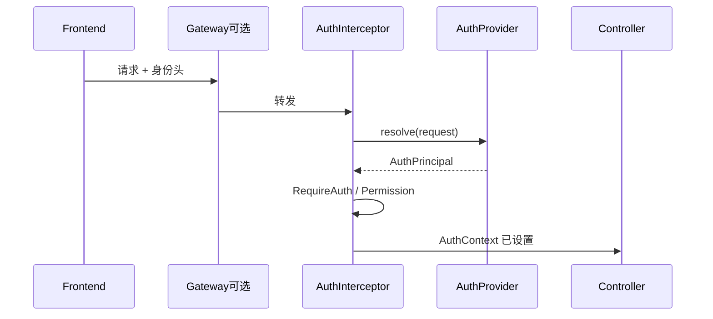

# 鉴权设计（Auth SPI）

> Open Dashboard **不绑定** Spring Security / OAuth，无内置登录页。  
> 代码：`backend/open-dashboard-adapter/.../security/` · 前端：`frontend/src/api/http.ts`

---

## 1. 模型



- `AuthProvider`：从请求解析 `AuthPrincipal`（userId、displayName、permissions）  
- `AuthInterceptor`：写入 `AuthContext`；校验注解  
- `MenuProvider`：按主体返回可见菜单  

---

## 2. 默认开发行为

1. 前端自动附带：  
   - `X-User-Id`  
   - `X-User-Name`  
   - `X-User-Perms`（逗号分隔；`*` = 全部）  
2. `localStorage` 键 `od.auth.headers` 默认演示用户 `demo` / `*`  
3. `HeaderAuthProvider` 解析上述 Header  
4. 无 Header 且 `opendashboard.auth.dev-fallback=true` → 配置中的演示主体  

生产：

```yaml
opendashboard:
  auth:
    dev-fallback: false
```

---

## 3. 注解与权限码

```java
@RequireAuth
@RequirePermission("dashboard:manage")
```

| 权限码 | 用途 |
|--------|------|
| `dashboard:manage` | 看板树写、布局、发布、分享创建 |
| `datasource:manage` | 数据源写、探库、预览表 |
| `dataset:manage` | 数据集写、字段保存 |
| `report:manage` | 报告写、文档、发布 |
| `*` | 全部（开发用） |

读接口多数仅需 `@RequireAuth`（已登录主体）。  
当前主体：`AuthContext.get()` / `AuthContext.userIdOr("system")`。

---

## 4. 公开接口

| 路径 | 说明 |
|------|------|
| `GET /api/share/{token}` | 已发布看板观看 |
| `POST /api/share/{token}/chartQuery` | Token 取数 |
| `POST /api/share/{token}/export` | Token 导出 |
| `GET /api/auth/menus` | 可匿名（无主体时空/默认） |
| `GET /api/auth/me` | 当前主体（fallback 下有演示用户） |

---

## 5. 客户接入

替换 **唯一** `AuthProvider` Bean（默认带 `@ConditionalOnMissingBean`）：

```java
@Component
public class JwtAuthProvider implements AuthProvider {
  @Override
  public Optional<AuthPrincipal> resolve(HttpServletRequest request) {
    // 校验 JWT / 调 IAM
    return Optional.of(new AuthPrincipal(userId, name, Set.of("dashboard:manage")));
  }
}
```

菜单：实现 `MenuProvider` 替换 `DefaultMenuProvider`（默认五项：工作台 / 数据源 / 数据集 / 仪表盘 / 报告）。

前端：改 `getAuthHeaders()`，或由 API 网关统一注入身份头。

---

## 6. 明确不在本期

- 登录页 / Session Cookie / 内置 OAuth2  
- 资源级 ACL 流水线（`de_dashboard_auth` 表预留）  
- 数据集 RLS / CLS 引擎  

演进见 [../product/roadmap.md](../product/roadmap.md)。
