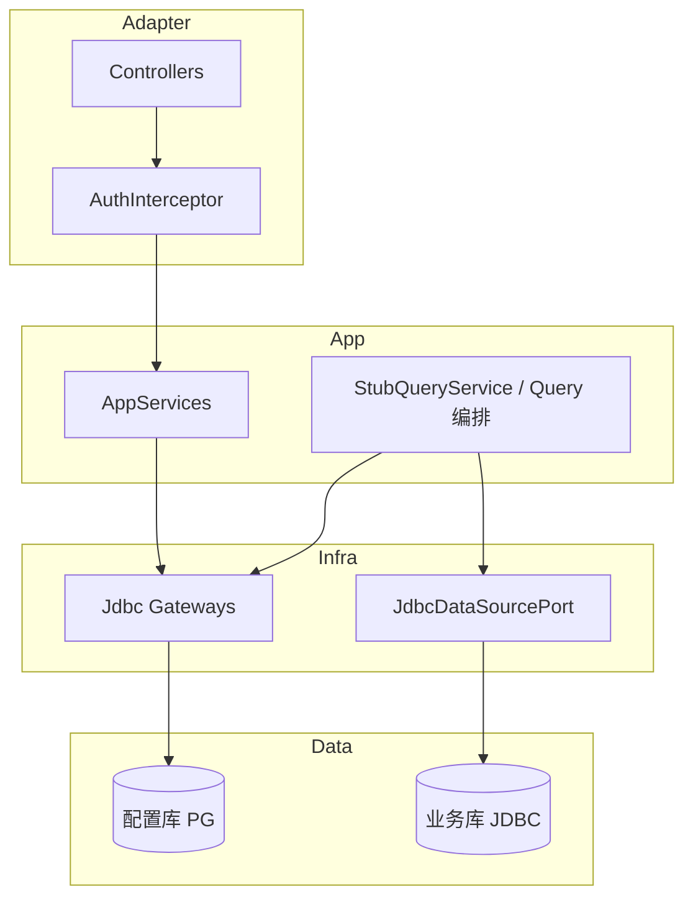

# 后端设计

> 维护向：COLA 多模块、配置 / 取数分层、运行时 Profile。  
> 代码根：`backend/` · 启动：`open-dashboard-start`

---

## 1. 模块划分（COLA）

```
backend/
├── open-dashboard-domain/          # DTO、Gateway 接口、AuthContext
├── open-dashboard-app/             # 应用服务（用例编排）
├── open-dashboard-infrastructure/  # Gateway JDBC 实现、DataSourcePort
├── open-dashboard-adapter/         # REST Controllers + Auth SPI
└── open-dashboard-start/           # 启动、application*.yml、Flyway
```

| 层 | 职责 | 禁止 |
|----|------|------|
| domain | 契约类型与端口 | 依赖 Spring Web / JDBC 细节 |
| app | 编排发布、模板、取数编译 | 直接拼 HTTP |
| infrastructure | 持久化、真实 JDBC 执行 | 暴露 Controller |
| adapter | HTTP、鉴权注解、异常 | 塞入复杂业务规则 |
| start | 组装与配置 | 业务逻辑 |

> 注意：磁盘上若仍有旧版 `backend/src/`，**不以之为产品入口**。

---

## 2. 分层原则



1. **配置层**：树、布局、组件、图表 encode/style、联动、分享、报告文档 → 只写配置库。  
2. **查询层**：`chartQuery` 读图配置 + context → 编译 QuerySpec → 调数据集执行 → 按图类型塑形。  
3. **数据集层**：字段元数据 + `datasetQuery` / preview → **唯一**触达业务库。  
4. **权限层（当前）**：Auth SPI 权限码 + 分享 Token；资源 ACL / RLS 表预留未接业务。

风格 / 高级配置 **永不**进入 SQL。

---

## 3. 应用服务与入口对照

| 能力 | 主要类 | Controller |
|------|--------|------------|
| 仪表盘树 / 画布 / 发布 / 分享创建 | `DashboardAppService` | `DashboardController` |
| 公开分享观看 / 取数 / 导出 | 同上 + Query | `ShareController` |
| 图表取数 / CSV | `StubQueryService`（名遗留） | `ChartQueryController` |
| 数据集查询 | 同上 | `DatasetQueryController` |
| 数据源 | `DatasourceService` | `DatasourceController` |
| 数据集 | `DatasetService` | `DatasetController` |
| 报告 | `InMemoryReportStore` 或 JDBC Gateway | `ReportController` |
| 插图目录 | Catalog 组装 | `CatalogController` |
| 鉴权 / 菜单 | Auth SPI | `AuthController` |

模板：`DashboardTemplateCatalog`（blank / sales / ops / finance）。

导出辅助：`ChartExportHelper`（CSV）。

---

## 4. 持久化

- 引擎：PostgreSQL 16  
- 迁移：Flyway，目录 `open-dashboard-start/src/main/resources/db/migration/`  
- 访问：Spring JDBC + 手写 Repository（无 JPA）  
- 配置类字段：JSONB（含 `mobile_json`、encode/style/senior、报告 content）

主要表族：

| 前缀 / 表 | 用途 |
|-----------|------|
| `de_dashboard*` | 树、布局、组件、发布副本 |
| `de_chart_view` | 单图配置 |
| `de_dashboard_linkage` | 图间联动 |
| `de_dashboard_share` | 分享 Token |
| `de_dashboard_auth` | ACL（表在，业务闸门未接） |
| `de_datasource` / credentials | 数据源 |
| `de_dataset` / `de_dataset_field` | 数据集与字段 |
| `de_report` | 报告元数据 + 文档 |

库表演进**以 Flyway 为准**（勿另维护平行 schema 真相源）。

### 发布双副本

- `copy_type` = `draft` | `published`（布局 / 组件等）  
- `publish`：draft → published，status=`published`  
- `discardDraft`：published → draft  
- 在已发布后再改草稿 → `publishedWithDraft`

---

## 5. 运行时 Profile

| Profile | 行为 |
|---------|------|
| 默认 | `stub-query: true`；`auth.dev-fallback: true` |
| `local` | 连本机 / 指定 PG；开发常用 |
| `docker` | `stub-query: false`；真实 JDBC；`bootstrap.meta-datasource: true` |
| `stub` | 排除 DataSource / Flyway；看板 / 报告走内存 |

`StubQueryService`：名称历史遗留；在非 stub-query 时委托 `JdbcDataSourcePort`。模板 demo 数据集失败时可回落演示数据，避免空画布。

数据源凭证：配置库加密存储（`opendashboard.datasource.crypto-key`）；生产必须改密钥。

---

## 6. Auth SPI（摘要）

详见 [auth.md](./auth.md)。

- 无 Spring Security 登录链  
- `@RequireAuth` / `@RequirePermission("...")`  
- 默认 `HeaderAuthProvider`；可 `@ConditionalOnMissingBean` 替换  
- 公开：`/api/share/**`、部分 auth 接口  

---

## 7. API 约定

- 前缀：`/api`  
- JSON ID：**string**  
- 写操作权限码：`dashboard:manage` / `datasource:manage` / `dataset:manage` / `report:manage`  
- 契约文件：[`../openapi.yaml`](../openapi.yaml) · 人读总览：[`../api/rest.md`](../api/rest.md)  

冲突处理：报告 `PUT /doc` 的 contentId 不匹配 → 409；看板 contentId 字段已存在，强制校验待补齐。

---

## 8. 扩展点（集成）

| 扩展 | 方式 |
|------|------|
| 身份 | 实现 `AuthProvider` Bean |
| 菜单 | 实现 `MenuProvider` Bean |
| 业务库方言 | `DataSourcePort` / JDBC 元数据浏览按类型分支 |
| 查询引擎 | 保持 QuerySpec 入、ResultTable 出；勿让 Controller 直查 |

---

## 9. 本地运行

```bash
cd backend
mvn -pl open-dashboard-start -am spring-boot:run \
  -Dspring-boot.run.arguments='--spring.profiles.active=local --server.port=8082'
```

无库：`--spring.profiles.active=stub`  
开箱全栈：仓库根 `./scripts/up.sh`（见 [../deploy.md](../deploy.md)）。
