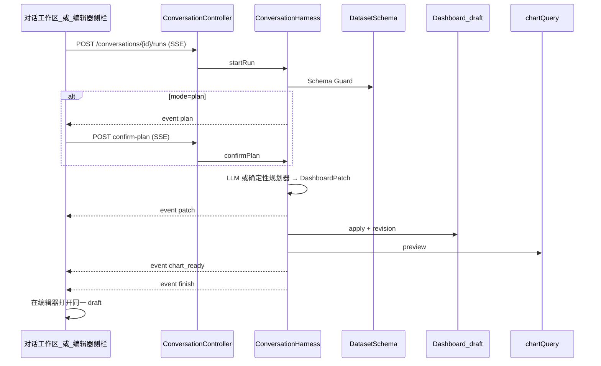

# 仪表盘生成流程方案

> 产品契约入口：本文件属 `docs/design/`。  
> 交互真相：[conversation.md](./conversation.md) · **AI 总架构（问数优先）**：[ai-architecture.md](./ai-architecture.md) · Harness：[ai-harness.md](./ai-harness.md) · 契约：[openapi.yaml](./openapi.yaml) · 提案：[P004](../proposals/P004-conversation.md) · [P006](../proposals/P006-ask-data.md)

## 定位

- **对话是入口**；**仪表盘 draft 是唯一运行时真相**。
- 生成物是结构化 `DashboardPatch`（配置），不是内嵌结果行的静态页 / HTML。
- 取数始终走既有 `datasetQuery` / `chartQuery`；布局库禁止写入查询结果行。

## 端到端流程



### 步骤说明

| 步 | 谁 | 做什么 |
|----|----|--------|
| 1 | 用户 | 落地页选数据集 + 自然语言；Auto 或 Plan |
| 2 | API | 鉴权 `conversation:use`；写看板仍走 dashboard 写权限 |
| 3 | Harness | 加载会话上下文（conversationId、linkedDashboardId、styleId、datasetIds） |
| 4 | Schema Guard | 读字段 schema；无可用 schema → **禁止页面级 Patch** |
| 5 | 证据链 | 编辑器选中图 encode / 用户指定 dataset / 字段语义（可选） |
| 6 | 规划 | Auto：直接 PatchBuild；Plan：推 `plan`，等 `confirm-plan` |
| 7 | PatchBuild | LLM JSON（可选）或确定性模板 → `DashboardPatch` ops |
| 8 | Validate | 数据集可访问、字段存在、encode 角色合法 |
| 9 | Apply | 写入 Dashboard **draft** + conversation revision |
| 10 | Preview | `chartQuery` → SSE `chart_ready` |
| 11 | 桥接 | 「在编辑器打开」→ `/dashboards/:id/edit`（同一次生成的图） |

## DashboardPatch（产物形态）

```json
{
  "dashboardId": "…",
  "ops": [
    { "op": "upsert_chart", "chartId": "…", "type": "bar", "datasetId": "…", "title": "…", "encode": {}, "style": {} },
    { "op": "upsert_component", "id": "…", "chartId": "…", "x": 0, "y": 0, "w": 24, "h": 12 },
    { "op": "set_layout", "gridCols": 72, "themeRef": "default" },
    { "op": "set_theme", "styleId": "feishu-blue" }
  ]
}
```

- Apply 前必须过 Schema Guard / Validate。
- 禁止把查询结果行写入 layout / component / HTML。

## 规划来源

| 来源 | 条件 | 行为 |
|------|------|------|
| 确定性规划器 | 默认；或 LLM 关闭 / 失败 / Guard 不通过 | 经营分析模板：KPI + 对比 + 趋势 |
| OpenAI 兼容 LLM | `opendashboard.conversation.llm.enabled=true` 且有 key | 结构化 Patch JSON；非法字段整次回退确定性 |

配置见 [ai-harness.md](./ai-harness.md#llm-配置)。

## SSE 事件（生成期）

`run`（含 runId）· `step` · `plan` · `patch` · `chart_ready` · `message_delta` · `error` · `finish{reason,detail}`

Plan 模式：`finish.reason=awaiting_confirm` → 客户端再调 `confirm-plan` 续流 apply。

## 入口

| 入口 | 路径 | 说明 |
|------|------|------|
| 一级对话 | `/conversations` | 两段式：落地 → 工作台（对齐高保） |
| 编辑器侧栏 | `/dashboards/:id/edit?conversationId=` | AI 拾取当前图 + Prompt；共享 conversationId |
| 高保原型 | `prototypes/hi-fi/conversation-workspace.html` | 交互真相源 |

## 双轨边界（勿混）

> 总架构与排序结论见 [ai-architecture.md](./ai-architecture.md)：**问数默认优先**；本文件描述「直接生成 / 采纳后」的 Patch 路径。

1. **问数轨（默认，P006）** — 会话内表/临时图；**不**自动改看板；可「保存到仪表盘」或「直接生成仪表盘」再走 Patch。  
2. **配置写入轨（生成 / 采纳）** — NL 或问数证据 → `DashboardPatch` → draft → 预览 → 编辑器（本文件）。  
3. **洞察报告轨（v0.6 / P005）** — 统计洞察 + 叙事 → Umo 块（引用 live 图）。

## 成功标准（生成路径）

- 问数结果可一键进入本路径；或快捷意图直出整页 draft。  
- 取数仅 `datasetQuery` / `chartQuery`；布局无结果行。  
- Plan 必须确认后才 apply。  
- 与高保一致：落地 → 工作台 → 桥接编辑器。

## 实现落点（索引）

| 层 | 位置 |
|----|------|
| design / OpenAPI | 本文件 · [conversation.md](./conversation.md) · [ai-harness.md](./ai-harness.md) · [openapi.yaml](./openapi.yaml) |
| app | `ConversationHarness` · `DashboardPatchApplier` · `DeterministicPlanner` · `OpenAiCompatibleLlmClient` |
| adapter | `ConversationController`（SSE） |
| FE | `src/conversation/` · 编辑器 `ConversationAiPanel` |
