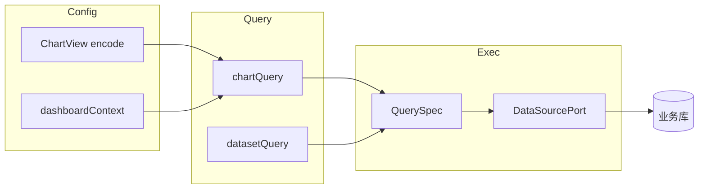

# 取数架构

> 数据源 → 数据集 → chartQuery / datasetQuery。  
> 原则：配置与取数分离；风格不进 SQL。

---

## 1. 总览

| 接口 | 职责 |
|------|------|
| `POST /api/chartQuery/query` | 读图配置 + context → 编译 QuerySpec → 执行 → 按图类型塑形 |
| `POST /api/chartQuery/export` | 同上结果导出 CSV |
| `POST /api/datasetQuery/execute` | **唯一**通用查询入口：QuerySpec → columns + rows |
| `POST /api/dataset/{id}/preview` | 数据集工作室预览（内部同样走查询能力） |
| `POST /api/share/{token}/chartQuery` | 分享态取数（强制 published 图配置） |

---

## 2. 编译路径（chartQuery）

1. 解析 `chartId` / 或 inline 配置（报告新建图）  
2. 加载 ChartView（draft 或 published，由调用方 / 分享强制）  
3. 合并 `filters` + `linkages` → 过滤条件  
4. 按 encode 生成维度 / 指标 / 聚合  
5. 调用 Dataset 执行（`DataSourcePort` 或 stub 演示表）  
6. 塑形为前端 ECharts / 表格所需结构（`ChartQueryResult`）  

**不**把 `style`、主题、组件坐标编进 SQL。

---

## 3. QuerySpec / 结果

逻辑形态（实现以 domain `QueryDtos` 为准）：

- 输入：数据集 ID、选中字段、聚合、过滤、排序、limit  
- 输出：`columns[]`（名 / 类型）+ `rows[][]`  

图表层在结果之上做 encode 映射（category / value / 系列等）。

---

## 4. 运行时切换

| 配置 | 行为 |
|------|------|
| `opendashboard.stub-query=true`（默认） | 内存演示表，便于无库联调 |
| `stub-query=false`（docker profile） | `JdbcDataSourcePort` 真实 JDBC |
| profile `stub` | 无 DataSource；配置亦内存 |

类名 `StubQueryService` 为历史命名：在真实模式下仍是查询编排入口。

模板演示数据集若连库失败，可回落 stub 行，保证模板看板可渲染。

---

## 5. 权限闸门（目标 vs 现状）

| 闸门 | 目标 | 现状 |
|------|------|------|
| 登录 / 权限码 | 管理态取数需身份 | 已有 `@RequireAuth`；分享匿名 |
| 仪表盘 ACL | 无权限不可读配置 / 取数 | 表预留，未接 |
| 数据集 USE | 无权限不可查该数据集 | 未接 |
| RLS / CLS | 行过滤 / 列裁剪注入 Spec | 未接 |
| 分享 Token | 仅 published + token 有效 | 已实现；密码校验不完整 |

查询路径 **不得**信任前端传来的「可见字段列表」作为授权依据；授权应以服务端数据集元数据为准（待 ACL 落地时强化）。

---

## 6. 导出

- 管理态：`POST /api/chartQuery/export`  
- 分享态：`POST /api/share/{token}/export`  
- 格式：CSV（一期）；PNG / PDF 见产品 roadmap  

---

## 7. 与报告的关系

报告插图：

- 引用看板图：按 chartId 走同一 chartQuery（阅读态用已发布配置）  
- Inline 图：请求携带节点内 encode + datasetId，不落 `de_chart_view`  

Catalog（`GET /api/catalog`）只提供选图 / 选字段目录，不执行查询。
