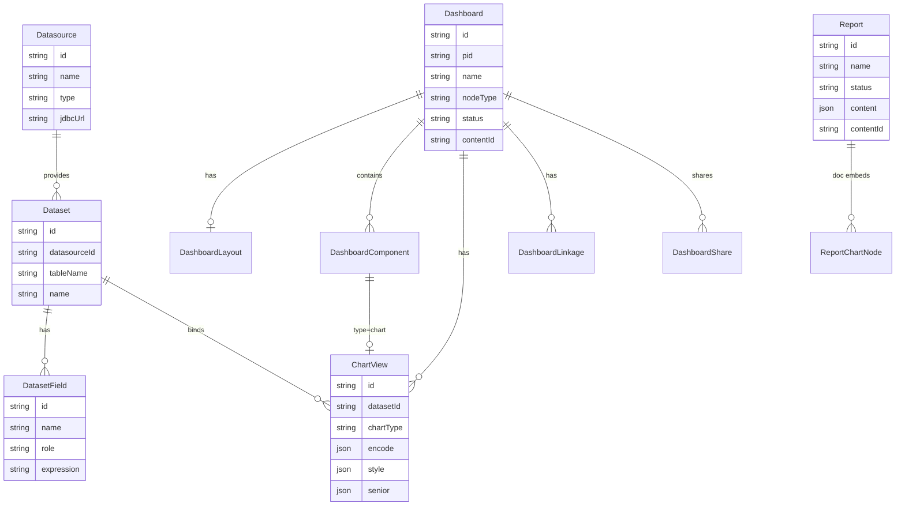
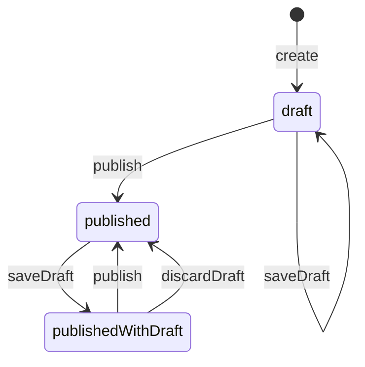

# 领域模型

> 配置域实体与发布状态机。取数协议见 [data-query.md](./data-query.md)。

---

## 1. 实体关系



---

## 2. 仪表盘发布状态机

对外三种状态：

| 状态 | 含义 |
|------|------|
| `draft` | 从未发布 |
| `published` | 草稿与已发布一致 |
| `publishedWithDraft` | 已发布且草稿有未发布改动 |



### 副本策略

- 编辑默认读写 **draft**  
- 观看 / 分享只读 **published**  
- `publish`：draft 覆盖 published  
- `discardDraft`：published 覆盖 draft  
- 不对外暴露 snapshot / resourceTable 等实现名  

---

## 3. 组件与图表

### 组件 type（一期）

| type | 说明 |
|------|------|
| `chart` | 绑定 ChartView |
| `filter` | 筛选器 → 统一 filterState |
| `text` | 静态文本 |
| `image` | 静态图片 |
| `tabs` | 容器（可深化） |

### ChartView 配置分层

| 字段 | 进 SQL？ | 说明 |
|------|----------|------|
| `datasetId` | 间接 | 绑定数据集 |
| `encode` | 是（字段 / 聚合） | category / value / agg / format 等 |
| `style` | 否 | 颜色、图例、展示 |
| `senior` | 否（计算类后续可编译） | 高级选项、同环比预留 |

移动端：PC 与移动 **布局坐标分离**（`mobile_json`）；encode 与数据绑定共用；样式可 `styleSync` 或分设覆盖。

---

## 4. 联动与查询上下文

联动配置存 `DashboardLinkage`（源图字段 → 目标图字段）。运行时由前端组装：

```json
{
  "dashboardId": "1",
  "filters": [
    { "componentId": "f1", "field": "region", "operator": "eq", "value": "华东" }
  ],
  "linkages": [
    {
      "sourceChartId": "c1",
      "sourceField": "product",
      "value": "A",
      "targetChartId": "c2",
      "targetField": "product_name"
    }
  ]
}
```

`chartQuery` 将 filters + linkages 合并为 Dataset 过滤条件后再聚合。后端一期不做图遍历引擎。

---

## 5. 数据源与数据集

- **Datasource**：连接信息 + 加密凭证；支持 probe / ping / 元数据浏览 / 表预览  
- **Dataset**：逻辑表 + 字段银行（table 字段 / 计算字段 expression）  
- 图表与报告插图 **只引用 Dataset**，禁止直连 Datasource  

---

## 6. 分享

`DashboardShare`：`token`、visibility、perm、expire、可选 password。  
公开 API 凭 token 读 published 详情并取数；管理端创建 Token 需 `dashboard:manage`。

---

## 7. 报告

- 元数据：名称、状态、审计字段  
- 文档：Umo JSON（`content`）+ `contentId` 乐观锁  
- 正文内图表节点：  
  - **引用型**：指向已有看板 ChartView  
  - **Inline 型**：节点内自带 datasetId + encode（不写回看板）  
- 发布：文档侧 status；与看板双副本模型独立  

---

## 8. 模板

内置蓝图（`DashboardTemplateCatalog`）：`blank` / `sales` / `ops` / `finance`。  
创建时生成布局槽位、图配置，并可挂接演示数据集（docker 下真实表，失败回落 stub 数据）。
