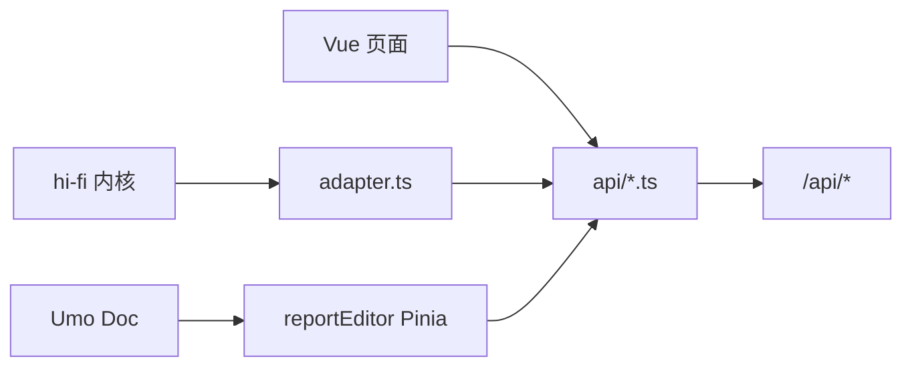

# 前端设计

> 维护向：描述当前 Vue 3 应用结构与关键约定。  
> 代码根：`frontend/` · 路由：`src/router/index.ts`

---

## 1. 技术栈

| 项 | 选择 |
|----|------|
| 框架 | Vue 3（Composition API + `<script setup>`） |
| 构建 | Vite |
| 语言 | TypeScript |
| 状态 | Pinia（报告编辑器用；看板编辑器状态主要在 hi-fi 内核） |
| 路由 | Vue Router |
| 图表 | ECharts |
| 报告编辑 | `@umoteam/editor`（Tiptap） |
| HTTP | `fetch` 封装（`src/api/http.ts`） |

---

## 2. 目录结构

```
frontend/src/
├── api/                 # 通用 HTTP、鉴权头、看板 API
├── shell/               # 顶栏 ModuleTopbar
├── workbench/           # 工作台
├── datasource/          # 数据源管理 + api.ts
├── dataset/             # 数据集工作室 + api.ts
├── dashboard/
│   ├── views/           # List / Editor / Preview / ShareView
│   ├── hifi/            # 高保编辑器 Host + adapter
│   └── utils/
├── report/
│   ├── views/           # List / Editor / Preview
│   ├── components/      # 插图向导、Inspector
│   ├── extensions/      # Umo reportChart 扩展
│   ├── nodeviews/
│   ├── stores/
│   └── api/
├── views/reports/       # 路由薄包装（转调 report/views）
├── types/
├── App.vue
└── main.ts
```

按业务域分目录；跨域壳在 `shell/`。

---

## 3. 路由

| Path | 组件 | 说明 |
|------|------|------|
| `/` | → `/workbench` | 默认 |
| `/workbench` | Workbench | 流水线 + 概览 |
| `/datasources`、`/:id` | DatasourceManage | 列表 / 详情同页 |
| `/datasets`、`/:id` | DatasetManage | 字段银行 + 预览 |
| `/dashboards`、`/:id` | DashboardList | 树 + 摘要 |
| `/dashboards/:id/edit` | DashboardEditor | hi-fi host |
| `/dashboards/:id/preview` | DashboardPreview | draft/published |
| `/share/:token` | DashboardShareView | `hideShell` |
| `/reports`、`/:id` | reports/list | 报告列表 |
| `/reports/:id/edit` | reports/edit → ReportEditor | Umo |
| `/reports/:id/preview` | reports/preview | 只读 |

兼容重定向：`/list`、`/editor/:id`、`/preview/:id`。

顶栏菜单与后端 `GET /api/auth/menus` 对齐；本地也可静态五项。

---

## 4. 模块设计要点

### 4.1 HTTP 与鉴权

`src/api/http.ts`：

- 基址：`/api`（dev 代理到后端端口）
- 自动附加 `X-User-Id` / `X-User-Name` / `X-User-Perms`
- 默认 `localStorage['od.auth.headers']` → 演示用户 `demo`、权限 `*`

接入客户 IAM：替换 `getAuthHeaders()` 或由网关注入等价 Header。

### 4.2 数据源 / 数据集

- 各自 `api.ts` 对接 REST
- 数据集工作室：拖拽字段、计算字段、预览表、血缘 tab
- 预览调用数据集 preview / query，不直连数据源 SQL

### 4.3 仪表盘编辑器

```
DashboardEditor.vue
  └── DashboardEditorHost.vue   # 挂载 hi-fi 内核
        └── adapter.ts          # REST ↔ 内核模型适配
```

- **交互真相源**：`prototypes/hi-fi` / 内嵌内核，而非纯 Vue 重写画布  
- 保存：layout / components / charts / linkages 分 API  
- 取数：编辑器与预览均调 `POST /chartQuery/query`  
- 导出：优先服务端 CSV；失败可客户端回退（`chartDownload.ts`）

### 4.4 分享页

- 无顶栏（`meta.hideShell`）
- 仅调公开 `/api/share/{token}*`，不带管理态写接口

### 4.5 在线报告

| 部件 | 职责 |
|------|------|
| ReportEditor | Umo 宿主 + 保存 / 发布 |
| reportChart 扩展 | 正文内图表节点 attrs（引用或 inline 配置） |
| InsertDashboardChartDialog | 从 Catalog 多选看板图 |
| CreateInlineChartWizard | 报告内新建图 |
| ReportChartInspector | 右侧配置 |
| ReportChartView | NodeView：挂载时 chartQuery |

文档存 Umo JSON；**不存查询结果行**。Catalog：`GET /api/catalog`。

---

## 5. 状态与数据流



- 列表类页面：本地 ref / 组件状态即可  
- 报告编辑：Pinia `reportEditor` 管脏标记、contentId、选中图  
- 看板编辑：状态在 hi-fi；Vue 层负责壳与持久化适配  

---

## 6. 约定

1. ID 在前端按 **string** 处理。  
2. 编辑默认 draft；预览可选 view；分享强制 published（后端保证）。  
3. 新增模块：`views` + `api` + 路由 + 顶栏/menus 同步。  
4. 不要把业务 SQL 或数据源密码拼进前端；凭证只走后端。  
5. UI 文案与用户手册截图（`docs/user-manual/`）保持模块名一致。

---

## 7. 本地开发

```bash
cd frontend && npm install && npm run dev
# http://127.0.0.1:5173  · 代理 /api → 后端
# 用户手册：http://127.0.0.1:5173/help/（顶栏右侧「帮助」）
```

`docs/user-manual/` 在 `dev` / `build` 时同步到 `public/help/`，随静态资源发布。

高保静态参照（非产品运行时）：

```bash
# 仓库根
npm run hi-fi
```
