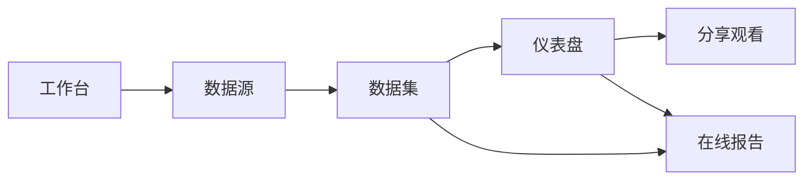

# Open Dashboard

开源的 **仪表盘 / BI 画布**：分析师接数、建模、编排看板与报告，业务读者打开分享即可观看。

- **编排**：模块化工作台 + 画布编辑，接近飞书式排版体验  
- **治理**：数据源 → 数据集 → 仪表盘 / 报告分层；看板只描述「看什么」，取数走数据集，风格不进查询  

对标的是能力语义（资源树、发布态、数据集建模），不是照搬别人的菜单或路径。

已交付能力见 [requirements.md](./requirements.md)。下一步见 [roadmap/](./roadmap/)。

## 用户与场景

| 角色 | 典型场景 |
|------|----------|
| 分析师 | 连接数据、建数据集、用模板或空白画布做看板、发布与分享 |
| 业务读者 | 打开分享链接只读观看已发布看板，需要时导出表格 |
| 报告作者 | 在线撰写正文，插入看板图或在报告里新建图，取数后发布 |
| 接入方 | 用企业现有身份接入，不强制自带登录页 |

## 产品结构

| 模块 | 做什么 |
|------|--------|
| 工作台 | 进入各模块、看资源与待办、发起问数 |
| 数据源 | 连接业务库、探库、预览表 |
| 数据集 | 选表、定义维度/指标与计算字段、预览 |
| 仪表盘 | 文件夹管理、模板、编辑、发布、联动、分享 |
| 在线报告 | 写正文、插图或新建图、发布 |
| 分享观看 | 无编辑壳的只读看板 |

## 产品原则

1. **配置与取数分离**：画布只存布局、字段绑定和样式；样式不进查询。  
2. **看板只绑数据集**：图表不能直连数据源；业务数据一律经数据集取出。  
3. **草稿 / 已发布**：编辑写草稿；观看与分享只读已发布版本。  
4. **可嵌入、不自带账号中心**：写操作靠权限；登录由接入方提供。

## 现在能做什么

工作台 → 数据源 → 数据集 → 仪表盘（模板 / 编辑 / 发布 / 分享 / 导出表格）→ 在线报告（插图并实时取数）。

## 明确未做

| 项 | 说明 |
|----|------|
| 内置登录 / 完整 IAM | 产品定位为可嵌入的分析组件 |
| 资源级权限、行列权限 | 规划中，尚未对业务开放 |
| 跳转、告警、嵌入、查看 SQL、画布出图 | 见路线图 |
| 分享密码、同时编辑冲突保护 | 见路线图 |
| Excel / API 数据源 | 当前主路径是数据库连接 |
| 对话问数 / 对话生成看板 | 进行中，未验收，不算已交付 |

长期不做清单见 [roadmap/wont/](./roadmap/wont/)。

## 本目录

| 打开 | 看什么 |
|------|--------|
| 本文 | 产品是什么、给谁用、模块与边界 |
| [requirements.md](./requirements.md) | **已交付**能力基线（验收通过才写入） |
| [roadmap/](./roadmap/) | 下一步：进行中 / 已完成 / 计划中 / 搁置 / 不做 |
