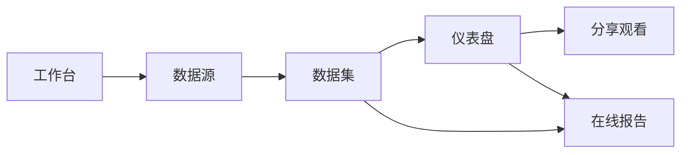

# 产品概述

> 以当前仓库实现为准（约 v0.3 核心 + v0.4 报告）。  
> 详细需求见 [requirements.md](./requirements.md)，演进见 [roadmap.md](./roadmap.md)。

## 定位

Open Dashboard 是开源的 **仪表盘 / BI 画布** 产品：Vue 3 前端 + Spring Boot 后端。

- **编排气质**：飞书式模块化工作台与画布编辑体验  
- **分析治理**：Quick BI 式「数据源 → 数据集 → 仪表盘/报告」分层，配置与取数分离  

对标参考（语义与能力，非路径拷贝）：DataEase 资源树 / 发布态、飞书多维表式画布、Quick BI 数据集建模。

## 用户与场景

| 角色 | 典型场景 |
|------|----------|
| 分析师 | 接库、建数据集、用模板或空白画布做看板、发布与分享 |
| 业务读者 | 打开分享链接只读观看已发布看板，导出 CSV |
| 报告作者 | 在线报告中撰写正文，插入看板图或报告内新建图，实时取数后发布 |
| 集成方 | 通过 Auth SPI 接入自有身份，不绑死登录页 / OAuth |

## 模块地图

| 模块 | 路由前缀 | 一句话 |
|------|----------|--------|
| 工作台 | `/workbench` | 四步流水线入口 + 资源概览 |
| 数据源 | `/datasources` | JDBC 连接、探库、表/列元数据、预览 |
| 数据集 | `/datasets` | 选表、字段语义、计算字段、预览取数 |
| 仪表盘 | `/dashboards` | 树 CRUD、模板、编辑器、发布、联动、分享 |
| 在线报告 | `/reports` | Umo 文档 + 插图 / 新建图 + 发布 |
| 分享 | `/share/:token` | 无壳只读观看（公开 API） |

## 核心设计原则（产品契约）

1. **配置与取数分离**：画布只存布局 / encode / style；风格不进 SQL。  
2. **看板只绑 Dataset**：禁止图表直连 Datasource；`datasetQuery` 是唯一触达业务库的查询入口。  
3. **draft / published 双副本**：编辑写草稿；观看与分享读已发布。  
4. **鉴权可插拔**：无内置登录页；Header / 自研 `AuthProvider`；权限码控制写操作。  
5. **高保是交互参照**：复杂画布逻辑以 `prototypes/hi-fi` 为基准，产品侧通过 hi-fi host 承载，而非一次性重写。

## 当前交付边界（已实现）

- 全链路：工作台 → 数据源 → 数据集 → 仪表盘（模板 / 编辑 / 发布 / 分享 / CSV）→ 报告（Umo 插图）
- Docker 一键：PostgreSQL + API + Web；元库 bootstrap + 示例数据集
- 本地可切 `stub`（纯内存）或真实 JDBC（docker / local profile）

## 明确未做（见 roadmap）

- 登录页 / OAuth 内置实现  
- 资源级 ACL（表已有，业务未接）、行列权限引擎  
- 跳转、告警、嵌入 SDK、`explainSql`、画布 PNG 导出  
- 分享密码完整校验、contentId 乐观锁强制  
- Excel / API 型数据源（UI 文案有，主路径为 MySQL / PostgreSQL JDBC）
