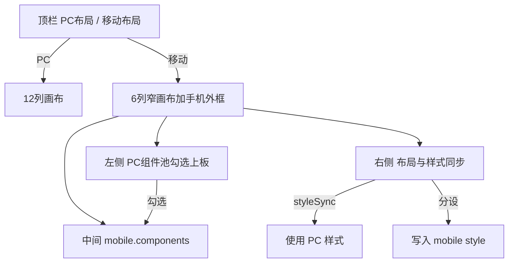

# P001 · 移动端布局与样式（DataEase C 档）

> **状态** `done` · 路线图 [已完成](../../product/roadmap/done/) · 高保 none · 代码 merged · 验收 passed

## 开发入口

已交付，只追溯。现行行为看 [architecture.html](../../design/architecture.html#application) 与 `PR-DASH-11`。新的移动端需求开新提案，不要改本文当设计稿。

## 背景

高保原型目前仅有「手机外框 + 仍渲染 PC 12 列布局」的窄屏预览（Phase B「移动预览」），**没有独立移动端排版**，也无法按组件覆盖移动端样式。

对标 [DataEase 移动端布局](https://dataease.cn/docs/v2/user_manual/app_description/)：

- 独立移动端画布（从 PC 勾选组件上板，单独拖拽排版）
- 可开启/关闭移动端
- 组件样式可与 PC 同步，或移动端单独配置

本提案选定 **C 档**：独立布局 + 组件级样式同步/分设。

## 目标

| 项 | 说明 |
|----|------|
| 独立布局 | `dash.mobile.components` 与 PC `components` 坐标分离 |
| 勾选上板 | 移动编辑态左侧为 PC 组件池 |
| 样式 | `styleSync`：跟 PC；关闭后 `style` 覆盖 |
| 预览 | 手机外框渲染移动布局；列表显示「移动端」标识 |
| 演示 | `dash_sales` 预置精简移动布局 |

非目标（本提案不做）：原生 App、数据大屏移动端、与 PC 不同的数据绑定/encode。

## 档位说明（已决议）

| 档 | 内容 | 决议 |
|----|------|------|
| A | 同一布局 + 外框/简单重排 | 否 |
| B | 独立布局，样式始终跟 PC | 否 |
| **C** | **独立布局 + 同步/分设样式** | **是** |

## 数据模型

```js
dash.mobile = {
  enabled: false,
  device: 'iphone390',   // 预览外框：390 | 430
  bg: '#f5f6f7',
  components: [
    {
      id: 'm_xxx',
      refId: 'w_pc_comp_id', // → PC components[].id
      x, y, w, h, z,
      styleSync: true,
      style: null            // styleSync === false 时与 PC style merge
    }
  ]
}
```

约定：

- **数据不拆分**：`charts` / encode / 联动只维护一份；移动端只改布局与可选样式覆盖。
- **栅格**：`COL_MOBILE = 6`。默认尺寸：KPI `3×2`，图 `6×4`，表 `6×5`，切片器 `6×1`。
- **撤销**：对 `dash` 的深拷贝快照须包含 `mobile`。

## 编辑器交互



1. **顶栏**：`state.editSurface = 'pc' | 'mobile'`（替换「一点击就进预览」的旧入口）。移动态画布居中外框（390/430）。
2. **左侧（移动）**：PC 组件列表 + 勾选上板；「一键导入全部 / 清空移动布局」。
3. **中间**：复用拖拽缩放；读写 `dash.mobile.components`，列上限 6。
4. **右侧**：x/y/w/h；**与 PC 样式同步**；分设时精简样式（背景、标题色/底/加粗、表头色等）；仪表盘级 `enabled` / `bg` / 机型。
5. **Phase**：编辑能力挂 Phase B+；Phase A 仅桌面。

## 渲染与预览

- 解析组件：用 `refId` 找 PC 组件 → `chartId` / slicer props。
- 样式：`styleSync ? pcStyle : { ...pcStyle, ...mobileStyle }`。
- 预览「移动宽」：若 `enabled` 且有移动组件则渲染移动布局，否则提示并回退 PC 窄屏。
- 列表：`mobile.enabled` 显示「移动端」标识。

## 演示数据

`dash_sales`（销售周报）：`enabled=true`，纵向精简（切片器 + 4 KPI + 主图 + 饼），不含重型透视/明细。

## 实现落点

单文件原型：[`docs/prototypes/hi-fi/dashboard-commercial.html`](../../prototypes/hi-fi/dashboard-commercial.html)

- `ensureMobile(dash)`、`COL_MOBILE`、设备预设
- `tabComps` / `commitLayout` / `renderBoard` / `renderEditor` 按 `editSurface` 分支
- `renderMobilePool`、`resolveCompStyle`
- 预览、列表标识、sales seed

## 验收

执行判据与历史证据见 [acceptance.yaml](./acceptance.yaml)。

- [x] PC / 移动布局切换互不覆盖对方坐标
- [x] 勾选上板、拖拽改尺寸后，手机框预览顺序正确
- [x] 关闭同步改标题商务蓝仅移动端变化；开启后跟随 PC
- [x] 列表有移动端标识；未开启时移动预览有明确提示

## 实现备注

- 已交付需求：[requirements.md](../../product/requirements.md) PR-DASH-11
- 现行架构：[architecture.html](../../design/architecture.html#application)
- Phase A 仅桌面；Phase B+ 顶栏「PC布局 / 移动布局」切换（替换旧「一点击进预览」）
- 已知限制：移动端不新建组件（仅池勾选）；样式分设时右侧仍展示完整样式面板（写入覆盖袋）

## 修订记录

| 日期 | 变更 |
|------|------|
| 2026-08-03 | 初稿：选定 C 档，写入 proposals |
| 2026-08-03 | 高保落地，状态 accepted → v0.2.0 |
