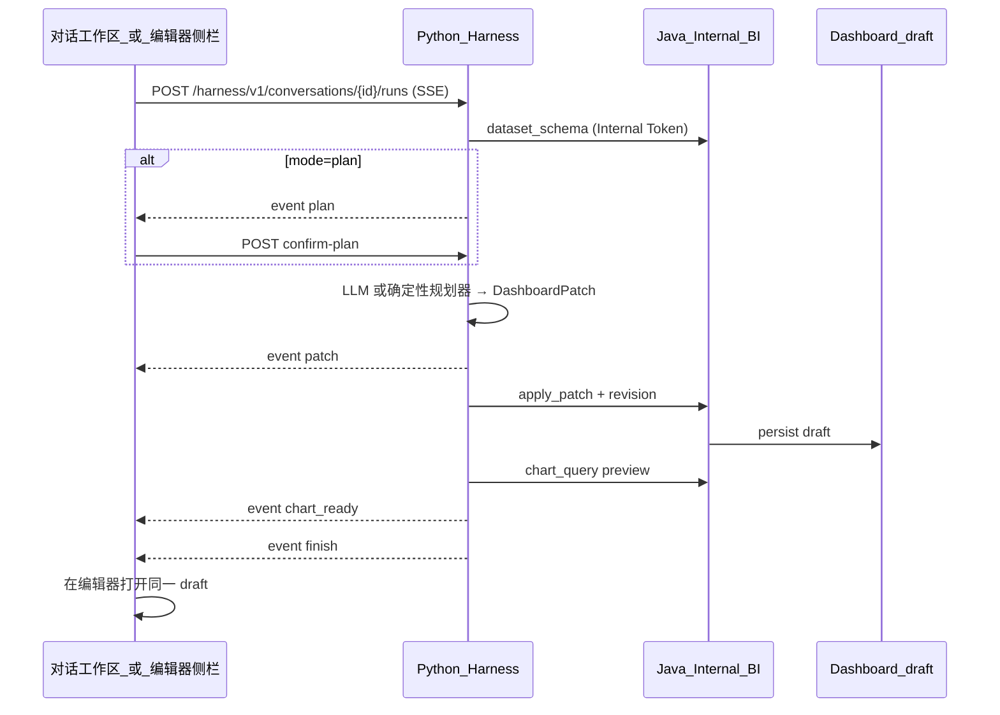

# 仪表盘生成流程方案

> 现行代码中的生成交互与管道已写入 [architecture.html · 生成看板](../../design/architecture.html#gen) 与 [业界对照](../../design/architecture.html#compare)（已编码未验收）。本文仍是提案详细设计，不是 4A 现行架构。
> 交互真相：[design.md](./design.md) · **AI 总架构（问数优先）**：[P006 design](../P006-ask-data/design.md) · Harness：[harness-design.md](./harness-design.md) · 契约：[openapi.yaml](../../design/openapi.yaml) · 提案：[P004](./README.md) · [P006](../P006-ask-data/README.md)

## 定位

- **对话是入口**；**仪表盘 draft 是唯一运行时真相**。
- 生成物是结构化 `DashboardPatch`（配置），不是内嵌结果行的静态页 / HTML。
- 取数始终走既有 `datasetQuery` / `chartQuery`；布局库禁止写入查询结果行。

## 端到端流程



### 写入入口统一

配置写入只有两类 Harness 入口，二者最终都只调用 Java internal BI：

| 入口 | 触发 | Harness 职责 | Java 职责 |
|------|------|--------------|-----------|
| `POST /harness/v1/conversations/{id}/runs` | 直接生成整页看板，`intent=gen` | 规划、质检、生成 `DashboardPatch`；Auto 直接 apply，Plan 等 `confirm-plan` | `/api/internal/bi/apply-patch` 写 draft，`chartQuery` 预览 |
| `POST /harness/v1/conversations/{id}/runs/{runId}/adopt` | 问数结果卡「保存到仪表盘」 | 从 run artifact / AskPlan / answer_chart 重建本题图 Patch；拒绝无可采纳产物 | 同上 |

不采用 `FE → Java public adopt → Harness → Java internal BI`。Java public conversation adopt 从 Controller 与 OpenAPI 删除；新前端只连 Harness。

### 步骤说明

| 步 | 谁 | 做什么 |
|----|----|--------|
| 1 | 用户 | 落地页选数据集 + 自然语言；Auto 或 Plan |
| 2 | API | 鉴权 `conversation:use`；写看板仍走 dashboard 写权限 |
| 3 | Harness | 加载会话上下文（conversationId、linkedDashboardId、styleId、datasetIds） |
| 4 | Schema Guard | 读字段 schema；无可用 schema → **禁止页面级 Patch** |
| 5 | 证据链 | 编辑器选中图 encode / 用户指定 dataset / 字段语义（可选） |
| 6 | 规划 | Auto：直接 PatchBuild；Plan：推 `plan`，等 `confirm-plan` |
| 7 | PatchBuild | LLM JSON（可选）或确定性模板 → `DashboardPatch` ops |
| 8 | Validate | 数据集可访问、字段存在、encode 角色合法 |
| 9 | Apply | 写入 Dashboard **draft** + conversation revision |
| 10 | Preview | `chartQuery` → SSE `chart_ready` |
| 11 | 桥接 | 「在编辑器打开」→ `/dashboards/:id/edit`（同一次生成的图） |

## DashboardPatch（产物形态）

```json
{
  "dashboardId": "…",
  "ops": [
    { "op": "upsert_chart", "chartId": "…", "type": "bar", "datasetId": "…", "title": "…", "encode": {}, "style": {} },
    { "op": "upsert_component", "id": "…", "type": "chart", "chartId": "…", "x": 0, "y": 9, "w": 36, "h": 20 },
    { "op": "upsert_component", "id": "…", "type": "query", "x": 0, "y": 0, "w": 72, "h": 8, "props": { "label": "查询条件", "items": [] } },
    { "op": "set_layout", "gridCols": 72, "themeRef": "default" },
    { "op": "set_theme", "styleId": "feishu-blue" }
  ]
}
```

- Apply 前必须过 Schema Guard / Validate。
- 禁止把查询结果行写入 layout / component / HTML。

## 生成默认信息架构

默认稿面（对齐销售模板，由 `od_plan_charts` + `od_layout_board` 落地）：

1. 顶栏 `type=query`（日期 + 状态/渠道等，最多 3 项）
2. 有数 KPI（探测 `rowCount>0` 且聚合非 null）
3. 两列满铺图：**图表与汇总表合并成两列（各 36/72 宽）铺满整行**，避免单张全宽导致的右侧留白或汇总表被压缩
4. 查询控件默认值：日期框默认填充**数据真实区间**（探测 MIN/MAX，如 `2025-11-03 ~ 2026-07-15`），
   既不让控件看起来是空的，也不会因默认近 30 天等假区间丢数据；下拉默认「全部」。

**多图是默认，单图是例外**：`od_plan_charts` 默认按模板 IA 生成多图；即使数据集没有业务度量
（log/埋点/状态表），也用「计数」生成丰富看板（对齐运营模板 #38 的构图）：4 KPI
（记录数 / 成功 / 异常 / 平均耗时，成功异常用 `encode.filters` 拆状态）+ 计数分布（bar）
+ 占比（pie）+ 按状态度量对比（hbar）+ 用户类维度调用量（bar）+ 2 张不同维度的汇总表
（grouptable）。为此 `_enrich_count_profile` 在无度量时补确定性探测：
计数维取值分布、首个 DECIMAL 字段 AVG、用户类低基数维度（2~15 取值）、时间字段 MIN/MAX。
只有用户明确「只要一张图」时 LLM 才传 `mode="single"`，此时只出 1 张 KPI。
（A 确定性骨架 + B LLM 低风险决策：字段映射/槽位合法性始终走确定性逻辑，LLM 只影响 mode 取舍，
缺省/非法 mode 一律回退默认多图；`od_review_charts` / `od_layout_board` 强制以 `state.last_plan`
的确定性规划为准，LLM 传参不允许改图，防丢图/混入杂图；`od_emit_patch` 同样强制以本轮
`state.last_layout` 的权威 patch 为准，LLM 自拼 patch 不生效，杜绝 append 旧稿残留。）

`upsert_component` 可 `type=query`，`props.items: [{kind, field, label, scope}]`，
日期项可带 `from/to/fromDefault/toDefault`（对话页读 from/to 做过滤与回显，编辑器读 fromDefault/toDefault 做回显）。
生成落库后，harness 经 `PATCH /api/conversations/{cid}` 把 `linkedDashboardId` 回写后端 Java，
供前端打开对话时回填工作台。

**质检闸（plan_charts 与 layout_board 各跑一次）**：关假 KPI 环比、去掉同一维度的重复饼图、丢掉粒/原始时间戳折线、明细表改汇总、最多两张不同维度汇总表。**允许**柱图与饼图同维并存（柱看量、饼看占比，对齐 #38 模板）。不阻断 emit，只自动修复。

**查询条进入 `chartQuery.context.filters`**：顶栏日期/枚举变更会作为 FilterContextItem 数组随 chartQuery 下发；Java 转 Filter AST 后编进 SQL WHERE（eq / in / between / last）。意图卡 `encode.filters`（近一年等）仍走同一 AST，与查询条合并。禁止为了密度保留空 KPI / 空趋势。

**对话页刷新后图表预览回填**：`openConversation` 打开既有对话时，若后端记录缺 `linkedDashboardId`（生成期由 harness 运行时持有），前端从 harness 补拉权威值；随后 `hydratePreviewFromDashboard` 从草稿看板重建 `charts`/`queryBar`，使对话工作台重开不空白。柱图/线图预览经 `LiveChartPreview` 每次重建独立 host 容器再 `echarts.init`，规避 v-for 复用节点导致实例失效、canvas 不绘制的问题。

**对话工作台预览布局**：预览卡 `.dash-preview` 以 `width:100%` 铺满画布列、`overflow:visible` + `flex-shrink:0`，内容随 KPI 行/图表网格/汇总表自然增高，由父 `.ask-pane`（`overflow:auto`）统一纵向滚动，避免 `overflow:hidden` 造成的底部图表不可达与右侧留白；`chart-grid`/`table-grid` 用 `1fr 1fr` 两列铺满，不预留空白。

**思考过程持久化与历史回溯**：前端生成结束时，把本次 `liveTools`（工具步骤链，含 `od_profile_dataset/od_plan_charts/od_review_charts/od_layout_board/od_emit_patch` 及 planner 质检说明）经 `sanitizeTrace` 精简后，作为 assistant 消息的 `attachments`（`{kind:'trace', steps:[...]}`）存入后端。后端 `ConversationMessageCreateRequest`/`ConversationAppService` 已透传 attachments 到 `de_conversation_message.attachments_json`。打开历史会话时前端 `extractTrace` 从 attachments 恢复步骤链，在「已思考」折叠区内逐步展示，实现「查看会话记录即可回溯完整推理/执行过程」。同时 `maybeResumeUnanswered` 对已有 `linkedDashboardId`（已生成产物）的会话跳过自动 resume，避免每次进入历史会话重复触发生成、消息越积越多。

**生成版本记录与回滚（patch 版本回放）**：每次看板落盘（`_emit_applied` 触发 `board_ready`）时，Python harness 调用后端新增 internal 端点 `POST /api/internal/bi/record-revision`（`conversationId/runId/dashboardId/patch/label`），后端 `ConversationAppService.recordRevision` 用 `DashboardPatchApplier.snapshotOf(dashboardId)` 生成权威快照（meta/layout/components/charts）写入 `de_conversation_revision`（runId 存原文，非数字 id 落 NULL 但 API 透传）。对话工作台预览卡头部新增「版本历史」入口：`toggleRevisions` 拉取 `GET /conversations/{id}/revisions` 列表，每条展示 label/#dashboardId/时间并可「回滚」；`restoreRevision` 调 `POST /conversations/{id}/revisions/{rev}/restore`（后端 `restoreSnapshot` 先取当前组件 id 全量删除、再按快照替换 layout/components/charts，避免 upsert 语义造成新旧组件混排），成功后 `hydratePreviewFromDashboard` 刷新预览。最新版本的回滚按钮禁用（无意义回滚到自身）。

**工具治理中间件**：新增 `tools/guard.py` 统一工具治理管线 `execute_guarded`——pre(参数 guard，`od_run_sql` 复用 `sqlbot.guard` 只读闸) → execute(线程软超时兜底) → retry(仅对可重试错误做指数退避) → post(异常归一化为 `{ok:False, error}`)。策略按工具名配置（`tools/guard.py::DEFAULT_POLICY`）：`od_run_query/od_run_sql/od_profile_dataset/od_plan_charts/od_layout_board` 超时 60s + 重试 1-2 次退避，其余默认 90s 不重试（写类/编排类工具重复执行有副作用风险）。LLM 工具环（`runtime.py` 工具执行点）与确定性规划路径（`od_plan_charts/od_layout_board`）均改走 `execute_guarded`，网络查询超时/瞬时失败自动退避重试，错误结构化返回给模型，不再整轮崩溃。

**多数据集并行规划**：确定性 gen 路径（`_run_gen`）在 `dataset_ids.length > 1` 时，为每个数据集创建独立 `create_registry(linked)`（独立 ToolState，互不串扰），用 `ThreadPoolExecutor(max_workers=min(4, n))` 并行执行 `od_plan_charts`（受治理管线超时保护）；`_merge_plans` 合并各计划——charts 汇总、query items 按 field 去重、标题用数据集名 ` + ` 拼接、rationale/probes 累积、`empty`/失败数据集跳过不贡献。合并后的 charts 统一走 `od_layout_board`（A 层确定性布局，按时间戳统一分配 chartId，无冲突）。单数据集保持原路径不变；LLM lead 路径本就可多轮多数据集调 plan，无需改动。验证：ds_78f81f1b + ds_861730f6 并行生成 11 charts（10+1），标题拼接两数据集名，revision 落库。

## 规划来源

| 来源 | 条件 | 行为 |
|------|------|------|
| 确定性规划器 | 默认；或 LLM 关闭 / 失败 / Guard 不通过 | profile → plan_charts → 质检 → layout（compose-board 仅双失败兜底） |
| OpenAI 兼容 LLM | `opendashboard.conversation.llm.enabled=true` 且有 key | 结构化 Patch JSON；非法字段整次回退确定性 |

配置见 [harness-design.md](./harness-design.md#llm-配置)。

## SSE 事件（生成期）

`run`（含 runId）· `step` · `plan` · `intent_map` · `patch` · `chart_ready` · `message_delta` · `error` · `finish{reason,detail}`

Plan 模式：`finish.reason=awaiting_confirm`，Harness 把 patch 存在 run.pending；客户端 `confirm-plan` 后续流 `apply-patch`。取消则不落库。

## 入口

| 入口 | 路径 | 说明 |
|------|------|------|
| 一级对话 | `/conversations` | 两段式：落地 → 工作台（对齐高保） |
| 编辑器 SQLBot | `/dashboards/:id/edit` | DataEase 式浮层问数；选当前看板数据集；默认不写画布；「保存到仪表盘」才 Patch |
| 高保原型 | `docs/prototypes/hi-fi/conversation-workspace.html` | 交互真相源 |

## 双轨边界（勿混）

> 总架构与排序结论见 [P006 Ask-data 设计](../P006-ask-data/design.md)：**问数默认优先**；本文件描述「直接生成 / 采纳后」的 Patch 路径。

1. **问数轨（默认，P006）** — 会话内表/临时图；**不**自动改看板；结果卡只可「保存到仪表盘」并写入本题图。  
2. **配置写入轨（生成 / 采纳）** — NL 或问数证据 → `DashboardPatch` → draft → 预览 → 编辑器（本文件）。  
3. **洞察报告轨（v0.6 / P005）** — 统计洞察 + 叙事 → Umo 块（引用 live 图）。

## 成功标准（生成路径）

- `PR-CONV-03/04`：问数结果可保存本题图；快捷生成意图可直出整页 draft。  
- 取数仅 `datasetQuery` / `chartQuery`；布局无结果行。  
- Plan 必须确认后才 apply。  
- 与高保一致：落地 → 工作台 → 桥接编辑器。

## 实现落点（索引）

| 层 | 位置 |
|----|------|
| design / OpenAPI | 本文件 · [design.md](./design.md) · [harness-design.md](./harness-design.md) · [openapi.yaml](../../design/openapi.yaml) |
| Harness | `opendashboard-harness/`：Agent loop、LLM、SSE、工具注册 |
| Java | `/api/internal/bi/*`：Schema、查询、Patch、revision；不承担 Agent SSE |
| FE | `src/conversation/` · 编辑器 `ConversationAiPanel` |
