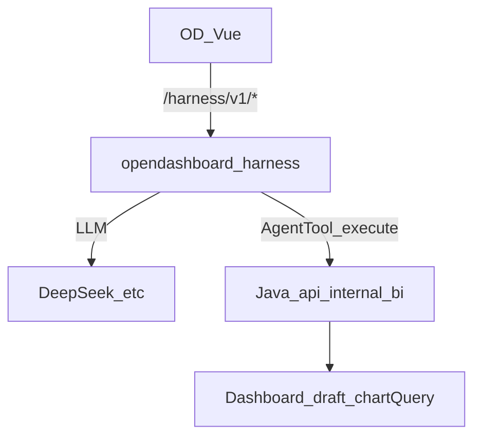
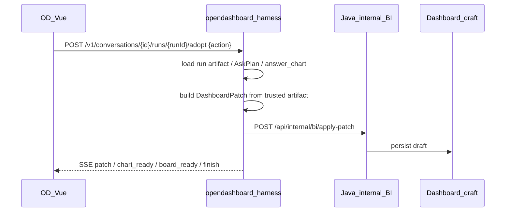
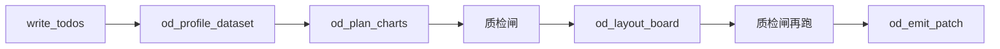

# AI Harness（Pi 架构 · FE 直连）

> 状态：P004 进行中详细设计，不属于现行 4A 架构。
> **总架构**见 [P006 Ask-data 设计](../P006-ask-data/design.md)。
> 对照仓：`refs/pi`（`pi-agent-core` / `pi-ai`）— **抄模式，不搬 TS 整仓**。
> 实现：[`opendashboard-harness/`](../../../opendashboard-harness/)。

## 默认决策

| 层 | 做什么 | 不做什么 |
|----|--------|----------|
| **OD Vue** | 对话 UI；直连 harness（`/harness/v1/*`） | 不直连模型；不经 Java 跑 Agent |
| **opendashboard-harness** | Agent loop、工具注册、运行时上下文、会话短事实、SSE；run 时按 Java 会话 id 补建运行时文件；adopt 时从 run artifact 生成 Patch | 不持有生产库写账号；不把结果行写入布局；不作为问数历史真相；不在 P004 内定义长期记忆 |
| **Java** | 会话 CRUD + 消息落 `de_conversation*`；`/api/internal/bi/*` 工具实现 + 看板/数据集 CRUD | 不做 Lead/LLM；**不提供** conversation adopt 公开入口 |



- **问数 Ask-3**：对照 `refs/sqlbot` 迁 generate-SQL → 只读校验 → 执行 → 出图；不搬用户/工作空间/RAG。
- **步骤折叠**：工具结束 SSE `step.preview`（schema 字段、SQL、行数），前端二次展开。
- **问数文件源**：`POST /api/dataset/import` 后与 JDBC 数据集同一套工具。
- **不整仓搬 SQLBot**；编辑器浮层 + harness `sqlbot/` 管道。任意 SQL 不暴露给 FE。
- 看板真相：`DashboardPatch` → draft + live `chartQuery`。
- Java `/api/conversations/*/runs` 已废弃；Java public adopt 从 Controller 与 OpenAPI 删除。

## 从 Pi 抄 / 不抄

**抄：** AgentMessage vs LLM Message、`transformContext`、事件流（turn/tool_execution）、工具 `name+schema+execute`、Session 落盘、Skills 注入、精简核心。

**不抄：** coding-agent 的 bash/read/write/edit、TUI CLI、嵌 TS monorepo。

## 能力

| 能力 | 行为 | 主工具 |
|------|------|--------|
| ask | SQLBot NL2SQL（Ask-3）→ 会话 ephemeral；失败回退意图卡 encode | schema → generate SQL → `od_run_sql` → finish |
| **编辑器 SQLBot** | 同 ask；浮层选当前看板数据集；默认不写画布 | 同上；采纳才 `od_emit_patch` |
| insight | 问数 + 叙事 | 同上 + skill od-ask-board |
| gen | DeerFlow planner + JoyAgent critic：`write_todos` → `od_profile_dataset` → `od_plan_charts`（探测有数 + 质检）→ `od_review_charts`（可省略，layout 再跑）→ `od_layout_board`（查询条+满铺）→ emit_patch；compose-board 仅双失败兜底 | profile / plan_charts / review / layout / emit |
| 多轮 append | 有 linkedDashboard 默认 append | board_summary + emit append |
| 记忆 | 会话内短事实；跨会话用户 facts 见 [P010](../P010-user-memory-ask-knowledge/)，并按 `workspaceId + userId` 隔离 | session_store.memory[] + P010 workspace/user scoped memory |
| 降级 | 无 LLM key：`OD_HARNESS_MODE` | deterministic compose-board |
| 事件日志 | append-only `events[]` 为 agent 事实源；产品列表仍以 Java 为准 | GET `/v1/conversations/{id}/events` |
| 多轮硬路由 | linked + rechart/insert → `_run_rechart`，不靠 Lead 自觉 | `od_rechart_chart` |

## 工具目录（定义在 harness，实现在 Java）

| 工具 | Java |
|------|------|
| `od_list_datasets` | `GET /api/internal/bi/datasets` |
| `write_todos` | harness 本地（DeerFlow planner 任务列表） |
| `od_profile_dataset` | `POST /api/internal/bi/profile-dataset` |
| `od_plan_charts` | harness 本地（只保留 `probes[].rowCount>0` 且 KPI 非 null 的 encode；带 `query` + `grouptable`；内含质检） |
| `od_review_charts` | harness 本地（JoyAgent critic：关假环比、去同维饼图、丢掉粒折线、明细表改汇总；不阻断 emit） |
| `od_get_schema` | `GET /api/internal/bi/datasets/{id}/schema` |
| `od_run_query` | `POST /api/internal/bi/query/chart` |
| `od_run_sql` | `POST /api/internal/bi/query/sql`（SQLBot：sqlglot 校验后的 SELECT） |
| `od_get_board_summary` | `GET /api/internal/bi/board-summary` |
| `od_layout_board` | harness 本地（顶栏 `type=query` + KPI 行 + 两列满铺 + 底汇总表；强制再跑质检） |
| `od_compose_board` | `POST /api/internal/bi/compose-board`（兜底） |
| `od_emit_patch` | `POST /api/internal/bi/apply-patch` |
| `od_finish` | harness 本地 |

鉴权：工具 → `X-OD-Internal-Token` **且**转发 `X-User-Id` / `X-User-Perms`；FE→harness 只从 Auth SPI 头取身份，JSON body 不得声明 `userId`。列表按 `ownerId` 硬过滤。

## Harness HTTP

- `GET /health`
- `GET|POST /v1/conversations`（运行时会话；产品列表以 Java 为准）
- `GET|PATCH|DELETE /v1/conversations/{id}`
- `GET /v1/conversations/{id}/messages`
- `GET /v1/conversations/{id}/events` — 按 run 可回放的 SSE 事件日志
- `GET /v1/conversations/{id}/replay` — 历史会话回放：各 run 的 events + ask artifact，前端据此恢复思考过程与结果卡
- `GET /v1/conversations/{id}/runs/{runId}/trace` — 单次 run 的 events / artifact / knowledgeRefs / memoryRefs
- `POST /v1/conversations/{id}/runs` — SSE：`run` · `step` · `plan` · `intent_map` · `answer_*` · `patch` · `chart_ready` · `board_ready` · `message_delta` · `error` · `finish`
- `POST /v1/conversations/{id}/runs/{runId}/adopt` — 从 run artifact 生成 `DashboardPatch`，调用 Java internal `apply-patch`，SSE 返回 `patch` / `chart_ready` / `board_ready` / `finish`
- `POST /v1/conversations/{id}/runs/{runId}/confirm-plan` — Plan 确认后 apply pending patch

### Adopt 闭环



约束：

- FE 只能提交 `action=save|generate` 和展示偏好，不能提交完整图表配置或 Patch。
- Harness 必须从自己的 run artifact 重建 Patch；若 run 不存在、不是 `answered`、没有可采纳图表或是 clarify，则返回 `error + finish`。
- Java internal BI 是最终写闸门；字段、数据集、dashboard 权限不通过则拒绝写入。
- 禁止恢复 Java public conversation adopt，避免 `FE → Java → Harness → Java` 的循环。

前端 Vite：`/harness` → `http://127.0.0.1:8091`。

## 生成默认信息架构

对齐销售模板槽位，生成页默认：

```text
[ 查询条 type=query：日期范围 + 1～3 个枚举下拉 ]
[ KPI × 2～4（仅 probe 有非空聚合；无 yoy/mom 不画假环比）]
[ 图 图 ] [ 图 图 ]     ← 两列满铺；奇数最后一张拉满；饼图不与柱图同维
[ 汇总表 grouptable ]
```



对照：**DeerFlow** 提供 `write_todos` planner 与 SSE 步骤；**JoyAgent** 的报告路径是「分析后再可视化」——OD 把后者收成确定性质检闸（不另起 LLM critic），LLM 跳过 `od_review_charts` 时 `od_layout_board` 仍会修。

- **空图不进稿**：`od_plan_charts` 要求对应 `probes[].rowCount>0`，KPI 还要求样本值非 null；无命中探测则不加。Agent 禁止在 plan 之外发明未探测 encode。
- **意图对齐**：问数/生成先 `POST /api/internal/bi/resolve-intent`。`encode.filters` 的相对时间（近一年等）进入 SQL WHERE；缺字段则 `answer_clarify`，不盲打试查询。
- **质检闸（确定性，LLM 跳过也会被 layout 兜住）**：KPI `calc` 非 yoy/mom 则 `showCompare=false`；饼图与已有柱图同维则去掉；折线 `tooGranular` 或样本为 ISO 时间戳则去掉；`table` 改 `grouptable`。
- **查询条进入 `chartQuery` context.filters**：顶栏控件写入 draft，同时作为 FilterContextItem 数组进入 chartQuery；与意图卡 `encode.filters` 在 Java 侧合并为同一 Filter AST。
- Plan 模式：`od_emit_patch` 只缓存 patch（`defer_apply`），`POST /v1/conversations/{id}/runs/{runId}/confirm-plan` 再 apply。
- 探测为空的 KPI / 趋势不会出现在 `chart_ready`，预览不用空卡占位。

## 配置（harness `.env`）

```bash
OD_BI_BASE=http://127.0.0.1:8082
OD_INTERNAL_TOKEN=od-dev-internal
OD_HARNESS_PORT=8091
OD_HARNESS_MODE=auto          # auto | lead | deterministic
OD_HARNESS_DATA_DIR=.od-harness
OD_LLM_BASE_URL=https://api.deepseek.com/v1
OD_LLM_API_KEY=
OD_LLM_MODEL=deepseek-v4-pro
```

## 安全

- 任意 SQL 不暴露给 FE；受控 query 仅 internal。
- 写看板只能 `od_emit_patch`。
- 采纳只能由 Harness `/adopt` 根据 run artifact 触发 Java internal `apply-patch`。
- `.env` gitignore。
