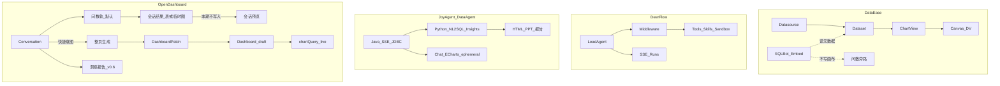

# AI 能力架构（对照三开源 · 问数优先）

> 现行代码中的问数交互与管道已写入 [architecture.html · 问数流程](../../design/architecture.html#ask)（已编码未验收）。本文仍是提案详细设计，不是 4A 现行架构。
> 对照仓（不入本仓 git）：`/Users/shen/backdashboard/refs/`（DataEase / DeerFlow / JoyAgent `data_agent`）。
> 关联：[P004 对话设计](../P004-conversation/design.md) · [生成设计](../P004-conversation/dashboard-generation-design.md) · [Harness](../P004-conversation/harness-design.md) · 提案 [P004](../P004-conversation/README.md) · [P006](./README.md)

## 结论（先回答「问数要不要先做」）

**要。对话默认能力是问数；仪表盘是问数结果的显式落地，不是问数的前置条件。**

| 问题 | 结论 |
|------|------|
| 是否必须先有问数，才有仪表盘生成？ | **产品顺序：问数优先。** 用户先得到可复核的答案（表/临时图）。问数结果卡本期不负责写入看板；整页写入走独立「生成看板」意图。 |
| 是否等于不能直出看板？ | **否。** 「直接生成仪表盘」仍是一等意图（快捷路径），内部可复用问数规划出的 encode / 字段证据，而不是跳过 Schema。 |
| 工程上谁先落地？ | **共享底座（Schema Guard + datasetQuery/chartQuery + SSE Harness）→ 问数 ephemeral 结果 → 采纳为 Patch → 整页生成。** 已有的 Patch 闭环可与问数并行补齐，但高保/产品叙述以问数为默认。 |

理由（对照三仓）：

1. **JoyAgent DataAgent**：会话主路径是 NL2SQL → 结果 + 内联图；报告/诊断是后续产物。OD 应对齐「先答再落配置」。
2. **DataEase SQLBot**：问数是**嵌入旁路**，吃 DS/Dataset 元数据，**不**直接写 DV 画布。社区仓只有加载器（`assistant.vue` → 远端 `assistant.js`）；实现在独立仓 [dataease/SQLBot](https://github.com/dataease/SQLBot)（本地 `refs/sqlbot`，不入本仓 git）。OD **不** iframe 整套 SQLBot（用户/工作空间/RAG/任意 SQL），把编辑器浮层壳迁过来，接到现有 `intent=ask` harness。
3. **DeerFlow**：提供 Lead + 中间件 + SSE run + Plan/澄清；不提供 BI 真相。OD 只抄 Harness，不抄沙箱产物当看板。

**硬边界不变：** 看板真相是 Dashboard draft 配置；会话内结果行可展示，**禁止**把结果行持久化进布局 / HTML。采纳时只写 `DashboardPatch`（encode + 布局），运行时再 `chartQuery`。

---

## 三仓对照（架构取舍）



| 维度 | DataEase | DeerFlow | JoyAgent | **OD 采用** |
|------|----------|----------|----------|-------------|
| 问数 | SQLBot 嵌入，旁路 | 非 BI | NL2SQL 主路径 + 内联图 | **对话默认轨**；会话 ephemeral |
| 看板 | DS→Dataset→Chart→Canvas 持久配置 | 无 | HTML/PPT ≠ 看板 | **Patch → draft**；分层 IA 抄 DE |
| 写回 | 问数不写 DV | 文件产物 | 结果进聊天/HTML | **问数不写；显式生成才 Patch** |
| 编排 | 外挂 | Lead + 中间件 + SSE | Java 编排 + Python 工具 | Python `opendashboard-harness`；Java 只提供 BI 工具 |
| 不抄 | getData 整 DTO | Docker/E2B/bash | 结果行进 HTML 当真相 | — |

本地路径：`refs/dataease` · `refs/sqlbot` · `refs/deer-flow` · `refs/joyagent-jdgenie-data_agent`（若缺见 [Harness 设计](../P004-conversation/harness-design.md) 重拉说明）。

---

## 目标架构：双意图 · 一真相

### 意图 A — 问数（默认）

```text
自然语言 → Schema Guard → 意图卡（短语对齐字段）→ encode + filters
  → datasetQuery | chartQuery（会话预览）
  → SSE: intent_map / step / answer_table | answer_chart / finish
  → UI：会话内预览（本期无「保存到仪表盘」）
```

- 默认**不**改 linked dashboard。
- 结果可在会话展示；刷新仍走查询，不落行。
- **Adopt 闭环标本期不做产品入口**（契约 `POST …/adopt` 仍保留，问数卡与 SQLBot 不调用）。
- **Few-shot**：数据集页高频问法 → `GET /api/internal/bi/datasets/{id}/questions` → 按问题相似度注入最多 3 条。
- **维度值**：schema `field.values`（仅 confirmed）+ `<dimension-values>`，过滤用原文字面量。

### Adopt 协议闭环（契约保留 · 产品入口延后）

问数结果卡本期不走 Harness adopt。若后续重新开放「保存到仪表盘」，仍统一走 Harness，不让前端回调 Java，也不让 Java public conversation 入口再反调 Harness：

```text
FE
  → POST /harness/v1/conversations/{conversationId}/runs/{runId}/adopt
       body: { action: "save", styleId? }
  → opendashboard-harness
       读取 run artifact（answer_table / answer_chart / answer_sql / AskPlan）
       由可信运行时产物生成 DashboardPatch
       校验 datasetId / encode / chartType / rowCount，不信任前端传图表配置
  → Java /api/internal/bi/apply-patch
       最终校验字段、数据集权限、Dashboard draft 写权限并写入 draft
  → Harness SSE: patch / chart_ready / board_ready / finish
```

职责边界：

| 层 | 做什么 | 不做什么 |
|----|--------|----------|
| FE | 问数只展示 SSE 结果；生成走 `intent=gen`。本期不调 adopt | 不传完整 `DashboardPatch`，不直调 Java adopt |
| Harness | 保存 run artifact；adopt 时从 artifact 生成 Patch；通过 internal token 调 Java BI | 不持有生产库账号，不把结果行写入布局 |
| Java internal BI | `schema/query/apply-patch`、权限与字段最终闸门、draft 持久化 | 不承担 Agent run，不反调 Harness |

Java public `/api/conversations/{id}/runs/{runId}/adopt` 从公开契约与 Controller 删除；新实现不得把前端切回 Java public adopt。

### 意图 B — 直接生成仪表盘（快捷）

```text
自然语言（「生成经营看板」等）→ 同 Harness
  → DashboardPatch（KPI+趋势+结构…）→ draft → chart_ready
```

- 与 [P004 生成设计](../P004-conversation/dashboard-generation-design.md) 一致。
- Plan 模式仍可确认后 apply。

### 共享底座

| 组件 | 职责 |
|------|------|
| Conversation SSE | `run/step/plan/patch/chart_ready/answer_*/message_delta/error/finish` |
| Schema Guard | 无 schema 禁止 patch；问数无 schema 则拒答或降级澄清 |
| Askable Guard | 可问集合 = `conversation:use ∩ dataset:use`；无权限数据集不进入选择器、Schema 或提示词 |
| BI 工具白名单 | listDatasets / getSchema / proposeEncode / emitPatch / validateChartQuery；（问数二期）proposeQuery — **禁止**任意 SQL 入口暴露给前端 |
| DashboardPatchApplier | 唯一写 draft 通道 |
| chartQuery / datasetQuery | 唯一取数通道 |

---

## 产品交互（高保 · Ask-1）

入口：[`conversation.html`](../../prototypes/hi-fi/conversation.html) → 嵌入 [`conversation-workspace.html`](../../prototypes/hi-fi/conversation-workspace.html)（`?embed=1&v=` 缓存戳）。

| 区域 | 行为 |
|------|------|
| 落地页 | 品牌「先问数」；Chip 以问数为主，「直接生成仪表盘」次要 |
| Composer | 默认意图问数；数据集胶囊在输入框**下方**工具条，点开列表朝下换表，发送后自动收起；对话页不提供「上传表」、Auto/Plan、风格切换；可点「换一个问数问题」 |
| 反问 | 已选表后，元指令（换一个问数问题 / 不知道问什么）或 SQL 生成失败（无具体问数需求）→ 按当前表字段给出可点 Chip；点选后再走 SQLBot 出 SQL/图 |
| 对话列 | **问数**：步骤 + 结果卡同列（结论 / 临时图；无图才出明细表）；思考过程与结果卡同一内容轴（头像右侧、等宽圆角卡片）；SQL 留在思考过程，结果卡有图时不并列铺明细行；思考过程默认展开，折叠后结果卡上移不留白；**打开历史会话必须回放步骤与结果卡**（Harness replay，不重跑）；**生成**：步骤在对话，draft 在画布 |
| 流程条 | ① 提问 → ② 问数/规划 → ③ 结果 → ④ 保存 / 生成看板 |
| 画布 | **问数不展开**。仅「生成看板」或采纳后出现 draft；洞察证据也先在对话里 |
| 桥接条 | 写入 draft 后：路径 + 编辑器 |
| 顶条 | 新对话 / 历史 / 探索示例，不展示会话问题标题 |

**演示路径：** `#/conversation` → 选订单表 →「换一个问数问题」→ 点「各商户类型的商户收入合计」→ 见 SQL 与图。另：`#/conversation` →「区域销售额」→ 追问「华南为什么下滑？」→ 应看到 **洞察诊断**（驱动拆解），而不是同一张区域图。

---

## 分期

| 阶段 | 内容 | 提案 |
|------|------|------|
| **Ask-1** | 高保问数交互；SSE `answer_table` / `answer_chart`；确定性问数（字段聚合，无任意 SQL） | [P006](./README.md) |
| **Ask-2** | 问数结果会话预览；「保存到仪表盘」产品入口延后；整页生成归 P004 独立快捷意图 | P006 + P004 |
| **Ask-3** | SQLBot 问数主路径：M-Schema → LLM SQL → sqlglot 只读校验 → `query/sql` → 图 | [P006](./README.md) |
| Gen | 整页生成 / Plan / 编辑器侧栏 | [P004](../P004-conversation/README.md) · [生成设计](../P004-conversation/dashboard-generation-design.md) |
| Insight | 洞察 → Umo | [P005](../P005-insight-report/README.md) |

---

## 成功标准（问数优先一期）

- `#/conversation` 默认可完成：选数据集 → 提问 → 见步骤与结果表/图（会话内）。
- `PR-ASK-05`：结果卡无「保存到仪表盘」、无整页生成主按钮；「直接生成仪表盘」只在落地页、Composer 快捷意图或追问 Chip 出现。
- 布局库无结果行；取数仅 query API。
- 「生成经营仪表盘」快捷意图仍可用，不强制先问一题。
- 追问「为什么/下滑」走 **洞察态**（DIAG），不复用上一张问数图。
- SQL 合法但 **0 行**（例如问了样本里没有的年份）：发 `answer_insight` 说明无数据，**禁止**用空白图冒充成功；历史会话已有 replay 产物时不得再 POST `/runs`。
- 结果表头、图例、轴标题对用户展示中文（数据集 `label`；无中文时把 `order_cnt` 转成「订单数」），物理列名只留在 SQL / encode。

---

## 高保 → 实现清单（Ask-1 / Ask-2）

高保已表达交互真相；落地按层拆：

| 层 | 要做 | 说明 |
|----|------|------|
| **契约** | OpenAPI 补 `intent=ask\|gen\|insight`；SSE 增 `answer_table` / `answer_chart` / `answer_insight` | 先于 FE/BE |
| **Python Harness** | 意图路由：问数 / 洞察 / 生成；确定性 encode + 聚合预览；洞察 = 下钻拆解（可先规则，后 LLM） | `opendashboard-harness/`，Vue 直连 `/harness/v1/*` |
| **BE 取数** | 问数预览：`query/sql`（SQLBot）或 `chartQuery` encode 回退 | **不**把任意 SQL 暴露给前端 |
| **采纳闭环** | 契约保留 Harness `/runs/{runId}/adopt`；问数本期不调。写入看板只走 `intent=gen` emit_patch | 与 P004 共用；FE 不调 Java public adopt |
| **FE `/conversations`** | 对齐高保：默认问数、结果卡、DIAG、桥接编辑器（生成后） | 替换/增强现有壳 |
| **编辑器 SQLBot** | 对齐 DE：浮层问数 + 当前看板数据集；不写画布 | `ConversationAiPanel`；对照 `refs/sqlbot` + DE `assistant.vue` |
| **不做（本期）** | 任意 SQL 入口、沙箱、结果行入库、问数「保存到仪表盘」、独立 ChatBI 站、整仓搬 SQLBot | — |

建议迭代：

1. **Ask-1 工程**：意图分类 + `answer_*` SSE + FE 结果卡（确定性模板即可演示）
2. **Ask-2**：问数预览打通；保存本题图延后
3. **Ask-3**：SQLBot generate-SQL 管道（harness `sqlbot/` + Java `query/sql`）
4. **Ask-4（暂缓对话入口）**：文件导入 API 仍保留；对话落地页 / Composer **不**暴露「上传表」，只从已有可问数据集选择。

---

## 进程边界（现行）

**Java 零 AI；DeerFlow / `opendashboard-harness` 承载全部智能能力。** 详见 [Harness 设计](../P004-conversation/harness-design.md)。

```text
浏览器 (OD Vue)
  → opendashboard-harness
       /harness/v1/*（Agent loop / LLM / SSE）
  → open-dashboard-backend
       /api/internal/bi/*（schema / query / applyPatch）
       DatasetService + chartQuery + DashboardAppService
```

| 能力 | 落点 |
|------|------|
| 问数 | SQLBot 管道 `sqlbot/`（LLM SQL + 只读执行）；失败回退 `od_run_query` encode |
| 解读 / 报告 | harness skills + `od_import_report` 写 Java |
| 仪表盘生成 | DeerFlow planner：`write_todos` → profile → `od_plan_charts` → `od_review_charts`（layout 再跑）→ layout → `od_emit_patch` |
| 沙箱 Python | DeerFlow sandbox（分析用）；落看板必须再 emit_patch |

**结论：** 编排与模型在 DeerFlow；看板/权限/取数真相在 Java。不在 Java 保留第二套 Agent。
