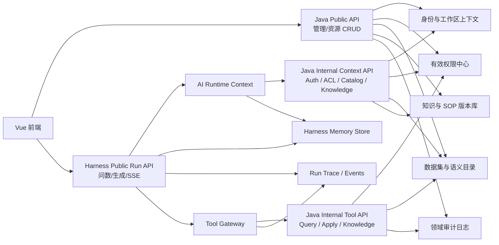
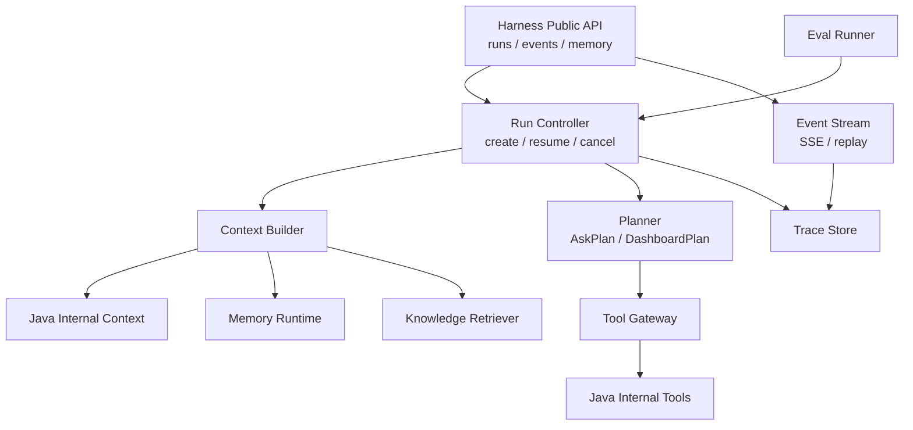
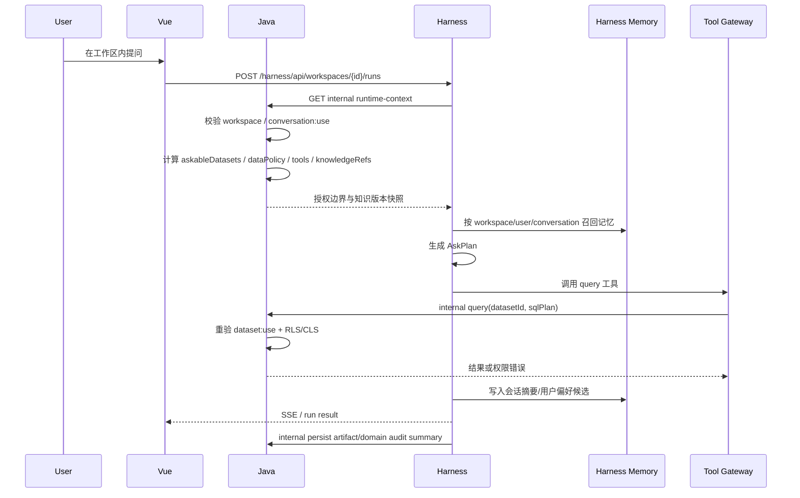

# P009 · 工作区隔离、用户体系与知识治理详细设计

> 状态：未实现详细设计，不属于现行 4A 架构。实现并验收后只把稳定结果沉淀到 [`architecture.html`](../../design/architecture.html)。  
> 需求入口：[README](./README.md) · 验收：[acceptance.yaml](./acceptance.yaml)  
> 本轮同步方案与高保，不改 OpenAPI、不改运行代码。

## 1. 参考框架对照

| 参考 | 看到的实现 | 借鉴 | 不照搬 |
|------|------------|------|--------|
| DataEase | `org`、`user`、`role`、动态路由、组织切换、`/sqlbot/dataset/{dvInfo}` 授权数据集入口 | 组织/角色/资源菜单分层，工作区切换体验，SQLBot 只拿授权数据集 | 不照搬前端动态路由作为最终鉴权；服务端必须重新算有效权限 |
| SQLBot | `workspace`、`permissions`、`training`、`assistant`、`audit` API，数据训练和模型工作区映射 | 工作区绑定模型、数据权限、训练样本和审计的产品分面 | 不让 SQLBot 成为独立权限源；它应消费平台统一上下文 |
| DeerFlow | auth / authz / memory router，大量用户隔离、工具过滤、记忆隔离测试 | AuthN/AuthZ 分离、权限 provider、工具级过滤、记忆按用户隔离、测试优先 | 不把通用 Agent 的文件/系统工具直接开放给 BI 用户 |
| JoyAgent / Genie | PlanView、SOP 召回、table RAG、nl2sql、analysis/report 工具 | 计划可视化、SOP/知识召回、问数到报告的工具链 | 不把生成的 HTML/文件作为 BI 事实源；最终产物仍写入平台模型 |
| Pi | AgentMessage、toolCall/toolResult、事件流、工具参数校验、turn 生命周期 | 统一消息、事件、工具结果和停止条件，便于回放和审计 | 不引入前端直连工具；工具执行必须受 Java 下发上下文约束 |

结论：平台应采用“Harness 作为 AI Run 独立入口和记忆归属 + Java 统一业务与权限事实 + 受控 internal tool contract”的结构。refs 中值得借的不是某个 prompt，而是组织隔离、知识发布、工具过滤、计划事件、记忆隔离和可回放审计。

## 2. 总体架构



调用方向按入口拆开：

```text
普通业务：FE → Java public API
AI 运行：FE → Harness public run API → Harness memory/context → Java internal context/tool API
```

禁止的方向：

```text
FE → Java public run API → Harness → Java internal API
```

这个方向会让 Java 既是 run 发起方又是工具被调用方，链路绕、事务边界不清、错误码和 SSE ownership 也容易漂移。

边界：

- Harness 是问数和仪表盘生成的独立运行入口，负责 run 生命周期、计划、事件流、工具编排和中止。
- Java public API 承接工作区、成员、角色、数据集、仪表盘、报告、知识管理等普通业务页面。
- Harness 拥有 AI runtime context、session memory、user memory、workspace memory、run trace 和 SSE ownership。
- Harness 启动前向 Java internal context API 获取身份、工作区、权限、数据目录、知识版本和工具清单边界，后续领域工具调用走 Java internal tool API。
- Java internal API 每次重新校验工具权限、资源权限和数据权限，不信任模型产出的 ID。
- Java 不保存 AI 长短期记忆；Java 只保存业务事实、权限事实、知识发布状态、领域产物和领域审计。
- Harness 不保存业务权限真相，只保存运行过程、计划、记忆、事件和工具结果摘要。
- FE 不直接调用 Java internal API，也不持有任何 internal tool 地址。

### 2.1 Harness 演进架构

不建议直接在 refs 的开源项目里改造成主 Harness。主干保留当前 `opendashboard-harness`，原因是它已经贴近本项目的 Java internal apply、问数和仪表盘产物模型；refs 只按模块吸收成熟做法。

目标结构：



模块职责：

| 模块 | 职责 | 主要参考 |
|------|------|----------|
| `RunController` | run 生命周期、取消、重试、恢复、幂等 | Pi agent loop、DeerFlow run/router 测试 |
| `EventStream` | SSE ownership、事件回放、计划进度 | Pi EventStream、JoyAgent PlanView |
| `ContextBuilder` | 合并 Java 授权边界、知识引用、Harness 记忆和用户输入 | DeerFlow user isolation、SQLBot workspace |
| `Planner` | 产出结构化 `AskPlan` / `DashboardPlan` / `KnowledgeChangePlan` | JoyAgent plan/SOP |
| `ToolGateway` | 工具注册、参数校验、权限过滤、预算和输出裁剪 | Pi toolCall/toolResult、DeerFlow tool policy |
| `MemoryRuntime` | session/user/workspace/run memory 的写入、召回、压缩、清理 | DeerFlow memory isolation |
| `KnowledgeRetriever` | 基于 Java `knowledgeRefs` 做关键词、向量、重排和裁剪 | SQLBot training、JoyAgent table RAG |
| `TraceStore` | run trace、tool trace、knowledgeRefs、memoryRefs、错误码摘要 | DeerFlow tests、Pi message events |
| `EvalRunner` | 准确性回放集、权限隔离回归、SQL/图表质量评测 | refs 的隔离测试思路 |

### 2.2 refs 吸收策略

| 来源 | 吸收方式 | 落点 |
|------|----------|------|
| Pi | 借事件流、AgentMessage、toolCall/toolResult、工具参数校验和停止条件 | `RunController`、`EventStream`、`ToolGateway` |
| DeerFlow | 借 authz provider 思路、工具过滤、记忆隔离、用户隔离测试 | `ContextBuilder`、`MemoryRuntime`、`EvalRunner` |
| SQLBot | 借 workspace、权限、training、assistant、audit 的产品分面 | Java 知识管理、Harness `KnowledgeRetriever` |
| JoyAgent / Genie | 借 PlanView、SOP 召回、table RAG、nl2sql、analysis/report 工具链 | `Planner`、`KnowledgeRetriever`、前端运行详情 |
| DataEase | 借组织切换、角色挂载、授权数据集入口 | Java 工作区和权限管理 |

原则：

- 不 fork ref 项目作为主服务，避免带入外部用户体系、权限模型和产物模型。
- 可以复制小模块思想或局部实现，但进入本仓后按 P009 的边界改造成平台契约。
- 所有工具都挂到 Tool Gateway，不能让某个 ref 的工具直接绕过 Java internal 权限。
- 所有评测用例要围绕本平台验收 ID，而不是围绕 ref 原项目行为。

### 2.3 Harness 改造流程

```text
现有简陋 Harness
  → 抽 RunController / EventStream / TraceStore
  → 接 Java internal runtime-context
  → 工具统一进 ToolGateway
  → 结构化 AskPlan / DashboardPlan
  → 接 Harness MemoryRuntime
  → 接 Java knowledgeRefs + Harness KnowledgeRetriever
  → 建 EvalRunner 回放准确性、权限和稳定性用例
  → 再按需吸收 refs 的局部算法或 UI 表达
```

阶段目标：

| 阶段 | 交付 | 结果 |
|------|------|------|
| H1 runtime 骨架 | `RunController`、`EventStream`、`TraceStore`、统一 run/event schema | 运行可回放、SSE ownership 清晰 |
| H2 Java context | internal runtime-context client、授权快照、工具清单 | Harness 不再猜用户、数据和权限 |
| H3 ToolGateway | 工具注册表、JSON Schema 校验、权限过滤、输出裁剪 | 工具调用稳定且可审计 |
| H4 Planner | `AskPlan`、`DashboardPlan`、计划事件和失败兜底 | 问数和生成从自然语言散答变成结构化流程 |
| H5 MemoryRuntime | session/user/workspace/run memory、策略、索引、清理 | 个性化和团队经验可控复用 |
| H6 KnowledgeRetriever | Java active knowledgeRefs、关键词/向量召回、重排、裁剪 | 指标口径和 SQL 示例进入稳定上下文 |
| H7 EvalRunner | golden questions、权限矩阵、dashboard generation replay | 准确性和隔离问题可复现、可回归 |

每个阶段都要保持 Harness 独立入口不变：

```text
FE → Harness Public Run API
Harness → Java Internal Context / Tool API
```

不能退回：

```text
FE → Java Public Run API → Harness → Java Internal API
```

### 2.4 前端信息架构

前端先采用一个产品壳，不拆两个独立应用。产品壳按权限分区展示：

| 区域 | 面向谁 | 页面 | 服务入口 |
|------|--------|------|----------|
| 用户使用端 | 业务用户、分析师、看板消费者 | 工作台、数据广场、对话分析、仪表盘、报告 | AI run 调 Harness public；数据广场和资源读写按需调 Java public |
| 管理端 | 平台管理员、工作区管理员、数据管理员、知识管理员 | 数据源、数据集、知识库、成员权限、审计 | Java public API |

导航规则：

- 所有用户进入平台后必须先落在一个当前工作区；顶部工作区切换器展示 `workspaceId`、工作区名和当前角色。
- 无管理权限的用户只看到用户使用端；有数据、知识或成员权限时才展示对应管理入口。
- 用户使用端不承载成员、角色、发布、审计等治理动作，只展示“当前有哪些数据、可申请哪些数据、当前可问什么、用了什么知识、生成了什么产物”。
- 管理端不发起 AI run；它维护数据、知识、权限和审计事实。需要试问时跳回对话分析，并带当前 `workspaceId` 与授权数据集上下文。

高保落点：

| 文件 | 覆盖内容 |
|------|----------|
| `docs/prototypes/hi-fi/index.html` | 高保统一入口：登录入口、用户使用端、管理端、当前演示上下文和端到端链路 |
| `docs/prototypes/hi-fi/shared/shell.js` | 用户使用端 / 管理端分组、工作区切换器、当前用户角色 |
| `docs/prototypes/hi-fi/login.html` | 登录、企业 SSO、退出后提示、忘记密码 |
| `docs/prototypes/hi-fi/register.html` | 注册用户、邀请码加入工作区、创建新工作区 |
| `docs/prototypes/hi-fi/account-settings.html` | 个人资料、修改密码、登录安全、通知偏好 |
| `docs/prototypes/hi-fi/data-market.html` | 用户端数据广场：数据空间、资产分类、我的数据、已获权、可申请、申请中、消费申请 |
| `docs/prototypes/hi-fi/workspace-admin.html` | 成员、项目组、角色矩阵、数据权限、工具权限、审计摘要 |
| `docs/prototypes/hi-fi/knowledge.html` | 管理端知识库：候选确认、指标、术语、金标准问法、我的记忆 |
| `docs/prototypes/hi-fi/conversation-workspace.html` | 用户使用端对话分析：当前工作区、可问数据集、知识命中和管理跳转 |

用户使用端核心体验：

```text
选择工作区
  → 工作台看到可问数据、最近对话、我的看板/报告
  → 数据广场查看企业资产、我的数据、可申请和申请中
  → 未获权时提交消费申请
  → 进入对话分析提问或生成
  → 前端直接调用 Harness public run
  → 对话展示结果、知识命中、权限解释和可保存产物
```

管理端核心体验：

```text
工作区管理员进入成员权限
  → 同步/邀请用户
  → 绑定项目组与角色
  → 配置数据集 use、可申请范围、行列策略和工具策略
  → 数据/知识管理员发布可问数据集和 active 知识
  → 审计页回看 run、工具调用、权限决策与知识版本
```

## 3. 领域模型

| 实体 | 关键字段 | 说明 |
|------|----------|------|
| `workspace` | `id`、`name`、`status`、`ownerId`、`defaultPolicy` | 工作区是租户隔离边界 |
| `workspace_member` | `workspaceId`、`userId`、`state`、`joinedAt` | 用户加入工作区 |
| `group` | `workspaceId`、`name`、`type` | 项目组，可从外部组织同步 |
| `group_member` | `groupId`、`userId` | 项目组成员 |
| `role` | `workspaceId`、`code`、`permissions` | 工作区内角色 |
| `role_binding` | `workspaceId`、`subjectType`、`subjectId`、`roleId` | 用户或项目组绑定角色 |
| `resource_acl` | `workspaceId`、`resourceType`、`resourceId`、`subject`、`action` | 仪表盘、报告、对话、数据集资源 ACL |
| `data_policy` | `workspaceId`、`datasetId`、`subject`、`rowFilter`、`columnMask` | 行列权限 |
| `semantic_asset` | `workspaceId`、`datasetId`、`type`、`status`、`version` | 指标、术语、字段解释、SQL 示例 |
| `sop` | `workspaceId`、`name`、`steps`、`status`、`version` | 问数、生成、审核等标准流程 |
| `memory_entry` | `scopeType`、`workspaceId`、`userId`、`conversationId`、`content` | Harness 持有的会话/用户/工作区分层记忆 |
| `tool_policy` | `workspaceId`、`toolName`、`requiredPermission`、`enabled` | 工具可用性与权限 |
| `audit_event` | `workspaceId`、`userId`、`runId`、`toolName`、`decision` | 可追溯审计 |

所有业务表和知识表必须带 `workspaceId`。跨工作区共享只能通过显式复制或发布，不允许同一资源在多个工作区隐式可见。

当前已落地的身份与菜单权限薄片使用 `V15__identity_access.sql`：

| 物理表 | 职责 | 当前边界 |
|--------|------|----------|
| `od_user_account` | 本地账号、展示名、邮箱和状态 | 服务端生成 `user_id`，前端不能指定 |
| `od_password_credential` | 密码凭证 | PBKDF2-HMAC-SHA256、随机盐、可调迭代次数；不存明文密码 |
| `od_auth_session` | 浏览器会话 | 只存 Token 哈希、过期时间、当前 `workspace_id` 和 user-agent 摘要 |
| `od_workspace_member` | 用户加入工作区 | 当前版本落用户-工作区-角色；后续再拆项目组继承 |
| `od_role`、`od_permission`、`od_role_permission` | RBAC 权限字典和角色授权 | 用于计算 `AuthPrincipal.effectivePermissions` |
| `od_menu_item`、`od_menu_permission` | 菜单字典和菜单访问条件 | `JdbcMenuProvider` 服务端过滤用户端 / 管理端菜单 |
| `od_external_identity` | 外部身份绑定 | Google / OIDC 的 `provider + subject` 绑定本地 user |
| `od_sso_state` | SSO 一次性 state | 保存 state hash、nonce、PKCE code verifier、登录后 redirect 和消费时间 |

浏览器身份以 `OD_SESSION` HttpOnly Cookie 为准。`X-User-Id`、`X-User-Perms` 等 header 只允许带有效 `X-OD-Internal-Token` 的 Java/Harness 内部调用使用，避免前端直接放大权限。

## 4. 权限模型

权限分四层收敛：

```text
effective = AuthN 用户身份
          ∩ Workspace membership
          ∩ RBAC / Resource ACL
          ∩ Data policy / Tool policy
```

动作建议：

| 领域 | 动作 |
|------|------|
| workspace | `admin`、`manage_member`、`switch` |
| dataset | `create`、`view`、`use`、`manage_policy`、`publish_semantic` |
| conversation | `create`、`use`、`view` |
| dashboard | `view`、`create`、`edit`、`publish`、`delete` |
| report | `view_static`、`refresh`、`edit`、`publish` |
| knowledge | `draft`、`review`、`publish`、`archive` |
| tool | `run_sql`、`generate_dashboard`、`apply_dashboard_patch`、`publish_knowledge` |

关键规则：

- `workspaceId` 必须来自服务端当前上下文，不能只信任前端传参。
- `askableDatasets = workspace membership ∩ conversation:use ∩ dataset:use ∩ data_policy`。
- 仪表盘生成分两段：能生成计划不等于能写入仪表盘；写入前必须校验 `dashboard:create/edit`。
- 数据源是管理对象，问数只能消费已发布数据集和语义资产。
- 工具权限不能比资源权限宽。模型想调用工具时，由 Tool Gateway 再算一次权限。

## 5. 用户体系与工作区接入流程

### 5.1 用户接入

```text
用户登录 / 注册 / 外部身份回调
  → Java 创建/更新 user
  → 读取用户已加入工作区或待处理邀请
  → 接受邀请后创建 workspace_member
  → 继承项目组角色与直接角色
  → 前端展示可切换工作区
```

第一阶段可以支持三种来源：

- 本地用户：本阶段已实现，支持登录、注册、修改密码、退出和切换工作区。
- Google / OIDC SSO：本阶段已实现通用 OIDC provider，支持 Google、Azure AD、Okta、Keycloak、自建 IdP 等授权码登录；回调后由 Java 绑定/创建本地 user 并建立 `OD_SESSION`。
- SAML SSO：作为后续企业增强，接入后也必须落到同一 user/session/permission 模型。
- 外部 header adapter：仅保留给可信内部网关或 Harness 内部调用，必须校验 `X-OD-Internal-Token`。

### 5.1.1 认证与账号通用功能

认证交互高保归属 P009，覆盖：

| 页面 / 交互 | 入口 | 结果 |
|-------------|------|------|
| 登录 | `login.html` | 账号密码登录后进入上次工作区或工作区选择 |
| 企业 SSO 登录 | `login.html` | 跳转 Google 或通用 OIDC 身份提供方，回调后由 Java 建立 user session |
| 忘记密码 | `login.html#reset` | 发送一次性重置链接，重置成功后注销其它设备 |
| 注册 | `register.html` | 创建 user；可用邀请码加入工作区，或创建新工作区 |
| 账号设置 | 账号下拉 → `account-settings.html` | 修改个人资料、语言、通知偏好 |
| 修改密码 | 账号下拉 → `account-settings.html#password` | 校验旧密码、更新新密码、可注销其它设备 |
| 登录安全 | `account-settings.html#security` | 查看设备会话，注销非当前设备 |
| 退出登录 | 账号下拉 → 退出确认 | 清空当前浏览器会话，跳回 `login.html?logged_out=1` |

规则：

- `userId` 永远由服务端登录态确定，前端表单不能指定。
- 注册不会自动获得数据权限；只有加入工作区并获得角色后，才出现对应用户使用端和管理端菜单。
- 修改密码属于用户级账号能力，不改变任何工作区角色、ACL、数据策略或记忆。
- 退出登录只结束会话，不删除用户记忆、工作区成员关系、运行 trace 或业务产物。
- SSO / header adapter 用户的密码修改入口应展示“到身份提供方修改”，本地用户才展示旧密码校验表单。

### 5.2 工作区切换

切换工作区后，Java 下发：

- 当前 `workspaceId`。
- 当前用户有效角色。
- 可见导航和功能开关。
- 可问数据集摘要。
- 资源列表摘要。

前端缓存只做展示加速，任何运行、查询、写入仍以服务端实时鉴权为准。

## 6. 问数核心流程



准确性控制点：

- 语义上下文只从已发布的 `semantic_asset`、`sop`、`sql_example` 中召回。
- 每个 AskPlan 必须包含目标数据集、指标口径、过滤条件、SQL 草案和置信度。
- Java 执行前做 SQL 安全校验、字段白名单、行列策略注入。
- 结果返回时附带“使用了哪些数据集、指标口径和策略”的解释摘要。

## 7. 仪表盘生成核心流程

```text
用户输入目标
  → 前端调用 Harness public run 入口
  → Harness 向 Java internal 读取授权边界、知识版本和工具清单
  → Harness 召回业务术语、指标、SQL 示例、SOP 和历史布局偏好记忆
  → 生成 DashboardPlan
  → 逐图 probe 查询并校验可视化类型
  → 需要写入时调用 Java internal apply
  → Java 校验 dashboard:create/edit + dataset:use
  → 保存 dashboard draft 与 run trace
  → 前端展示计划、草稿和可回滚记录
```

稳定性控制点：

- `DashboardPlan` 是结构化产物，不能只是一段自然语言。
- 每个图表必须有数据集、维度、指标、筛选、图形类型、失败兜底。
- 写入采用一次 run 对应一次 draft patch；失败不污染已发布版本。
- apply 只在 Java 内部 API 落库，避免前端和 Harness 形成循环调用。

## 8. 工具体系

工具注册表字段：

| 字段 | 说明 |
|------|------|
| `toolName` | 稳定名称，例如 `dataset.query`、`dashboard.applyPatch` |
| `inputSchema` | JSON Schema，运行前校验参数 |
| `outputSchema` | 结果 Schema，便于 UI 渲染和回放 |
| `requiredPermission` | 调用该工具所需权限 |
| `allowedScopes` | `workspace` / `user` / `conversation` |
| `sideEffect` | `none` / `read` / `write` |
| `auditLevel` | `summary` / `full` / `redacted` |

运行策略：

- 读工具默认可在计划内多次调用，但受查询预算限制。
- 写工具必须有明确用户意图和服务端权限。
- 工具输出超过预算时截断，但保留统计摘要和 artifact id。
- 对外部工具或插件，先映射到工作区级连接，再进入 Tool Gateway。

## 9. 规划体系

每类任务都有可持久化计划：

| 任务 | 计划 |
|------|------|
| 问数 | `AskPlan`：意图、数据集、指标、过滤、SQL 草案、校验结果 |
| 仪表盘生成 | `DashboardPlan`：布局、图表列表、数据查询、写入 patch |
| 知识维护 | `KnowledgeChangePlan`：新增/修改项、影响数据集、审核人 |
| 权限变更 | `PermissionChangePlan`：主体、资源、动作、影响范围 |

计划必须能被展示、回放和审计。用户对计划的“继续 / 修改 / 取消”作为事件进入 run trace。

## 10. 知识体系

知识归属 Java。知识是经过审核的业务事实补充，优先级高于记忆，必须和工作区、数据集、发布版本、审核状态绑定。

知识分四类：

- 业务术语：同义词、口径说明、禁用词。
- 指标口径：计算公式、粒度、默认过滤、适用数据集。
- SQL 示例：问题、数据集、SQL、解释、适用条件。
- SOP：问数、归因、异常排查、仪表盘搭建的标准步骤。

### 10.1 管理

管理入口放在 Java public API 和前端工作区管理页：

- 数据管理员维护字段解释、维表关系、可问数据集说明。
- 业务负责人维护指标口径、业务术语、同义词和禁用解释。
- 分析专家维护 SQL 示例和 SOP。
- 审核人负责草稿审核、发布、下线和回滚。

状态机：

```text
draft → validating → review → active → archived
              ↘ rejected
```

规则：

- `draft` 可以由人工创建，也可以由 Harness 从运行反馈中提出候选。
- `validating` 由 Java 校验字段存在、SQL 可执行、权限不越界、引用数据集未下线。
- `active` 才能进入 Harness runtime context。
- `archived` 保留历史版本，用于 run trace 回放，不再参与新召回。

### 10.2 存储

Java 侧保存结构化主表，索引层保存可检索副本。

| 存储 | 内容 | 作用 |
|------|------|------|
| `semantic_asset` | 指标、术语、字段解释、SQL 示例、SOP 的元数据、状态、版本 | 权威事实与审核流 |
| `semantic_asset_version` | 每次发布的不可变快照 | 回放、回滚、审计 |
| `semantic_asset_binding` | `workspaceId`、`datasetId`、`fieldId`、`resourceId` 绑定关系 | 授权过滤和影响分析 |
| `semantic_asset_index` | 分词文本、embedding id、关键词、摘要 | 召回索引 |
| object storage | 大段文档、附件、示例说明 | 降低主库膨胀 |

索引策略：

- 主库是知识真相，向量库/搜索引擎只是索引副本。
- 发布或下线时写 outbox，由异步任务更新关键词索引和向量索引。
- 索引记录必须携带 `workspaceId`、`datasetIds`、`assetType`、`version`、`status`。
- 索引延迟时，Harness 以 Java runtime context 返回的 active version 为准，不直接相信旧索引状态。

### 10.3 获取

Harness 获取知识分两步：

```text
Harness 请求 Java internal runtime-context
  → Java 根据 workspace/user/dataset 权限返回可用 knowledgeRefs
  → Harness 用 knowledgeRefs 限定关键词 + 向量召回
  → Harness 把命中的知识版本写入 AskPlan / DashboardPlan
  → Java 工具执行时按 dataset/use 和 data_policy 再校验
```

检索顺序：

1. 精确匹配：指标名、字段名、术语别名、数据集绑定。
2. 关键词召回：业务词、同义词、SQL 示例问题。
3. 向量召回：SOP、字段解释、历史示例摘要。
4. 重排：优先同数据集、同业务域、active 最新版本、人工高置信内容。
5. 裁剪：只把必要片段放入 prompt，完整内容以 `knowledgeRef` 进入 trace。

### 10.4 发布闭环

发布流：

```text
草稿
  → 自动校验字段存在、SQL 可执行、权限不越界
  → 人工审核
  → 发布为 active version
  → 进入向量索引和关键词索引
  → 被问数/生成流程召回
  → 运行反馈形成改进建议
```

知识隔离：

- 只召回当前工作区 active 知识。
- 数据集级知识必须受 `dataset:use` 过滤。
- 跨工作区复用需要复制成新版本，并记录来源。
- Harness 不能把未审核的记忆或运行摘要自动提升为知识；只能生成 `KnowledgeChangePlan` 候选，等待 Java 侧审核发布。

## 11. 记忆体系

记忆不是知识库，不能替代已审核口径。

记忆归属 Harness。Java 只负责告诉 Harness 本次运行允许使用哪些 `workspaceId`、`userId`、`conversationId`、`datasetId` 和知识版本；Harness 在这些边界内做召回、压缩、写入和清理。

| 层级 | 内容 | 生命周期 | 是否可参与答案 |
|------|------|----------|----------------|
| session | 本次对话短期上下文、澄清选择 | 对话内 | 可以，但不能覆盖权限/知识 |
| user | 用户偏好、常用展示方式、常问主题 | 用户级 | 可以，用于表达和默认选择 |
| workspace | 团队常见问题、常用分析路径、失败经验 | 工作区级 | 可以，需标注低于正式知识 |
| knowledge | 已审核指标、术语、SQL 示例、SOP | 版本化 | 最高优先级 |

### 11.1 管理

管理入口分两类：

- 用户记忆：用户在 Harness public API 查看、删除、禁用；前端可放在个人设置或运行详情侧栏。
- 工作区记忆：管理员在 Java public 管理页发起查看、删除、禁用、导出、保留期设置；Java 校验权限后调用 Harness memory 管理接口。

记忆状态：

```text
candidate → active → stale → deleted
          ↘ rejected
```

规则：

- `candidate` 来自模型总结、用户显式保存、运行失败复盘。
- `active` 由 Harness memory policy 自动提升，或由用户/管理员确认。
- `stale` 表示可能过期，只能低权重召回。
- `deleted` 必须不再召回；必要时保留删除审计，不保留正文。

### 11.2 存储

Harness 侧保存记忆，按 scope 分桶。

| 存储 | 内容 | 作用 |
|------|------|------|
| `memory_entry` | scope、正文、摘要、置信度、状态、来源 run、版本 | 记忆权威记录 |
| `memory_index` | embedding id、关键词、topic、更新时间 | 召回索引 |
| `memory_policy` | scope 开关、保留期、敏感词、最大条数 | 写入和清理策略 |
| `memory_audit` | 创建、更新、删除、召回记录摘要 | 排查污染和越权 |

推荐 scope：

| scope | key | 示例 |
|-------|-----|------|
| session | `workspaceId + conversationId` | 本轮澄清“本月按自然月” |
| user | `workspaceId + userId` | 用户偏好“优先看同比和异常点” |
| workspace | `workspaceId` | 团队常问“GMV 先排除测试订单” |
| run | `workspaceId + runId` | 本次 run 的计划、工具摘要、失败原因 |

存储规则：

- 记忆正文不保存查询结果明细，不保存无权限资源名，不保存敏感原始值。
- 长期记忆保存摘要和引用，不保存大结果集。
- `workspaceId`、`userId`、`conversationId` 是物理或逻辑分区键。
- 向量索引必须和主存储状态同步；删除或禁用后索引不可继续召回。

### 11.3 获取

Harness 在每次 run 内部装配记忆：

```text
Harness 创建 run
  → Java internal 返回授权边界
  → Harness Memory 按 workspace/user/conversation 过滤
  → 先取 session 近期摘要
  → 再取 user 偏好
  → 再取 workspace 低权重经验
  → 与 Java 返回的 active knowledgeRefs 合并
  → 写入 prompt context 和 run trace 的 memoryRefs
```

优先级：

```text
Java 权限边界 > Java active 知识 > session 记忆 > user 记忆 > workspace 记忆
```

任何记忆都不能扩大数据权限、不能覆盖已发布指标口径、不能让模型访问未授权数据集。

### 11.4 写入闭环

- 模型可提议记忆，Harness memory policy 决定是否保存；涉及工作区共享记忆时需要 Java 返回的管理员/审核权限。
- 敏感数据、查询结果明细、无权限资源名不进入长期记忆。
- 记忆召回必须带 `workspaceId` 和 `userId` 过滤。
- 用户可通过 Harness public API 查看、删除自己的用户记忆；工作区记忆由管理员在 Java public 管理页发起治理动作，再调用 Harness memory 管理接口落地。

## 12. 分期建议

### Phase 1：Harness runtime 骨架

- 保留当前 Harness 主干，先抽 `RunController`、`EventStream`、`TraceStore`。
- 定义 run/event/tool/result 的结构化 schema。
- 问数和仪表盘生成都从 Harness public run 入口启动。

### Phase 2：工作区与用户边界

- 新增 workspace / member / group / role / binding。
- 前端工作区切换。
- 所有核心资源补 `workspaceId`。
- Java public API 统一注入当前工作区。

### Phase 3：有效权限与可问数据

- 落 P008 资源 ACL、数据集 `use`、行列策略。
- 工作台、对话、SQLBot 共用 `askable-datasets`。
- Harness runtime context 改为 Java internal 授权快照。
- Tool Gateway 统一工具注册、参数校验、权限过滤和输出裁剪。

### Phase 4：知识治理

- 指标、术语、SQL 示例、SOP 草稿/审核/发布。
- 向量与关键词双召回。
- AskPlan / DashboardPlan 引用知识版本。

### Phase 5：记忆与审计

- 会话、用户、工作区记忆分层。
- run trace、tool call、permission decision 可追溯。
- 建立回放用例和准确性评测集。

### Phase 6：refs 局部吸收与外部接入

- 按 H1-H7 的模块边界吸收 Pi、DeerFlow、SQLBot、JoyAgent / Genie 和 DataEase 的局部做法。
- OIDC / SSO / header adapter。
- 外部项目组同步。
- 工作区级模型、工具、外部连接配置。

## 13. 验收映射

本设计的成功标准以 [acceptance.yaml](./acceptance.yaml) 为准：

- 工作区隔离：PR-WS-01、PR-WS-02。
- 权限闭环：PR-WS-03、PR-WS-04、PR-WS-05、PR-WS-06、PR-WS-09。
- 知识和记忆：PR-WS-07、PR-WS-08、PR-WS-11、PR-WS-12。
- 稳定性与追溯：PR-WS-10、PR-WS-13。
- 前端信息架构：PR-WS-14、PR-WS-16。
- 认证与账号通用功能：PR-WS-15。
