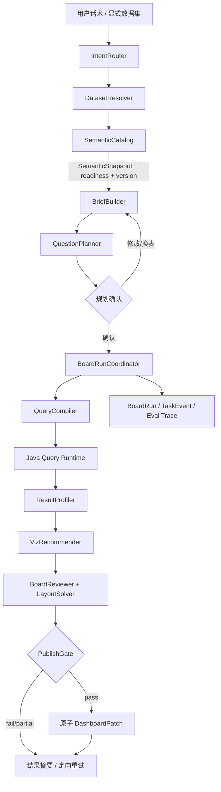

# P015 · 源码与开源方案综合评估

> 评估日期：2026-08-25。本文是 P015 的技术选型与源码演进契约，不代表能力已交付；现行实现仍以 `docs/design/architecture.html` 为准，是否可发布只看 [acceptance.yaml](./acceptance.yaml)。

## 1. 结论先行

当前“Lead 理解与确认 → 单 board worker 受限执行 → harness 校验、选图和提交”的大方向是对的，但现有源码还不是一套能稳定生成高质量仪表盘的最佳实现。它已经解决了“不要让模型自由写 SQL、不要一个图一个 agent”两个问题，却仍把最重要的业务语义压缩成字段 `role`，把规划压成固定驾驶舱槽位，把选图压成日期和行数判断。

因此不应继续围绕 `GOAL_PLAN_SYSTEM` 或 `checkChartType` 加提示词。目标方案是一个适配本产品的组合架构：

```text
Apache Ossie / MetricFlow / Cube 的语义模型思想
  + WrenAI / JoyAgent 的语义检索、真实取数和受控分析流程
  + CompassQL / Draco 的候选生成、硬约束和软评分
  + DataEase / Superset 的可编辑运行态
  + 本项目已有的权限、对话确认、原子 DashboardPatch
```

不开源依赖“大一统替换”，也不在 P015 内引入新的通用 agent 框架。优先把以下四个产品内核做实：

1. 版本化 `SemanticSnapshot`：数据粒度、实体键、维度用途、正式指标、默认过滤、时间/单位/权限；
2. 类型化编译链：`AnalysisBrief → BoardQuestion → QuerySpec → ResultProfile → VizSpec → BoardSpec`；
3. 确定性状态机：模型只在候选集合内提出问题和修复建议，host 掌握查询、重试、review 与 commit；
4. 可复现质量闭环：语义正确性优先于“看起来像仪表盘”，离线回放、盲评和线上返工共同决定发布。

## 2. 评估方法与“最佳”定义

“最佳”不是 GitHub star 数，也不是能生成最多图，而是对本产品约束下的适配度。评价顺序如下：

| 层 | 必须回答的问题 | 失败后果 |
|----|----------------|----------|
| 语义正确 | 这个数是什么、按什么粒度、能否聚合、默认过滤是什么 | 图再漂亮也是错误数据 |
| 查询正确 | 字段、关系、权限、时间、聚合与运行态是否一致 | 预览正确、打开错误或越权 |
| 问题有用 | 是否回答用户决策问题，而不是机械展示字段 | 数据真实但没有用途 |
| 图表合适 | 图种、排序、截断、单位和颜色是否匹配结果 | 难读或误导 |
| 整板成篇 | 是否有主次、覆盖、去重、布局和说明 | 单图可用但整页杂乱 |
| 可运营 | 是否可恢复、可追踪、可评测、可回滚 | 偶现坏板且无法定位 |

任何方案若不能让第一、二层 fail closed，就不能进入“最佳候选”。

## 3. 当前源码审计

### 3.1 已有正确基础

| 能力 | 源码证据 | 结论 |
|------|----------|------|
| Lead 与 worker 权限隔离 | `board-worker.js#workerGuardReason` 按 delegation depth 拒绝细工具 | 保留；这是比自由 ReAct 更安全的边界 |
| 规划后确认 | `index.js#od_plan_charts` 输出 `goalsForConfirm`，要求下一轮才执行 | 保留；但确认对象要升级成带口径的 `AnalysisBrief` |
| 字段绑定与整板 review | `gen-board.js#bindGoals` / `reviewCharts` | 保留框架，改为消费正式语义与 typed IR |
| staging 后一次提交 | `board-store.js` + `runCommitBoard` | 产品语义正确；实现需从进程内 Map 升级为可恢复 run |
| 查询后由 harness 选图 | `realize-task.js#suggestChartFromResult` | 分工正确；判据过薄，需要候选生成与评分 |
| Java 运行态 DashboardPatch | `DashboardPatchApplier`、`DashboardAppService` | 保留为唯一写入和运行态，不另建一套 dashboard runtime |

### 3.2 P0 漏洞

| 严重度 | 漏洞 | 当前源码证据 | 必须怎么改 |
|--------|------|--------------|------------|
| P0 | KPI 没有真实查询 | `runGetData` 对 KPI 直接写 `rowCount: 1`、`rows: []`；`realizeBoundCharts` 也直接跳过 KPI query | 所有 KPI 编译为无维聚合 `QuerySpec`，返回一行有限数值后才能 staging |
| P0 | 画像缺失仍按 schema 出板 | `loadSchemaAndProfile` 捕获 profile 异常后注释为 “schema-only plan still works” | 增加 `semanticReady`；生成整板时画像/正式指标不足必须阻断，问数可有限降级 |
| P0 | 单一 `role` 无法表达字段用途 | `semanticRole` 最终把普通数值归为 measure；ID/代码主要靠名称规则补洞 | 引入 `FieldCapability`：可作实体键、计数键、分类、排序、过滤、聚合的独立许可 |
| P0 | 比率与正式指标没有口径 | `measureKind`/名称规则只能把 rate 变成 AVG，无法表达加权平均、分子分母、成功状态 | `MetricDefinition` 保存表达式、聚合、粒度、默认过滤、单位和认证状态 |
| P0 | 生产 fallback 质量不等价 | 2026-08-25 `od_compose_board` 与 Java `compose-board` 已 fail-closed 不写 draft。`DeterministicPlanner` 仍存在于代码中但生产 compose 不再调用 | 生产生成入口只能走同一 compiler/review；`od_generate_board` last-resort 仍须同闸 |
| P0 | preview 变换不可在运行态重放 | `od_data_trans` 只改内存 rows，`od_save_chart` 仍保存原 encode | 未有正式 transform 契约时拒绝 commit；正式支持时先扩 OpenAPI 和 Java query compiler |

### 3.3 P1 漏洞

| 漏洞 | 影响 | 证据与修正 |
|------|------|------------|
| 固定驾驶舱模板替代用户问题 | 丰富字段表也会机械得到 3～4 KPI、若干 bar、pie、table | `GOAL_PLAN_SYSTEM` 强制 6～10 条、至少 3 KPI、固定顺序；改为问题候选打分，模板只作空主题先验 |
| 图表推荐只看行数、日期和 intent | 不看分布、负值、截断、多序列、标签长度、单位兼容、零值和异常 | `suggestChartFromResult` 只有少量分支；增加完整 `ResultProfile`、候选生成、硬约束、软评分 |
| 整板 review 不懂业务覆盖 | 能去重 encode，却不知道“成功率”是否缺失、多个状态图是否重复回答同一问题 | `BoardQuestion` 必须有决策目的、优先级和 coverage key；review 在问题层和视觉层各做一次 |
| 布局是机械 72 栅格 | 信息层级、标题高度、标签密度、移动端适配不足 | `layoutBoardPatch` 固定 KPI 行、半宽图、单表；升级为有限模板求解器，不让模型写坐标 |
| staging 只在进程内 Map | 重启丢失、重复确认可能重复提交、无法可靠恢复 | `board-store.js` 的 `sessions = new Map()` 改为持久化 `BoardRun` + task event；用 idempotency key |
| planner 与 commit 间语义可漂移 | 用户确认后 profile/指标变更，旧计划仍可执行 | plan 保存 `semanticVersion` 和 `planHash`；执行前不一致则回到确认 |
| 多数据集缺少关系和 grain | 字段都存在不代表可安全 join，可能倍增金额 | 没有 confirmed relationship 时整板仅允许单数据集；多表必须由语义图编译 join |
| 结果摘要不含足够证据 | 用户难以判断口径、截止日期、修复和跳过 | 结果卡展示指标口径、默认过滤、数据截止、成功/修复/跳过及定向重试 |

### 3.4 测试盲区

当前 20 条 eval 与 120 个单测适合做快速回归，但大多直接调用纯函数，不连接 Java、不调用真实 LLM，也不验证 draft 重新打开后的查询结果。`BOARD-E2E-ORDERS-01` 只证明主路径走 worker，不证明口径正确。必须补：

- 原始 schema → 学习 → semantic readiness → plan → confirm → execute → reopen 的生命周期回放；
- 相同 `semanticVersion` 下 preview/runtime 的查询语义 hash 一致；
- planner、credential、profile、query、commit 分别失败时均不进入弱 fallback；
- 同一用例三次运行的问题集合稳定性与最差 20% 质量；
- t_pay_order 的 dashboard 10 全部非法 encode 作为 forbidden regression。

## 4. 本地 ref 的真实价值与边界

| ref | 值得采用 | 不应照搬 | 对 P015 的决定 |
|-----|----------|----------|----------------|
| JoyAgent DataAgent | DGP 语义治理、TableRAG 两阶段选表/字段、`get_data → data_trans → save_insight`、SOPPlan | `ChartUtils.checkChartType` 仍主要按日期/行数选图；分析 worker 可执行 DataFrame/Python，不能直接变成可刷新看板契约 | 借流程分工和检索，不把它当整板质量算法；变换必须编译到 OD runtime |
| DataEase | 成熟图表编辑、字段槽位、查询与 dashboard runtime | 它主要服务人工搭图，不提供业务问题规划和自动质量证明 | 继续作为交互/渲染参考；不把自动规划下放给编辑器 |
| DeerFlow | thread/checkpoint、任务状态、恢复、受控工具 | 通用 agent/subagent 不能解决 BI 语义；为每图建 agent 增加成本和非确定性 | 只借鉴持久状态和 trace；保留单 worker + host 调度 |
| Apache Ossie | dataset、key、relationship、field、metric、AI context 的中立语义契约及 schema validation | 当前仍是孵化期的交换规范，不是查询引擎、推荐器或 dashboard 产品 | 内部模型与其概念对齐并预留导入导出，不直接把规范当执行层 |

JoyAgent 的源码也说明，`get_data/data_trans/save_insight` 只解决“分析过程可执行、结论有数据佐证”，不会自动保证整板问题有用。其 `checkChartType` 与本项目当前实现同样偏启发式，因此 P015 必须继续向约束式推荐演进。

## 5. GitHub 开源方案对标

以下只使用官方仓库/文档，不使用二手榜单。

| 方案 | 核心强项 | 缺口 | 采用方式 |
|------|----------|------|----------|
| [Apache Ossie](https://github.com/apache/ossie) | 跨 AI/BI 的中立语义交换；dataset、relationship、metric、AI context、schema validator | 规范而非查询与看板引擎；仍在 incubating | **概念兼容**：内部 `SemanticSnapshot` 映射 Ossie，不直接依赖其运行时 |
| [MetricFlow](https://github.com/dbt-labs/metricflow) | 指标定义编译为 dataflow plan；处理 ratio、expression、cumulative、时间粒度、多跳 join | 偏指标查询编译，不负责自然语言选板、图表和布局 | **借编译模型**：metric/entity/dimension/time spine/grain，暂不整体嵌入 Python 引擎 |
| [Cube Core](https://github.com/cube-js/cube) | headless semantic layer，统一 metric/dimension/join/access rule，提供 SQL/REST/GraphQL 与缓存 | 引入完整服务会和当前 Java 查询层、权限与部署重叠 | **借数据模型和 API 原则**；当跨源、缓存成为瓶颈时再做独立选型 |
| [WrenAI](https://github.com/Canner/WrenAI) | MDL/context layer、关系、schema retrieval、dry-plan validation、结构化错误和 eval；GenBI 能从语义项目生成 app | GenBI 偏 coding-agent 生成独立 app，不是本项目现有可编辑 DashboardPatch runtime | **最接近的 agentic BI 参考**：借 context/dry-plan/eval；不生成旁路 Web App |
| [LIDA](https://github.com/microsoft/lida) | 数据摘要、目标生成、图表生成、解释、评估与修复模块化 | 官方说明更适合小于等于 10 列；会生成并执行代码；不提供企业指标/权限/可刷新 dashboard 语义 | **借 goal/evaluate/repair 分层**；不执行模型生成代码，不用于 60 字段 t_pay_order 主链 |
| [CompassQL](https://github.com/vega/compassql) | 从部分可视化 spec 枚举候选，按 effectiveness 排序 | 项目偏研究/旧 Vega-Lite 生态，不懂业务指标和整板上下文 | **重写其模式**：OD 原生 `VizCandidate` + hard constraints + score，不强绑库 |
| [Draco](https://github.com/uwdata/draco) / [Draco 2](https://github.com/cmudig/draco2) | 将可视化知识形式化为硬/软约束，可学习权重 | ASP/solver 引入成本高，不能解决语义和整板问题 | **先实现小型确定性约束器**；规则量和实验数据足够后再评估 Draco 2 |
| [Apache Superset](https://github.com/apache/superset) | 成熟 Explore/dashboard、薄语义层、virtual/certified metrics、权限 | 自动问题规划弱；其语义层也在继续演进 | **借 certified metric 与人工编辑兜底**；不替换 OD 前后端 |
| [Lightdash](https://github.com/lightdash/lightdash) | dbt metrics/dimensions、content as code、可版本化 dashboard | 强依赖 dbt 工作流，自动生成不是核心 | **借内容版本与可回放思想**；不要求用户先有 dbt 项目 |
| [LangGraph](https://github.com/langchain-ai/langgraph) | durable execution、checkpoint、task write、human-in-the-loop | 通用编排不提供 BI 语义；替换 dsh 成本高 | **借状态语义**；先在现有 Java/DB 上实现 `BoardRun`，不立即迁框架 |

结论：WrenAI 是整体产品方向最接近的参考，MetricFlow/Cube 是语义和查询正确性更成熟的参考，CompassQL/Draco 是选图算法更强的参考；三者解决的是不同层，任何一个都不能单独成为本项目的最佳完整方案。

## 6. 目标架构



边界原则：

- LLM 只能输出 `IntentDraft`、`BriefDraft`、`QuestionDraft` 或从 host 候选中选择修复；不能直接输出 SQL、DashboardPatch、坐标或最终图种。
- Java backend 是权限、语义快照、query compile/execute 和 DashboardPatch 的权威层。
- dsh harness 是会话编排、问题候选和解释层；所有来自模型的字段引用都必须回到 Java/host validator 校验。
- 前端只呈现确认、进度、结果和编辑，不自己推导指标口径。

## 7. 六级类型化编译链

### 7.1 SemanticSnapshot

```json
{
  "datasetId": "ds_pay_order",
  "semanticVersion": "sem_42",
  "readiness": {"state": "ready", "reasons": []},
  "grain": {"entity": "payment_order", "keys": ["PayOrderId"]},
  "fields": [{
    "name": "MchId",
    "kind": "entity_key",
    "capabilities": ["group_top_n", "filter", "count_distinct"],
    "forbiddenAggregations": ["sum", "avg"]
  }],
  "metrics": [{
    "id": "paid_amount",
    "label": "支付成功金额",
    "expression": "SUM(Amount)",
    "defaultFilters": [{"field": "Status", "op": "in", "valueSet": "paid_statuses"}],
    "unit": "CNY_FEN",
    "certification": "confirmed"
  }],
  "relationships": [],
  "policies": {"excludedFields": ["ClientIp", "NotifyUrl"]}
}
```

`readiness` 不是布尔拍脑袋，而是 validator 结果。至少检查：grain/key、合法核心 metric、可用 dimension、时间能力、value map、profile 新鲜度、权限策略；每项都有 reason code。

### 7.2 AnalysisBrief

保存用户目标、受众、时间、业务对象、指标、维度、明确过滤、未知项、`semanticVersion`。其中 metric 引用 `metricId`，不再把 `field + agg` 当正式指标。

### 7.3 BoardQuestion

```json
{
  "questionId": "q_channel_contribution",
  "question": "各渠道支付成功金额和订单量差异如何？",
  "decisionUse": "识别主要渠道和低效渠道",
  "priority": "core",
  "metricIds": ["paid_amount", "paid_order_count"],
  "dimensionIds": ["channel_type"],
  "coverageKey": "channel_contribution",
  "visualIntent": "compare"
}
```

问题 planner 先生成 8～12 个候选，再由确定性 scorer 选 4～8 个：用户词匹配、metric 认证、决策价值、时间/维度覆盖加分；重复 coverage、弱口径、PII、高代价查询扣分。固定驾驶舱槽位只在用户没有主题时提供先验分，不是硬要求。

### 7.4 QuerySpec

由 `QueryCompiler` 从正式 metric/dimension 编译，包含 metric expression、group by、time grain、filter、sort、limit、permission context 和语义版本。禁止 worker 直接拼 `field + agg`。

### 7.5 ResultProfile 与 VizSpec

`ResultProfile` 必须来自真实结果，包含总行/截断、维度基数、null、零/负值、极差、偏斜、标签长度、时间有序性/间隔、序列数和单位兼容性。

`VizRecommender` 分三步：

1. 按 visual intent 枚举 2～5 个 OD 已支持图种；
2. hard constraints 淘汰误导或无法渲染的候选；
3. soft score 选择最高分并记录 `reasonCodes`。

例如 pie 的 hard constraints 是：单分类、单可加总非负指标、2～5 类、未截断、合计有意义、整板尚无 pie；“少于 6 行”本身不是充分条件。

### 7.6 BoardSpec

Board review 基于问题而不只是 encode：核心 coverage、重复 coverage、首屏指标数、趋势必要性、图种多样性、单位/颜色一致、风险说明。布局从少量经过测试的 section template 中求解：overview、trend、compare、diagnosis、detail；按优先级和预估高度放置，输出 72 栅格坐标。

## 8. 状态、幂等和失败语义

新增持久化实体：

```text
BoardRun
  runId, conversationId, dashboardId, briefId, semanticVersion,
  planHash, status, idempotencyKey, budget, createdBy, timestamps

BoardTaskRun
  runId, questionId, querySpecHash, status, attempt,
  errorCode, repairCode, resultProfile, vizReasonCodes

BoardRunEvent
  seq, runId, phase, taskId, publicMessageCode, internalDetail, at
```

硬约束：

- 同一个 `conversationId + confirmed planHash + dashboardId` 只能产生一个有效 run；重复“确认”返回已有 run。
- task query 可以恢复，DashboardPatch 只能在 publish gate 后提交一次。
- 重启后从最后一个持久 task state 恢复；不持久化结果明细行，只持久化 profile、hash 和错误码。
- 执行前若 `semanticVersion`、权限版本或数据集关系变化，run 标为 `needs_reconfirm`。
- `partial` 必须仍覆盖所有 core question；缺任一 core task 默认不 commit，除非确认卡已声明可缺失。

## 9. 源码落点

### 9.1 Java backend：权威语义与执行

| 新增/修改 | 职责 |
|-----------|------|
| `application/semantic/SemanticCatalogService.java` | 组装并版本化 SemanticSnapshot；计算 readiness |
| `application/semantic/SemanticValidator.java` | grain、field capability、metric、relationship、policy 硬校验 |
| `domain/semantic/*` | `FieldCapability`、`MetricDefinition`、`RelationshipDefinition`、`SemanticSnapshot` |
| `application/conversation/DatasetProfileLearner.java` | 只产出统计证据与候选语义，不把采样启发式直接等同 confirmed metric |
| `application/conversation/DatasetProfiler.java` | 返回 profile freshness/confidence/reason，不再只返回单 role |
| `application/query/SemanticQueryCompiler.java` | `QuerySpec → 现有 QueryDtos`；应用 metric filter、grain、permission |
| `application/conversation/BoardRunService.java` | run/task 状态、幂等、恢复、发布门与原子 patch |
| `DeterministicPlanner.java` | 从生产 compose 路径移除；若保留，仅测试/demo 且消费同一 SemanticSnapshot |

跨端先在 `docs/design/openapi.yaml` 增加 `/semantic-snapshot`、`/board-runs` 及 run event/结果摘要契约，再实现 Java 与 FE。不要在 P015 设计文档里提前把它写成已上线架构。

### 9.2 dsh harness：理解、问题规划和解释

| 当前文件 | 演进 |
|----------|------|
| `goal-planner.js` | 拆为 `brief-builder.js` 与 `question-planner.js`；去掉固定 3 KPI/6～10 槽位硬要求 |
| `gen-board.js` | `semanticRole/buildCapabilityCard` 改为消费 backend SemanticSnapshot；保留 alias/review 的纯函数 |
| `realize-task.js` | 查询参数改为 `querySpecId/specHash`；新增完整 ResultProfiler 和 VizRecommender |
| `board-worker.js` | 变成 run coordinator 的受限客户端；KPI 与非 KPI 统一真实 query；模型不决定循环与 commit |
| `board-store.js` | 只保留短期结果行缓存；权威状态迁至 `BoardRunService`，移除进程内 session 作为恢复依据 |
| `data-trans.js` | 只生成正式 `TransformSpec` 候选；runtime 未支持则返回 unsupported，不得 staging |
| `index.js` | 删除 “schema-only board still works”；`od_compose_board` 已 fail-closed；弱 `od_generate_board` 写入口仍待同闸 |

board worker 的 prompt 不再要求模型手工顺序调用每个 task 工具。host 根据确认后的 question list 创建 task DAG；LLM 仅在明确 `repair_options` 中选择，或生成面向用户的解释。

### 9.3 frontend：用户能判断质量

| 组件 | 展示 |
|------|------|
| 规划确认卡 | 数据集、业务目标、时间、正式指标口径、4～8 个问题、未知/跳过风险、调整/换表/确认 |
| 执行进度卡 | 数据确认、核心问题取数、图表与布局检查四段；不滚动暴露工具调用 |
| 结果卡 | ready/partial/failed；规划/成功/修复/跳过数；数据截止；核心指标口径；逐项错误与重试 |
| draft 画布 | 区块标题、数据截止/口径说明；状态颜色和值映射；可继续自然语言改图 |

## 10. 分期落地

### M0：立即封堵坏板

- KPI 真实查询；profile 0 行/不可用时 `semanticReady=false`；
- 生产路径禁止弱 fallback；`od_data_trans` 未有 runtime 契约时禁止 save；
- t_pay_order 正反生命周期 E2E；
- 删除固定模板对字段顺序的依赖。

完成标志：dashboard 10 类非法板的 `commit_count=0`，而不是“生成后再 review 看看”。

### M1：语义内核与类型化查询

- `SemanticSnapshot`、field capabilities、confirmed metric、version/readiness；
- `AnalysisBrief/BoardQuestion/QuerySpec` JSON Schema 与 validator；
- 单数据集 compiler；确认时展示口径；planHash/semanticVersion 失效重确认。

完成标志：t_pay_order 的订单量、成功金额、商户入账、状态、渠道、业务时间均来自可解释语义，不靠字段顺序或名称 prompt。

### M2：结果驱动选图与整板编排

- 完整 ResultProfile；VizCandidate hard/soft constraints；
- coverage review、section layout solver、颜色/单位/title reason code；
- 基于用户目标而非固定槽位选题。

完成标志：同一 QuerySpec 的图种选择可纯函数回放；每个图能解释“为什么选它、淘汰了什么”。

### M3：可恢复运行与质量发布

- BoardRun/TaskRun/Event、幂等恢复、定向重试；
- 48 例 × 3、preview/runtime replay、盲评、灰度返工 telemetry；
- 对最差 20% 和多次运行稳定性设发布阈值。

完成标志：进程重启/重复确认不产生重复或半成品板，候选达到 PR-REAL-16/17 门槛。

### M4：关系语义与生态兼容

- confirmed relationship、join cardinality、跨表 grain safety；
- Ossie import/export；按需要评估嵌入 MetricFlow/Cube，而非预先引入；
- 多数据集生成只有在 join 不会倍增 metric 时开放。

## 11. 明确不选的方案

- 不直接 fork JoyAgent 作为 dashboard backend：其分析流程有价值，但 DataFrame 快照和启发式图种不能替代可刷新 DashboardPatch。
- 不直接接 LIDA 生成图表代码：大宽表、代码执行、权限和运行态一致性不适配。
- 不现在引入 Cube/MetricFlow 完整服务：先把内部语义契约立稳，避免与 Java query/permission 双轨；未来以性能、跨源和生态需求触发 ADR。
- 不让 LLM 直接产 Vega/ECharts spec 或 grid 坐标：本产品需要可编辑、可回放、可验收的有限配置空间。
- 不因需要恢复就立即迁 LangGraph：状态模型先落在产品域，框架可替换，`BoardRun` 契约不可依赖某个 agent runtime。

## 12. 如何证明这套方案真的更好

质量保证不是一句“用了最佳实践”，而是四层证据：

1. **正确性证明**：所有 metric/query/transform 通过 schema validator；非法聚合、未确认关系、PII、preview/runtime 不一致均为零容忍硬闸；
2. **效用证明**：金标为“应回答的业务问题集合”，不是固定图表；核心问题覆盖率、重复率、口径正确率先过门；
3. **视觉证明**：对同一真实结果枚举候选并记录 reason code；自动规则 + 截图盲评共同判定；
4. **线上证明**：删除图、重做整页、改字段/聚合、time-to-publish 和失败恢复率均不回退。

只有 M0～M3 的阻塞验收通过，才能把“方向正确”升级为“整体仪表盘质量已提升”。单次生成 dashboard 11、单测全绿或选择某个知名开源框架，都不能单独证明这一点。

## 13. 决策记录

| 日期 | 决策 | 原因 |
|------|------|------|
| 2026-08-25 | 不选单一开源框架，采用语义层 + 类型化编译 + 约束推荐 + 现有 runtime 的组合 | 各开源方案覆盖不同层，直接替换会产生语义、权限或运行态双轨 |
| 2026-08-25 | Java backend 成为 SemanticSnapshot、QuerySpec 与 BoardRun 权威层 | 权限、真实查询和 DashboardPatch 已在 Java；正确性不能只存在于 prompt/worker 内存 |
| 2026-08-25 | 固定驾驶舱由硬模板降为无主题时的先验 | 用户问题和数据能力应决定整板，固定槽位会制造无用图 |
| 2026-08-25 | 图表选择采用候选 + 硬约束 + 软评分，不直接嵌入 Draco/CompassQL | 先适配 OD 有限图种与运行态；保留以后替换评分器的接口 |
| 2026-08-25 | 生产路径 fail closed；模板 fallback 不具备同等级闸时不得写板 | “总能生成”与数据产品可信度冲突 |
